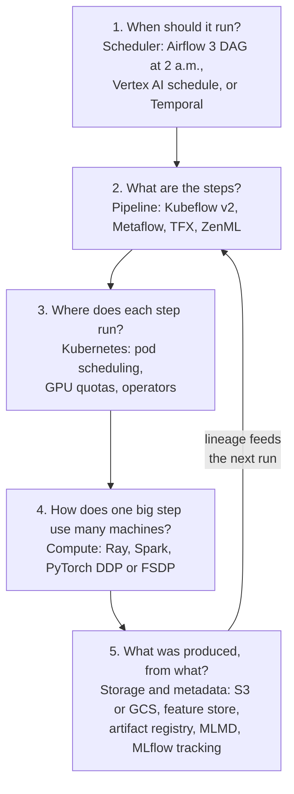
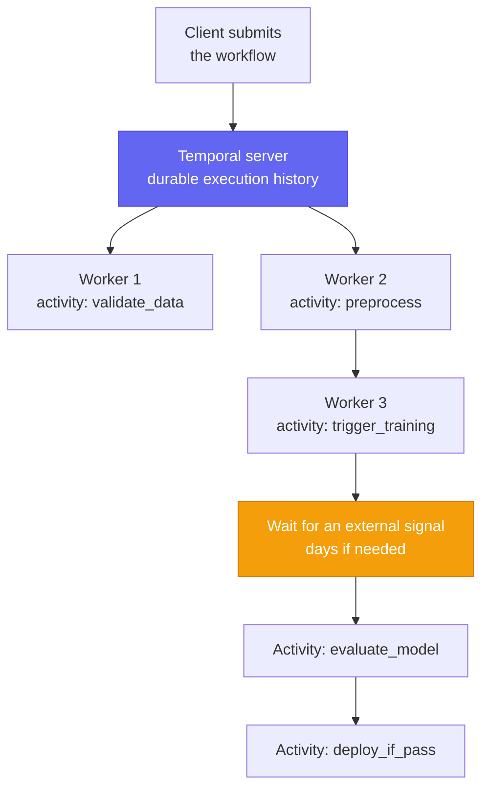
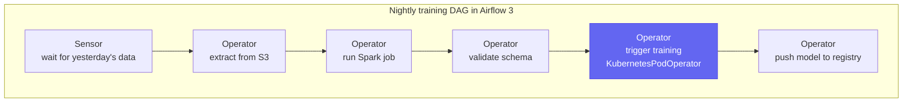
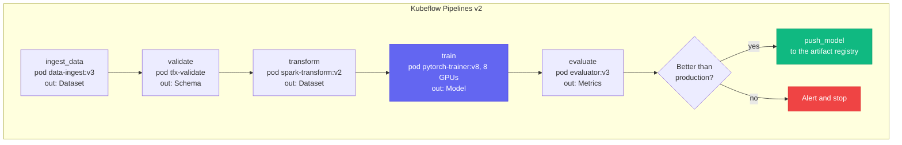
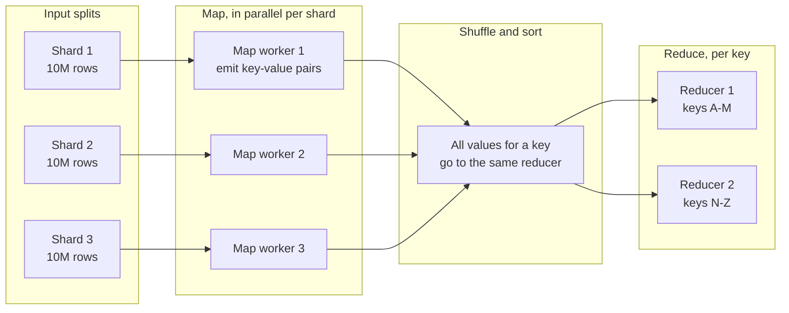
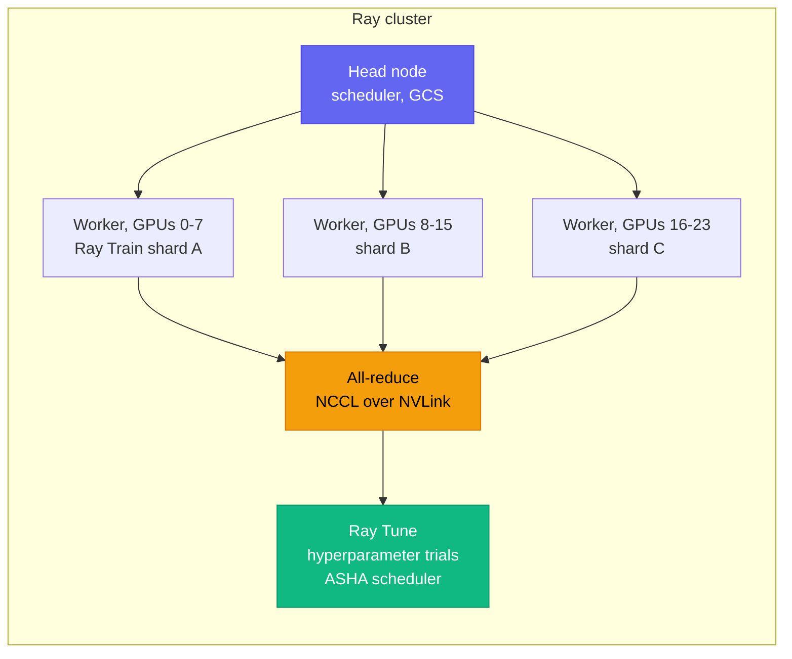
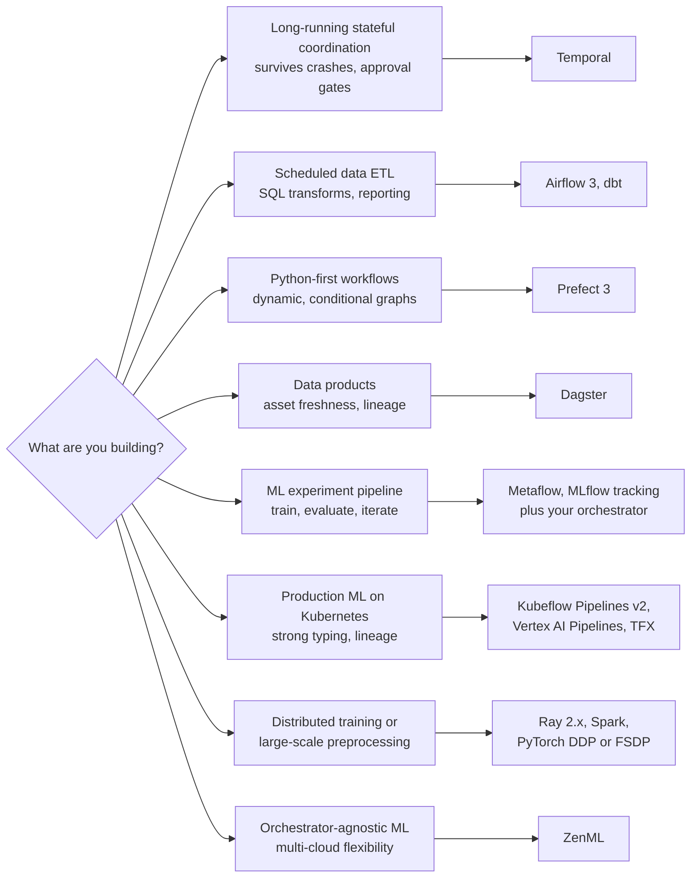
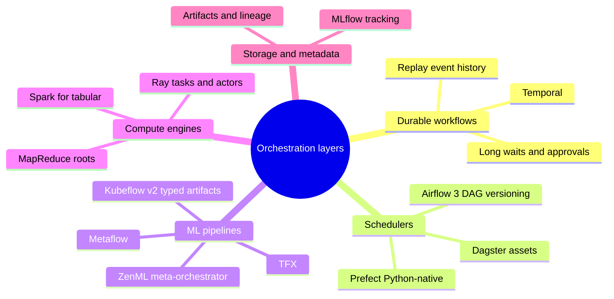

*By Gopi Krishna Tummala*

*Airflow, Kubeflow, Temporal and Ray all "orchestrate," but they sit at different layers and solve different problems. A map of the layers, using one daily retraining pipeline to show which tool owns which part.*

Part 8 of [the MLOps map](/posts/mlops/infrastructure-first-mlops-roadmap). Previous: [Agentic MLOps](/posts/mlops/beyond-inference-agentic-mlops-mcp).

---

Here's a pipeline almost every ML team runs in some form. Every night, once yesterday's user interactions have landed, compute fresh features, retrain a recommendation model on a few dozen GPUs, evaluate it against the model in production, and promote it only if it's better. If anything fails, someone should be able to see what data and code produced which model.

Ask a room of engineers which tool should run that and you'll hear Airflow, Kubeflow, Temporal, Ray and Metaflow, often in the same breath. They all "orchestrate steps," so they sound interchangeable. They aren't. They sit at different layers of the stack, and a real system usually uses two or three of them together. This post walks the nightly pipeline down those layers.

## The idea in one picture

*Each layer answers a different question. "Which orchestrator should we use?" usually means "which tool for which layer?"*

## Three questions that place any tool

For any tool in this space, ask:

1. **What starts it?** A schedule, an upstream task finishing, an event, or a person.
2. **What's the unit of work?** A Python function, a container, or a distributed graph of tasks.
3. **What does it run on?** One server, a fleet of workers, a Kubernetes cluster, or a GPU cluster.

Answering those three for Airflow (a schedule; an operator; whatever the operator calls) and Ray (code; a remote task; a Ray cluster) already shows they're doing different jobs.

## Durable workflows: Temporal

[Temporal](https://temporal.io/) is built for workflows where correctness after a crash matters most. A workflow is ordinary code, and Temporal records every step it takes. If the server running it dies, another one replays that history and continues from the last completed step, even days later. Steps with side effects (called activities) are retried until they succeed.

That makes it a good fit for the parts of ML that wait on the outside world: a pipeline that pauses for a human to approve a launch, long chains of external API calls that can time out, or agent workflows that must not lose their place. It isn't a data pipeline tool. It has no notion of datasets, lineage or a library of data connectors, so it usually coordinates around the other layers rather than replacing them.

*The server's history is what makes waiting safe: if a worker dies during the multi-day wait, another picks up from the same point.*

## Schedulers: deciding when things run

[Airflow](https://airflow.apache.org/) is the most widely deployed tool here. You describe a graph of tasks (a DAG) and when it should run, and Airflow runs it on schedule with retries. For our pipeline, Airflow is the piece that wakes up at 2 a.m. and waits until yesterday's data has actually arrived. Airflow 3.0, released in April 2025, added a long-requested feature: each run is tied to the exact version of the DAG code that created it, so historical runs no longer change when you edit the code. Airflow's strength is its huge library of connectors to databases, warehouses and cloud services. Its weakness is that it knows nothing about models, artifacts or experiments.

*Airflow sees boxes that succeed or fail. The training box is just a pod to launch; what happens inside is someone else's layer.*

Two alternatives take different angles. [Prefect](https://www.prefect.io/) lets you decorate ordinary Python functions instead of restructuring code into a DAG, which suits Python-first teams with dynamic, conditional workflows. [Dagster](https://dagster.io/) asks a different question: instead of "did the task succeed?" it asks "is this dataset fresh and correct?" You declare the data products that should exist and Dagster works out what to run to produce them. That framing helps when you need to reprocess specific date ranges or check data quality as part of the pipeline.

## ML pipelines: describing the steps

This layer was built with ML in mind. It describes the steps of a training pipeline, the artifacts passed between them (datasets, models, metrics) and the conditions between them, like "only deploy if the new model is better."

- **[Kubeflow Pipelines](https://www.kubeflow.org/docs/components/pipelines/):** each step is a container on Kubernetes. Version 2 compiles a pipeline into a portable definition and checks the types of artifacts passed between steps before anything runs, so a step expecting a model can't be handed a dataset. The same definition runs on Google's managed Vertex AI Pipelines. The cost is iteration speed: testing locally usually needs a Kubernetes setup.
- **[Metaflow](https://metaflow.org/):** Netflix's framework for data scientists. Steps are Python methods, and a decorator sends a step to cloud compute with the CPUs, GPUs and memory it needs. It's quick to iterate with and closely tied to AWS.
- **[TFX](https://www.tensorflow.org/tfx):** Google's opinionated framework with strict contracts between components such as data validation, transformation, training and evaluation. Powerful, but built around TensorFlow.
- **[ZenML](https://www.zenml.io/):** a layer on top of other orchestrators. You write the pipeline once and run it on Kubeflow, Vertex AI or SageMaker by changing configuration.

Here's the training part of the nightly pipeline as a Kubeflow pipeline. Each box is a container, and each passes a typed artifact to the next:

*Typed artifacts are what make lineage possible: every model in the registry points back to the exact Dataset and Schema that produced it.*

One tool left this layer: MLflow Recipes was removed in MLflow 3 (June 2025). MLflow now focuses on experiment tracking and the model registry, which you use from inside whichever pipeline tool you choose.

## Compute engines: one step, many machines

The layers above decide what runs and when. This layer decides how a single heavy step, like training on 64 GPUs or transforming terabytes of data, spreads across many machines.

The idea goes back to MapReduce: split the data, process the pieces in parallel, then combine the results, with the shuffle between the two phases usually the bottleneck.

*Google's 2004 MapReduce pattern. Data-parallel training is the same shape: each GPU's backward pass is the map, and the gradient all-reduce is the reduce, done as a ring with no central reducer.*

 [Spark](https://spark.apache.org/) made that pattern fast by keeping data in memory and is still the standard for large tabular processing. [Ray](/posts/mlops/ray-field-guide-core-to-production) generalizes it to arbitrary graphs of tasks and long-lived stateful workers, which suits mixed CPU and GPU work like preprocessing feeding distributed training. And for a single fixed-size training job, `torchrun` with PyTorch's distributed training is often enough.

*Inside one step: Ray places the training workers, NCCL syncs their gradients, and Ray Tune can run many such jobs as hyperparameter trials.*

The common confusion is treating Ray as a scheduler. Within a job it retries tasks and runs dependency graphs, but it has no schedule, no backfills and no idea whether yesterday's data has landed. Ray does the compute; the layers above decide when and why.

## The nightly pipeline, end to end

Putting the layers together for our retraining job:

1. **Airflow** wakes at 2 a.m. and waits until yesterday's interaction data has landed.
2. It starts a **Kubeflow** pipeline: validate the new data against the expected schema, compute features, train, evaluate, compare with production.
3. **Kubernetes** runs each step as a pod sized for that step, a CPU-heavy pod for validation and a 64-GPU job for training.
4. The training step runs on a **Ray** cluster (or `torchrun`), saving checkpoints to object storage as it goes.
5. Lineage and metrics land in the **metadata store and MLflow**: which data version, which pipeline version, which model.
6. If the new model passes its thresholds, a final step promotes it. Otherwise the pipeline alerts someone, with enough lineage to see what changed.

The same structure shows up in autonomous-driving teams at a larger scale, with data-readiness checks like "has yesterday's annotation batch finished?" and long validation suites over driving scenarios before any model ships. The tools change; the layers don't.

## Choosing tools

| Tool | Layer | Reach for it when |
|---|---|---|
| Temporal | Durable workflows | Long-running steps, human approvals, must survive crashes |
| Airflow | Scheduler | Schedule-driven data pipelines, many external systems to connect |
| Prefect | Scheduler | Python-first teams with dynamic, conditional workflows |
| Dagster | Scheduler | You think in data products and need freshness and partition-aware reruns |
| Kubeflow / Vertex AI | ML pipeline | Containerized steps on Kubernetes with typed artifacts and lineage |
| Metaflow | ML pipeline | Data-science teams iterating quickly, mostly on AWS |
| ZenML | ML pipeline | You don't want to commit to one pipeline backend yet |
| Ray / Spark / torchrun | Compute | One step needs many machines |

The same choices as a decision tree:

## What I'd remember

- **"Orchestration" is several layers.** When, what, where, how big, and what was produced. Name the layer before naming the tool.
- **Schedulers don't know about models; ML pipelines don't know about calendars.** Most real systems use one of each.
- **Ray and Spark are compute, not schedulers.** They make one step big; something else decides when it runs.
- **Temporal is for durability.** Use it where losing your place is unacceptable.
- **Lineage is the payoff.** The point of all these layers is being able to say which data and code produced which model.

The whole module on one page:

## Where to go next

- [The Ray Field Guide](/posts/mlops/ray-field-guide-core-to-production), for the compute layer in depth.
- [Training Frameworks](/posts/mlops/hidden-engine-of-ai), for what happens inside the training step.
- The [Airflow release notes](https://airflow.apache.org/docs/apache-airflow/stable/release_notes.html) and the [Kubeflow Pipelines docs](https://www.kubeflow.org/docs/components/pipelines/).

Previous: [Agentic MLOps](/posts/mlops/beyond-inference-agentic-mlops-mcp). Back to [the MLOps map](/posts/mlops/infrastructure-first-mlops-roadmap).

**Questions to sit with**

1. In your team's retraining pipeline, which tool owns each of the five layers, and is any layer owned by nothing?
2. Where would a human-approval step live, and what happens to the pipeline while it waits?
3. If a bad model shipped last week, could you name the exact data version it trained on?
