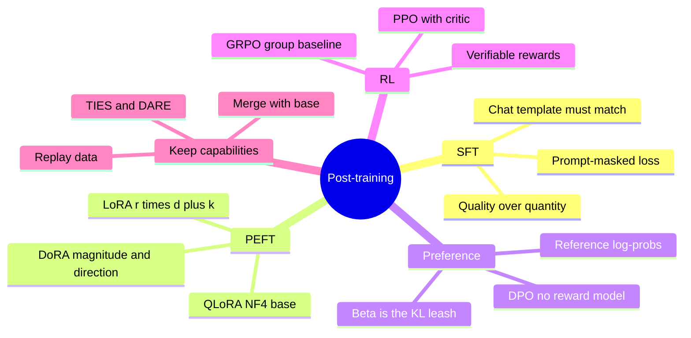
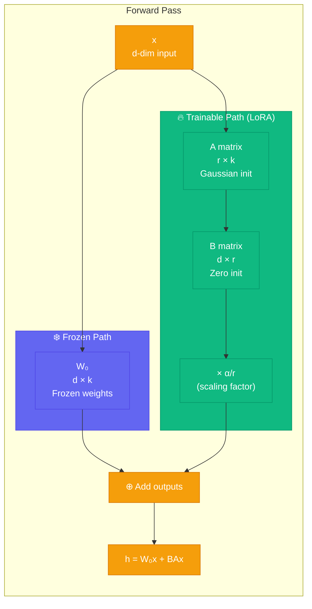
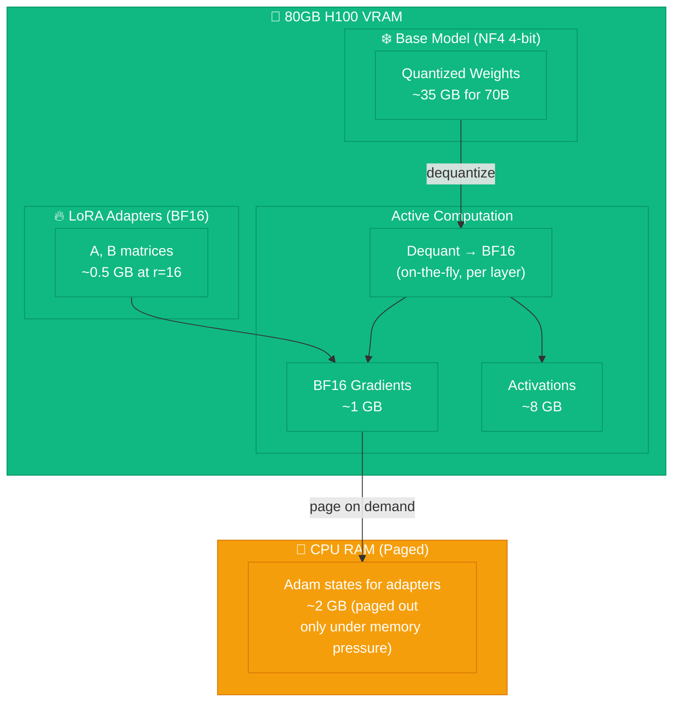
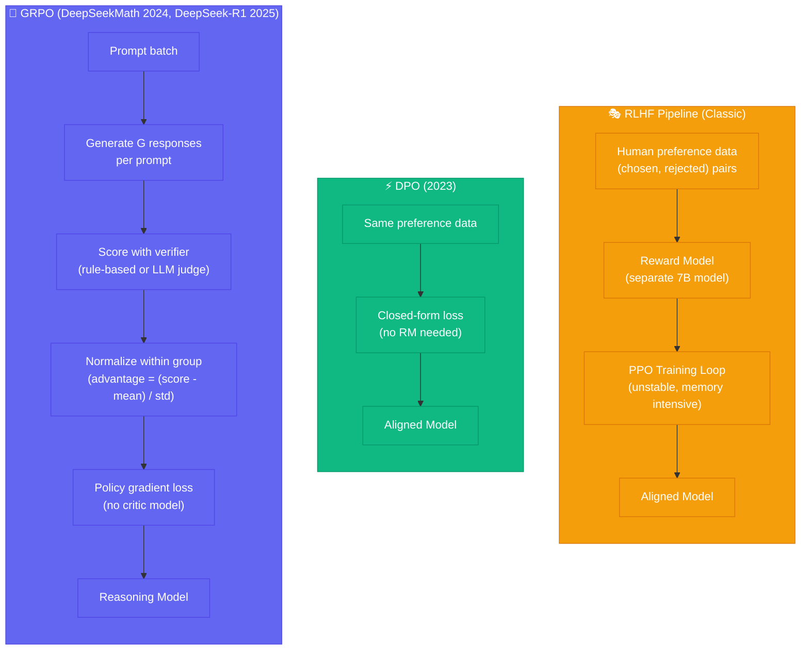
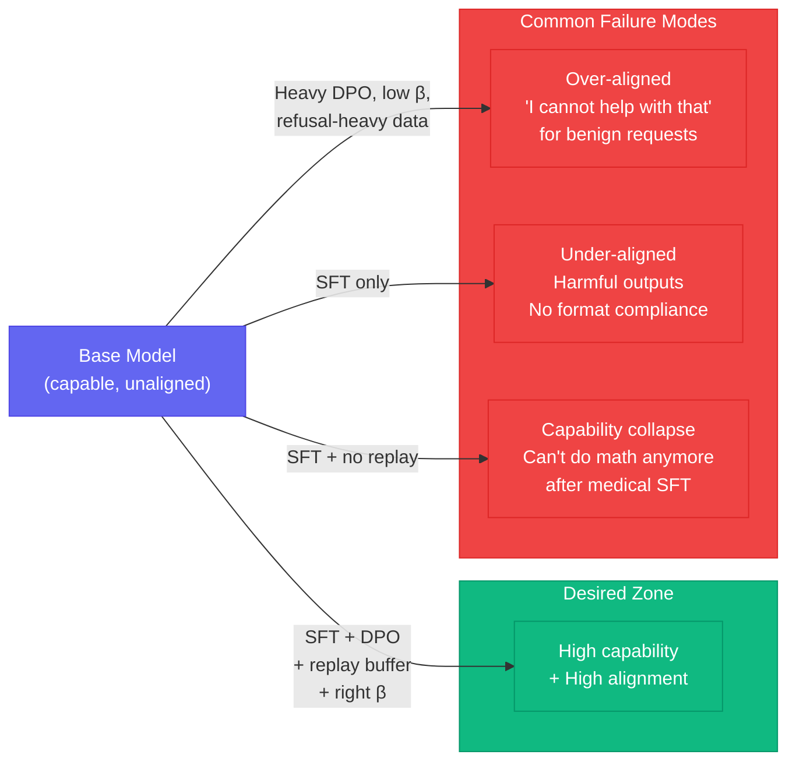

*By Gopi Krishna Tummala*

---

<div class="series-nav" style="background: linear-gradient(135deg, #059669 0%, #0d9488 100%); color: white; padding: 1.5rem; border-radius: 12px; margin-bottom: 2rem; box-shadow: 0 4px 6px rgba(0,0,0,0.1);">
  <div style="font-size: 0.875rem; opacity: 0.9; margin-bottom: 0.5rem; text-transform: uppercase; letter-spacing: 0.05em;">Infrastructure-First MLOps — Building the Engine of AI</div>
  <div style="display: flex; gap: 0.75rem; flex-wrap: wrap; align-items: center;">
    <a href="/posts/mlops/parquet-arrow-quest-for-analytic-speed" style="background: rgba(255,255,255,0.1); padding: 0.5rem 1rem; border-radius: 6px; text-decoration: none; color: white; opacity: 0.9;">Module 1: Data DNA</a>
    <a href="/posts/mlops/datasets-and-dataloaders" style="background: rgba(255,255,255,0.1); padding: 0.5rem 1rem; border-radius: 6px; text-decoration: none; color: white; opacity: 0.9;">Module 2: Dataloaders</a>
    <a href="/posts/mlops/hidden-engine-of-ai" style="background: rgba(255,255,255,0.1); padding: 0.5rem 1rem; border-radius: 6px; text-decoration: none; color: white; opacity: 0.9;">Module 3: Training</a>
    <a href="/posts/mlops/modern-post-training-peft-2026" style="background: rgba(255,255,255,0.25); padding: 0.5rem 1rem; border-radius: 6px; text-decoration: none; color: white; font-weight: 600; border: 2px solid rgba(255,255,255,0.5);">Module 4: Post-Training</a>
    <a href="/posts/mlops/vllm-trilogy-of-modern-llm-scaling" style="background: rgba(255,255,255,0.1); padding: 0.5rem 1rem; border-radius: 6px; text-decoration: none; color: white; opacity: 0.9;">Module 5: Serving</a>
    <a href="/posts/mlops/custom-kernel-craze" style="background: rgba(255,255,255,0.1); padding: 0.5rem 1rem; border-radius: 6px; text-decoration: none; color: white; opacity: 0.9;">Module 6: Kernels</a>
    <a href="/posts/mlops/beyond-inference-agentic-mlops-mcp" style="background: rgba(255,255,255,0.1); padding: 0.5rem 1rem; border-radius: 6px; text-decoration: none; color: white; opacity: 0.9;">Module 7: Agentic AI</a>
    <a href="/posts/mlops/ml-pipeline-orchestration-layers" style="background: rgba(255,255,255,0.1); padding: 0.5rem 1rem; border-radius: 6px; text-decoration: none; color: white; opacity: 0.9;">Module 8: Orchestration</a>
  </div>
  <div style="margin-top: 0.75rem; font-size: 0.875rem; opacity: 0.8;">📖 You are reading <strong>Module 4: Post-Training</strong> — Sculpting Intelligence</div>
</div>

---

## TL;DR

- **Post-training stack in 2026**: SFT (10k–100k examples) → LoRA/DoRA fine-tuning → DPO or GRPO alignment → model merging.
- **LoRA rank r means**: you're approximating a $d \times k$ update matrix with two matrices of shapes $d \times r$ and $r \times k$. At r=16, a 4096×4096 layer goes from 16.8M trainable params to 16×(4096+4096) = 131k. That's a 128× reduction.
- **QLoRA**: 4-bit NF4 quantized base + BF16 LoRA adapters. A 70B model fits in ~35GB VRAM and fine-tuning needs ~48GB — one 80GB H100.
- **DPO vs. RLHF**: DPO eliminates the reward model and the RL training loop. Training is stable, and the only extra cost over SFT is the frozen reference model (whose log-probs you can even precompute).
- **GRPO** (introduced in DeepSeekMath, popularized by DeepSeek-R1) replaces the critic with group-relative scoring — powerful for reasoning tasks with verifiable answers.
- **Alignment tax**: narrow fine-tuning and heavy preference optimization can regress general capabilities (reasoning, coding, calibration). Replay data, conservative β and careful data mixing are the mitigation.

---

## Table of contents

---

## The Module in One Picture



---

### Act 0: What Post-Training Actually Is

Pre-training creates a model that is staggeringly capable and completely useless. It predicts the next token from internet text. Ask it a question and it will continue the question, not answer it.

Post-training is the sequence of steps that turns "internet text prediction" into "helpful, accurate assistant behavior." It has four distinct phases:

```mermaid
graph LR
    subgraph PT["🏗️ Pre-Training\n(Done by labs)"]
        Base["Base Model\nLlama/Mistral/Qwen\nRaw next-token prediction"]
    end

    subgraph SFT["📚 Phase 1: SFT\nSupervised Fine-Tuning"]
        SFT_Data["10k–1M\nInstruction pairs\n(prompt, ideal response)"]
        SFT_Model["Chat Model\nFollows instructions\nstill unaligned"]
    end

    subgraph PEFT["🔧 Phase 2: PEFT\nParameter-Efficient FT"]
        LoRA["LoRA/DoRA Adapters\nTask specialization\n0.1–1% params trained"]
    end

    subgraph Align["⚖️ Phase 3: Alignment"]
        DPO["DPO / GRPO\nPreference optimization\nSafety + style + reasoning"]
    end

    subgraph Merge["🔀 Phase 4: Model Merging"]
        Merged["TIES / DARE Merge\nCombine specialists\ninto one model"]
    end

    PT --> SFT
    SFT_Data --> SFT_Model
    SFT_Model --> LoRA
    LoRA --> DPO
    DPO --> Merged

    classDef phase fill:#6366f1,color:#fff,stroke:#4f46e5
    classDef data fill:#f59e0b,color:#fff,stroke:#d97706
    classDef output fill:#10b981,color:#fff,stroke:#059669
    class SFT,PEFT,Align,Merge phase
    class Base,SFT_Data output
    class SFT_Model,LoRA,DPO,Merged output
```



*Figure 1: The post-training pipeline. Each phase builds on the previous one. You rarely need all four — the right depth depends on your task.*

---

### Act I: SFT — Getting the Format Right

Supervised fine-tuning is simpler than it sounds: it's just next-token prediction on (prompt, completion) pairs, with loss masked on the prompt tokens. The magic is in the data.

**The data quality trap**: 10,000 high-quality, diverse, correctly-formatted examples beat 1,000,000 mediocre ones. This was the central lesson from LIMA (2023): a 65B model fine-tuned on just 1,000 carefully curated examples produced responses that human raters judged equivalent to or better than GPT-4's in 43% of comparisons.

The format matters as much as the content. Every major model family has a chat template:

```
# Llama 3 chat format (ChatML-style models such as Qwen use <|im_start|> / <|im_end|> instead)
<|begin_of_text|>
<|start_header_id|>system<|end_header_id|>
You are a helpful assistant.<|eot_id|>
<|start_header_id|>user<|end_header_id|>
What is the capital of France?<|eot_id|>
<|start_header_id|>assistant<|end_header_id|>
Paris.<|eot_id|>
```

Training with the wrong chat template → the model learns to emit stray special tokens mid-response, or never stops generating because it never learned the end-of-turn token. This is one of the most common production bugs in fine-tuning pipelines. Use the tokenizer's own `apply_chat_template` for training and serving.

**SFT loss**: standard cross-entropy on the completion tokens only:
$$\mathcal{L}_{SFT} = -\sum_{t \in \text{completion}} \log p_\theta(y_t \mid x, y_{<t})$$

---

### Act II: LoRA — The Math Behind the Parameter Reduction

A pre-trained model's weight matrix $W_0 \in \mathbb{R}^{d \times k}$ is frozen. LoRA adds a learned update:

$$W = W_0 + \Delta W = W_0 + BA$$

where $B \in \mathbb{R}^{d \times r}$ and $A \in \mathbb{R}^{r \times k}$, with $r \ll \min(d, k)$.



*Figure 2: LoRA weight decomposition. B is initialized to zero so $\Delta W = 0$ at initialization — the model starts identical to the base. A is random Gaussian. During training, only A and B are updated.*

#### Why B=0 initialization matters

At the start of fine-tuning, $\Delta W = BA = B \cdot 0 = 0$. The model's initial output is identical to the base model. This prevents an abrupt gradient shock at step 0 and makes training more stable. As training proceeds, B gradually learns a non-zero value.

#### The hyperparameters that actually matter

**Rank r**: The bottleneck dimension. Higher r = more capacity but more trainable params and risk of overfitting.

| Task | Typical r |
|---|---|
| Style / format adaptation | 4–8 |
| Domain specialization (medical, legal) | 8–16 |
| Complex reasoning / code | 16–64 |
| Approach full fine-tuning quality | 128–256 |

**Alpha (α)**: The scaling factor applied to ΔW: `α/r`. Setting `α = 2r` is a common default. Think of it as a learning rate multiplier — higher alpha means the LoRA update has more influence. If the model forgets too fast, lower alpha; if it doesn't learn, raise it.

**Target modules**: Which weight matrices get LoRA adapters. Always include the attention Q, K, V projections. Usually include the output projection (`o_proj`) and optionally the FFN (`gate_proj`, `up_proj`, `down_proj`).

```python
from peft import LoraConfig, get_peft_model

config = LoraConfig(
    r=16,
    lora_alpha=32,           # α = 2r is a good default
    target_modules=[
        "q_proj", "k_proj", "v_proj", "o_proj",
        "gate_proj", "up_proj", "down_proj"
    ],
    lora_dropout=0.05,
    bias="none",             # don't train biases (usually)
    task_type="CAUSAL_LM",
)
model = get_peft_model(model, config)
model.print_trainable_parameters()
# Llama-2-7B, r=16 on all 7 linear layers:
# trainable params: 39,976,960 || all params: 6,778,392,576 || trainable%: 0.59
```

#### QLoRA: Fine-Tuning 70B on One GPU

QLoRA (Dettmers et al., 2023) combines:
1. **NF4 quantization**: Base model weights stored in 4-bit NormalFloat format (optimal for normally distributed weights). Each parameter uses 4 bits instead of 16 — a 4× compression.
2. **Double quantization**: Quantize the quantization constants themselves (saves about 0.37 bits per parameter, roughly 3 GB on a 65B model).
3. **Paged optimizers**: Use unified memory so optimizer states can be paged to CPU RAM during memory spikes (for example, a long sequence), then paged back, instead of crashing with OOM.
4. **Higher-precision LoRA adapters**: The trainable A and B matrices stay in BF16 (or FP32), and the 4-bit base weights are dequantized to BF16 on the fly for each matmul.



*Figure 3: QLoRA memory layout for a 70B model on a single 80GB H100. The base model is quantized to ~35GB; LoRA adapters (~200M params at r=16 on all linear layers), their optimizer states and active computation fit in the remaining VRAM; the paged optimizer spills to CPU RAM only during spikes.*

**Total VRAM for QLoRA on 70B**: ~35 (4-bit base) + 0.5 (adapters) + ~2 (adapter Adam states) + ~1 (gradients) + ~8 (activations, with checkpointing) ≈ **46 GB**. Fits on an 80GB H100. (The QLoRA paper fine-tuned a 65B model on a single 48GB GPU.)

#### DoRA: The 2024 Evolution

**DoRA (Weight-Decomposed LoRA)** decomposes the weight update into magnitude and direction:

$$W = m \cdot \frac{V + \Delta V}{\|V + \Delta V\|_c}$$

where $m$ is a learned magnitude vector, $V$ is the direction (frozen base), and $\Delta V$ is the LoRA direction update.

Why it works better: the DoRA authors found that LoRA tends to change a weight's magnitude and direction together, while full fine-tuning can make large directional changes with small magnitude changes. Learning the magnitude separately lets DoRA mimic full fine-tuning's learning pattern, and it consistently outperforms LoRA at the same rank with no extra inference cost once merged.

---

### Act III: Alignment — DPO vs. RLHF vs. GRPO

This is the section that actually differentiates senior candidates.



*Figure 4: Three alignment approaches. RLHF is the classic but requires a separate reward model and unstable PPO training. DPO eliminates both. GRPO replaces the critic with group-relative scoring — the key innovation in DeepSeek-R1.*

#### DPO: What the Loss Actually Does

Given a preference pair (chosen response $y_c$, rejected response $y_r$) for prompt $x$, the DPO loss is:

$$\mathcal{L}_{DPO} = -\mathbb{E}\left[\log \sigma\left(\beta \log \frac{\pi_\theta(y_c|x)}{\pi_{ref}(y_c|x)} - \beta \log \frac{\pi_\theta(y_r|x)}{\pi_{ref}(y_r|x)}\right)\right]$$

In plain English: maximize the log-ratio difference between chosen and rejected responses, relative to a frozen reference model ($\pi_{ref}$). The $\beta$ parameter controls how far the trained policy can deviate from the reference.

**Key insight**: DPO implicitly trains a reward model — the reward is recovered from the optimal policy ratios. You get RLHF's objective without RLHF's training instability.

**Memory**: DPO needs the trained policy plus a frozen reference model. Fully fine-tuning a 7B policy costs ~112GB of weights, gradients and optimizer state (16 bytes/param, see Module 3) plus 14GB for the BF16 reference, so it needs several GPUs with FSDP. On a single 80GB H100, use LoRA for the policy; with LoRA, the reference model is simply the base weights with the adapter disabled, so you don't need a second copy at all. You can also **precompute the reference log-probs** for the whole dataset once and drop the reference model from training entirely.

**β parameter guide** (β is the strength of the implicit KL "leash" to the reference model):
- β = 0.1 is the common starting point; lower values (0.01–0.1) let the policy move further from the reference
- β = 0.5–1.0: conservative, stays close to reference behavior
- β too high: the model barely changes from the SFT checkpoint
- β too low: the model over-optimizes the preference data, drifting toward whatever superficially separates chosen from rejected (length, hedging, refusals) at the expense of factuality and general capability

#### GRPO: The Reasoning Unlock (DeepSeek-R1)

GRPO (Group Relative Policy Optimization) was introduced in the DeepSeekMath paper (2024) and became famous as the RL algorithm behind DeepSeek-R1 (2025). It shines on tasks with **verifiable correctness** (math, code, logic puzzles).

For each prompt, generate $G=8$ responses. Score each with a verifier (e.g., check if the math answer is correct). Normalize scores within the group:

$$\hat{A}_i = \frac{r_i - \text{mean}(r_1, \ldots, r_G)}{\text{std}(r_1, \ldots, r_G)}$$

The advantage $\hat{A}_i$ tells the model: "this response was better/worse than average for this prompt." Then apply a policy gradient loss:

$$\mathcal{L}_{GRPO} = -\mathbb{E}\left[\hat{A}_i \cdot \log \pi_\theta(y_i|x)\right] + \beta\, \text{KL}\left(\pi_\theta \,\|\, \pi_{ref}\right)$$

(This is the simplified form. The full objective applies the advantage to every token of the response and uses a PPO-style clipped probability ratio between the new and old policy, exactly like PPO but with the group baseline instead of a learned value function.)

**Why it works for reasoning**: Math problems have ground-truth answers. You don't need human preference annotations — the verifier is the calculator. The group-relative advantage automatically calibrates for prompt difficulty (hard prompts where all G responses fail give zero gradient signal — correct behavior).

**Where it gets harder**: For tasks without verifiable answers (creative writing, summarization), you need a learned reward model or an LLM judge. GRPO still works with those (DeepSeekMath used a learned reward model), but now it inherits the reward model's blind spots and reward hacking becomes the main risk.

---

### Act IV: Catastrophic Forgetting and the Alignment Tax

These are the production problems that don't show up in papers.

#### Catastrophic Forgetting

When you fine-tune on medical data, the model's MMLU-Math score drops. When you align for safety, the model starts refusing coding questions. This is the "alignment tax" — a fundamental tension in multi-objective training.

**The mechanism**: LoRA adapters are low-rank perturbations. For highly domain-specific data, the adapter learns to redirect the model's representations — and those redirections can collide with the base model's general capabilities.

**Mitigation strategies**:

1. **Replay buffer**: Mix 5–10% of general data (pre-training text or broad instruction data) into your SFT or DPO dataset. This gives the model a constant signal to preserve general capability. InstructGPT's "PPO-ptx" variant applied the same idea during RLHF by mixing pre-training gradients into the PPO updates.

2. **Reduce LoRA rank**: Lower r means smaller perturbation, less forgetting. Start at r=8, increase only if task-specific performance is insufficient.

3. **Weight merging** (post-training): Interpolate between the fine-tuned model and the base model:
   $$W_{merged} = (1-\lambda) W_{base} + \lambda W_{finetuned}$$
   λ = 0.7 gives 70% fine-tuned character, 30% base knowledge. Simple and surprisingly effective.

4. **Layer-specific LoRA**: Give more rank to the layers that need to change and less to the rest. AdaLoRA automates this by learning an importance-based rank allocation during training.

#### The Alignment-Capability Tradeoff



*Figure 5: The alignment-capability tradeoff. The goal is the top-right quadrant — all failure modes are instructive for troubleshooting.*

---

### Act V: Model Merging

You've trained 5 specialized LoRA adapters: one for Python, one for SQL, one for medical Q&A, one for creative writing, one for math. You want one model that does all five. This is **model merging**.

#### TIES-Merging

TIES (Trim, Elect, Disjoint Merge) handles parameter conflicts:

1. **Trim**: For each adapter, zero out the lowest-magnitude parameter deltas (prune noise).
2. **Elect**: For each parameter position, a majority vote determines the sign of the final update.
3. **Disjoint merge**: For each parameter, average only the deltas whose sign matches the elected sign.

Without TIES, simply averaging adapter weights causes destructive interference — parameters where adapters disagree cancel out, erasing task-specific learning.

#### DARE (Drop and Rescale)

A simpler alternative: randomly drop 80–90% of each task vector's entries to zero, then rescale the remainder by 1/(1-drop_rate). The sparsity reduces interference between tasks while rescaling preserves the expected update magnitude.

> **Merge deltas, not LoRA factors.** TIES and DARE operate on *task vectors*: the weight delta ΔW of each fine-tune. For LoRA, that's ΔW = (α/r)·BA per layer. Averaging A matrices and B matrices separately is not the same thing, because the product of averages is not the average of products. Compute ΔW first (or use a library such as `mergekit` or PEFT's `add_weighted_adapter`, which handles this).

```python
# Conceptual DARE merge
import torch

def dare_merge(task_vectors, drop_rate=0.9):
    # task_vectors: list of {param_name: delta_W} dicts (fine-tuned minus base)
    merged = {}
    for key in task_vectors[0].keys():
        stacked = torch.stack([tv[key] for tv in task_vectors])
        # Random drop
        mask = torch.rand_like(stacked) > drop_rate
        dropped = stacked * mask / (1 - drop_rate)
        merged[key] = dropped.mean(dim=0)
    return merged
```

---

### Act VI: Interview Scenarios

#### "You have one 80GB H100. Fine-tune Llama-3 70B for SQL generation. How?"

**Step 1: Memory audit.**
- 70B in NF4 4-bit: ~35 GB
- LoRA adapters (r=16, all attention + FFN, ~200M params): ~0.4 GB BF16
- Adapter gradients and Adam states: ~2–3 GB
- Active computation (one dequantized layer at a time + activations, with gradient checkpointing): ~8–12 GB
- Paged AdamW absorbs memory spikes by spilling to CPU RAM
- **Total GPU**: ~46–50 GB. Fits on 80GB H100.

**Step 2: Configuration.**
```python
from transformers import AutoModelForCausalLM, BitsAndBytesConfig
from peft import LoraConfig, get_peft_model, prepare_model_for_kbit_training

bnb = BitsAndBytesConfig(
    load_in_4bit=True,
    bnb_4bit_quant_type="nf4",
    bnb_4bit_compute_dtype=torch.bfloat16,
    bnb_4bit_use_double_quant=True,
)
model = AutoModelForCausalLM.from_pretrained(
    "meta-llama/Meta-Llama-3-70B", quantization_config=bnb, device_map="auto"
)
model = prepare_model_for_kbit_training(model)   # enables gradient checkpointing, casts norms
model = get_peft_model(model, LoraConfig(r=16, lora_alpha=32, ...))

trainer = SFTTrainer(
    model=model,
    args=TrainingArguments(
        per_device_train_batch_size=1,
        gradient_accumulation_steps=16,   # effective batch = 16
        optim="paged_adamw_32bit",        # pages to CPU RAM
        bf16=True,
        ...
    ),
)
```

**Step 3: Data.** 10k high-quality (question, SQL) pairs. Mix in 5% general instruction data to prevent forgetting Python/English.

---

#### "Walk me through why DPO is more memory-efficient than RLHF."

**RLHF memory footprint (weights only, BF16):**
- Policy model (being trained): 14 GB BF16 (7B)
- Reference model (frozen): 14 GB BF16
- Reward model (7B separate): 14 GB BF16
- Value/critic model (same size as policy): 14 GB
- PPO rollouts (G=4 responses per prompt): +8 GB activations
- **Total: ~64 GB+** for a 7B model, *before* gradients and optimizer states for the two trained models (policy and critic), which add ~14 bytes/param each with full fine-tuning

**DPO memory footprint (weights only):**
- Policy model (being trained): 14 GB
- Reference model (frozen, can be quantized to 4-bit): 3.5 GB
- No reward model needed
- No critic model needed
- **Total: ~25 GB** for a 7B model

DPO eliminates the reward model and critic entirely. The reference model can be quantized since it's only used for inference (computing log-probs). This is why DPO became the default for resource-constrained alignment.

---

#### "Your DPO-trained model refuses harmless coding questions. What happened and how do you fix it?"

**What happened**: Over-optimization on a skewed preference set. Usually two things combine: the preference data has many "chosen = refusal" pairs, so the model learns that refusing is rewarded; and β is **low**, so nothing keeps the policy close to the SFT reference that happily answered coding questions. Coding patterns that appear in rejected responses can also get penalized by association.

**Diagnosis**: Track the implicit rewards $r = \beta \log \frac{\pi_\theta}{\pi_{ref}}$ for chosen and rejected responses. If the margin keeps growing while the *chosen* log-probabilities also fall, the model is drifting far from the reference (over-optimization). Then measure the refusal rate on a held-out set of benign prompts, before and after DPO.

**Fix options** (in order of preference):
1. Increase β (e.g., 0.05 → 0.1–0.3) so the policy stays closer to the SFT reference, and stop earlier
2. Curate rejection data more carefully — avoid cases where "rejected" and "chosen" differ only in minor style
3. Add coding examples to the DPO dataset where the "chosen" response is a good code answer (prevents coding being penalized by association)
4. Apply weight merging: interpolate the DPO model with the SFT checkpoint at λ=0.7 to recover some capability

---

### Key Takeaways

1. **LoRA rank math**: rank r on a d×k layer = r(d+k) parameters. At r=16, d=k=4096: 131k trainable params vs. 16.8M frozen. This is why LoRA is so memory-efficient.
2. **QLoRA = 4-bit base + BF16 adapters + paged optimizer.** A 70B model fine-tunes on a single 80GB H100. This is the production fine-tuning stack for resource-constrained scenarios.
3. **DPO eliminated the reward model and PPO loop.** If you can construct preference pairs, DPO is the default. If your task has verifiable answers, try GRPO.
4. **β is the KL leash to the reference model.** Low β lets the policy move far from the SFT model (bigger behavior change, more risk of over-optimizing quirks of the preference data, including over-refusal); high β keeps it close (safer for capabilities, smaller change). Fix over-refusal with better data and a stronger leash, not a weaker one.
5. **Always include a replay buffer** (5–10% general data) in your SFT and DPO dataset. The alignment tax is real and preventable.
6. **Model merging (TIES, DARE)** lets you combine specialist fine-tunes post-hoc. Merge weight deltas (ΔW = BA for LoRA), not raw A and B matrices. It's underused and highly practical for deploying multiple task-specific capabilities from a single base model.

<details>
<summary><strong>Self-check</strong></summary>

1. How many trainable parameters does LoRA add to a 4096×11008 projection at r=8?
2. Why is B initialized to zero in LoRA, and what would go wrong if both A and B were random?
3. What are the three ideas in QLoRA, and where does the remaining VRAM go when fine-tuning a 70B model on one GPU?
4. In DPO, what happens as β goes to 0? As β grows large?
5. How does GRPO estimate the advantage without a critic, and why do prompts where every sample fails contribute no gradient?
6. Your fine-tuned model starts emitting `<|eot_id|>` in the middle of answers. What's the likely cause?
7. Why can't you merge two LoRA adapters by averaging their A and B matrices?

</details>

---

**Previous:** [Module 3 — Training Frameworks](/posts/mlops/hidden-engine-of-ai)

**Next:** [Module 5 — LLM Serving (vLLM)](/posts/mlops/vllm-trilogy-of-modern-llm-scaling)


---

**Related deep dives:** [The Multimodal Atlas](/posts/generative-ai/multimodal-foundation-models-end-to-end) applies these methods beyond text: [MLLM post-training with GRPO and verifiable rewards](/posts/generative-ai/multimodal-foundation-models-end-to-end#how-a-model-learns-to-see-and-talk) and [Flow-GRPO and Diffusion-DPO for image and video generators](/posts/generative-ai/multimodal-foundation-models-end-to-end#how-an-image-generator-learns-to-paint) · [Ray actors and placement groups](/posts/mlops/ray-field-guide-core-to-production#the-gpu-to-gpu-fast-path) are the substrate most open RLHF frameworks run on.
