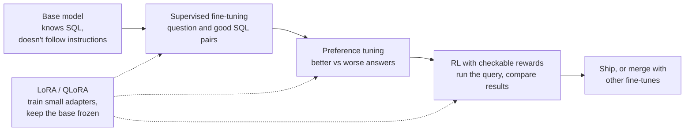

*By Gopi Krishna Tummala*

*Pre-training gives a model knowledge; post-training gives it behavior. A map of the main steps (supervised fine-tuning, LoRA, preference tuning, and reinforcement learning with checkable rewards), following one model as it becomes a SQL assistant.*

Part 4 of [the MLOps map](/posts/mlops/infrastructure-first-mlops-roadmap). Previous: [Training Frameworks](/posts/mlops/hidden-engine-of-ai). Next: [LLM Serving with vLLM](/posts/mlops/vllm-trilogy-of-modern-llm-scaling).

---

Your company wants an assistant that turns questions like "what was revenue by region last quarter?" into correct SQL for its own data warehouse. You start with an open base model. It knows a lot of SQL from pre-training on the internet, but ask it a question and it may continue your sentence instead of answering, invent table names, or write a query that runs and returns the wrong number.

Pre-training gave the model knowledge. Post-training gives it behavior: answer in the right format, use your schema, prefer queries that are correct and readable, and stop when done. This post follows the SQL assistant through the four steps most teams use: supervised fine-tuning, parameter-efficient fine-tuning with LoRA, preference tuning, and reinforcement learning with rewards you can check.

## The idea in one picture

*Each step changes behavior a little more. LoRA isn't a separate step; it's how most teams afford to run the others.*

## Supervised fine-tuning: show it good answers

Supervised fine-tuning (SFT) is the same next-token training as pre-training, but on examples of exactly the behavior you want: a question plus the schema as the prompt, and a correct SQL query as the answer. The loss is only counted on the answer tokens, so the model learns to respond, not to repeat questions.

Two things matter more than anything else here. The first is quality over quantity. The [LIMA paper](https://arxiv.org/abs/2305.11206) fine-tuned a 65B model on just 1,000 carefully chosen examples, and human raters judged its answers as good as or better than GPT-4's in 43% of comparisons. A few thousand verified question and query pairs from your own warehouse will usually beat a hundred thousand scraped ones. The second is the chat template. Every model family wraps turns in special tokens, and training with the wrong template is one of the most common fine-tuning bugs: the model leaks stray tokens into answers or never learns when to stop. Use the tokenizer's own `apply_chat_template` for both training and serving.

## LoRA: change a little, cheaply

Updating every weight of a large model needs enormous memory (see [Training Frameworks](/posts/mlops/hidden-engine-of-ai) for the arithmetic). LoRA, low-rank adaptation, freezes the original weights and learns a small correction for each weight matrix as the product of two thin matrices:

$$W = W_0 + BA$$

If $W_0$ is $d \times k$, then $B$ is $d \times r$ and $A$ is $r \times k$, with a small rank $r$ like 16. For a 4096×4096 layer, that's about 131,000 trainable numbers instead of 16.8 million. $B$ starts at zero, so the model begins exactly where the base model was and drifts only as far as training pushes it. The adapter is a few hundred megabytes, so you can keep one per task and swap them.

QLoRA goes further by storing the frozen base model in 4-bit precision while training the adapters in higher precision. That's what puts a 70B model on a single 80 GB GPU: about 35 GB for the 4-bit base, a few GB for adapters and their optimizer state, and the rest for activations. [DoRA](https://arxiv.org/abs/2402.09353) is a variant that learns the size and direction of each weight change separately and usually beats plain LoRA at the same rank.

For the SQL assistant, a LoRA adapter trained on your question and query pairs is often all the training you need to start.

## Preference tuning: better, not just correct

After SFT, the model writes plausible SQL, but some of it is subtly worse than it should be: a query that's correct but scans every partition, or one that silently drops rows with a careless join. It's easier to say which of two answers is better than to write the perfect one, so the next step learns from comparisons.

The classic approach, RLHF, trains a separate reward model on those comparisons and then optimizes the language model against it with reinforcement learning. [DPO](https://arxiv.org/abs/2305.18290) (direct preference optimization) skips both: it trains directly on pairs of a preferred and a rejected answer, raising the probability of the preferred one relative to a frozen copy of the starting model. It's much simpler and more stable, which is why it became the default.

DPO has one knob worth understanding, usually called β. Think of it as a leash to the starting model. A small β lets the model move far from where it started, which means bigger behavior changes but also a higher risk of overfitting to whatever superficially separates the preferred answers, such as length or caution. A large β keeps it close. If a preference-tuned model starts refusing harmless requests, the usual fix is better preference data and a tighter leash, not a looser one.

## Reinforcement learning with rewards you can check

SQL has a property most tasks don't: you can check answers automatically. Run the generated query against a test copy of the warehouse and compare its result with the right one. That makes reinforcement learning practical without a learned reward model.

The method most teams use now, GRPO, comes from the [DeepSeekMath paper](https://arxiv.org/abs/2402.03300) and became widely known through DeepSeek-R1. For each question, the model writes several answers, say eight queries. Each gets a reward (1 if the result matches, 0 if not). Each answer's advantage is how much better it did than the group's average, scaled by the spread of rewards in the group:

$$\hat{A}_i = \frac{r_i - \text{mean}(r)}{\text{std}(r)}$$

The model is then pushed toward its better-than-average answers and away from the worse ones. The group itself is the baseline, so no separate critic network is needed. A question that all eight attempts get wrong, or all get right, teaches nothing, which is the right behavior: the useful signal comes from questions the model is sometimes right about.

The risk is reward hacking. If the reward only checks that the query runs, the model learns to write queries that run. Reward what you actually care about, the correct result, and keep a held-out set of questions people check by hand.

## Keeping what the model already knew

Fine-tuning narrowly can cost general ability. After heavy SQL training, the assistant might get worse at explaining its queries in plain English, and preference tuning toward caution can make it refuse ordinary requests. Three practical defenses:

- **Mix in general data.** A small share of general instruction data in each training stage reminds the model of everything else it should still do. InstructGPT applied the same idea during its RL phase by mixing in pre-training updates.
- **Prefer a lower LoRA rank first.** A smaller adapter makes a smaller change. Raise the rank only if the task needs it.
- **Merge carefully.** You can combine fine-tunes, for example a SQL adapter and an explanation adapter, with merging methods like TIES or DARE that reduce interference between them. Merge the actual weight changes (for LoRA, the product $BA$), not the A and B matrices separately; tools like `mergekit` and PEFT's adapter merging handle that for you.

## What I'd remember

- **Pre-training gives knowledge; post-training gives behavior.** Each step nudges behavior, and data quality decides how far it gets.
- **LoRA makes post-training affordable.** Small adapters on a frozen base, and QLoRA puts a 70B model on one GPU.
- **Preferences are easier to give than perfect answers.** DPO learns directly from pairs; β is the leash to the starting model.
- **If you can check answers, use reinforcement learning.** GRPO compares a group of attempts and needs no critic.
- **Protect general ability.** Mix in general data, keep changes small, and evaluate on more than the target task.

## Where to go next

- Nathan Lambert's free [RLHF Book](https://rlhfbook.com/), the clearest longer treatment of everything here.
- Papers: [LoRA](https://arxiv.org/abs/2106.09685), [QLoRA](https://arxiv.org/abs/2305.14314), [DPO](https://arxiv.org/abs/2305.18290), [DeepSeekMath (GRPO)](https://arxiv.org/abs/2402.03300).
- [The Multimodal Atlas](/posts/generative-ai/multimodal-foundation-models-end-to-end), for the same steps applied to vision-language and image models.
- [LLM Serving with vLLM](/posts/mlops/vllm-trilogy-of-modern-llm-scaling), the next part of this series.

Previous: [Training Frameworks](/posts/mlops/hidden-engine-of-ai). Next: [LLM Serving with vLLM](/posts/mlops/vllm-trilogy-of-modern-llm-scaling).

**Questions to sit with**

1. For your own use case, which step would add the most: better SFT data, preference pairs, or a checkable reward?
2. Why does initializing $B$ to zero matter for the first step of LoRA training?
3. What would reward hacking look like for the SQL assistant, and how would you catch it?
