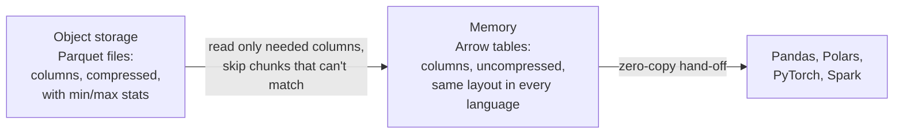
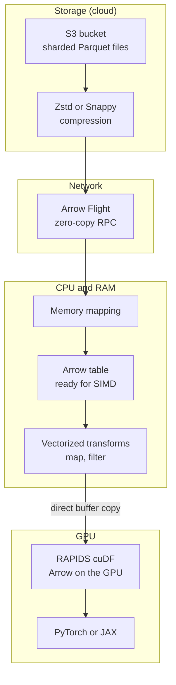
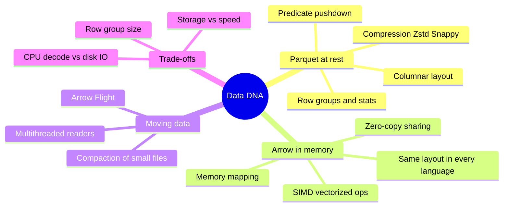

*By Gopi Krishna Tummala*

*How data is laid out on disk and in memory decides how fast everything above it can go. A map of Parquet (for storing) and Arrow (for computing), why ML pipelines use both, and the file-layout mistakes that quietly slow training down.*

Part 1 of [the MLOps map](/posts/mlops/infrastructure-first-mlops-roadmap). Next: [Datasets and Dataloaders](/posts/mlops/datasets-and-dataloaders).

---

You have a 10 TB table of user events: 100 columns, billions of rows. To train a model you need three of those columns, say timestamp, item ID and whether the user clicked, and only for the last 30 days. How long that takes to read is decided before any model code runs. It depends on how the data is laid out on disk and in memory.

Store the table as CSV and every read has to pull all 100 columns of every row off the disk and parse them as text. Store it in a format designed for this kind of question and you might read a few percent of those bytes, already in a form your code can use without converting. This post is about the two formats behind that second path, Parquet and Arrow, and the rule most ML pipelines follow: store in Parquet, compute in Arrow.

## The idea in one picture

*Parquet minimizes the bytes you store and move. Arrow minimizes the work once those bytes are in memory.*

## Rows versus columns

A CSV file stores data row by row: all 100 fields of event one, then all 100 fields of event two. That's natural for writing one record at a time, and terrible for our question, because the three columns we want are scattered across every row.

A columnar format stores each column together: all the timestamps, then all the item IDs, then all the click flags. To read three columns, you read three contiguous regions and skip the other 97. And because values within a column are similar (timestamps close together, the same item IDs repeated), they compress far better than mixed rows do.

## Parquet: storing data for reading

[Parquet](https://parquet.apache.org/docs/) is the standard columnar file format for data at rest. Three ideas do most of the work:

- **Read only the columns you need.** If our three columns are about 5% of the bytes, a query reads roughly 5% of the file.
- **Compress each column.** Encodings like dictionary and run-length encoding, plus a general compressor like Zstd or Snappy, often shrink data several times over. You spend CPU time decompressing to save much more time on disk and network.
- **Skip chunks that can't match.** Parquet files are split into row groups, and each stores the minimum and maximum value of every column. Asking for the last 30 days, a reader checks each row group's timestamp range and never opens the ones that are entirely older. This is called predicate pushdown.

For our table, the effect compounds. Reading 3 of 100 columns, from only the row groups covering the last month, from compressed files, can mean reading well under 1% of the original 10 TB.

## Arrow: computing on data in memory

Parquet is optimized for storage. Once data is in memory, a different format is better. [Apache Arrow](https://arrow.apache.org/docs/format/Columnar.html) is a columnar layout for data in memory: each column is one contiguous, uncompressed buffer that a CPU can process in bulk, many values per instruction.

Its most important property is that the layout is the same in every language. Python, C++, Rust, Java and GPU libraries can all read the same Arrow buffers without converting or copying them. That's why a pipeline can read Parquet with PyArrow, transform it in Polars, and hand it to PyTorch or Spark without paying a conversion cost at each step. Before formats like Arrow, a large share of data pipeline time went into serializing and deserializing data between tools.

Put together, a production pipeline keeps data in columns from storage all the way to the GPU, and never unpacks it row by row:

*Storage to silicon: compressed columns at rest, Arrow buffers in flight and in memory, and a direct copy into GPU memory at the end.*

Why not just store everything as Arrow? Because Arrow buffers are uncompressed so they can be used directly, and they lack Parquet's storage encodings. The same data as raw Arrow can be several times larger, which costs more to store and much more to move across a network. Hence the rule: store in Parquet, compute in Arrow.

## File layout is a performance setting

The format alone doesn't guarantee speed. How the files are laid out matters just as much.

**Too many small files.** A pipeline that writes a million 1 KB Parquet files makes every read slow: each file costs a separate request to object storage and its own metadata, and the min/max skipping has almost nothing to work with. The fix is compaction, a regular job that merges small files into larger ones, often a few hundred megabytes each.

**Row groups that are too big or too small.** Tiny row groups mean lots of metadata; huge ones mean the min/max statistics rarely let you skip anything. Sizes in the hundreds of megabytes are a common starting point for scan-heavy workloads.

**Datasets bigger than memory.** You don't have to load a 500 GB dataset into 64 GB of RAM. Memory-mapping an Arrow file lets the operating system load only the pages you actually touch, which is how libraries like Hugging Face Datasets handle data much larger than memory.

**Single-threaded processing.** If your preprocessing is a Python loop over rows in pandas, the CPU becomes the bottleneck long before the format does. PyArrow and Polars read and transform columns using all cores and release Python's global interpreter lock while they work.

## A quick back-of-envelope

Moving our 10 TB table over a 10 Gbps link (about 1.25 GB/s) takes about 2.2 hours uncompressed. Compressed to about 1.5 TB as Parquet, it takes about 20 minutes. Reading only three columns that make up 5% of the data cuts the reading by up to 20× again. Numbers like these are why format choices made at the bottom of the stack decide what's possible at the top.

## What I'd remember

- **Store in Parquet, compute in Arrow.** One minimizes bytes moved, the other minimizes work in memory.
- **Columns win for ML reads.** You usually want a few columns from many rows.
- **Skip what you don't need.** Read only the needed columns, and let min/max statistics skip chunks that can't match.
- **Arrow's value is a shared layout.** Tools hand data to each other without converting it.
- **Layout is a setting.** Compact small files, size row groups sensibly, and memory-map datasets larger than RAM.

The whole module on one page:

*Predicate pushdown is the formal name for skipping chunks with min/max statistics.*

## Where to go next

- [Datasets and Dataloaders](/posts/mlops/datasets-and-dataloaders), the next module: getting this data to the GPU fast enough.
- [Beyond Parquet: Lance](/posts/mlops/lance-lancedb-data-layer-for-ml), for what changes when ML needs single rows, new columns and versions.
- The [Arrow columnar format spec](https://arrow.apache.org/docs/format/Columnar.html) and [Parquet documentation](https://parquet.apache.org/docs/).

Next: [Datasets and Dataloaders](/posts/mlops/datasets-and-dataloaders).

**Questions to sit with**

1. Which of your datasets is read row by row even though most reads only need a few columns?
2. How many files does your largest training dataset have, and how big is the average one?
3. Where in your pipeline does data get converted from one format to another, and is it necessary?
