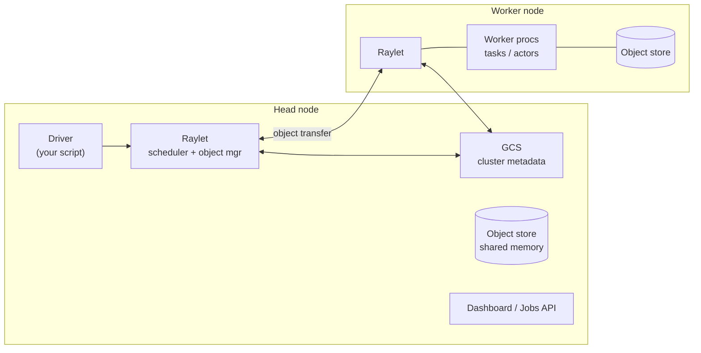
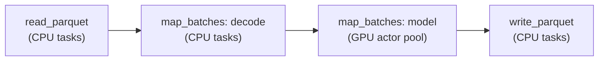

*By Gopi Krishna Tummala*

---

> **Companion to** [Module 2: Dataloaders](/posts/mlops/datasets-and-dataloaders), [Pipeline Orchestration](/posts/mlops/ml-pipeline-orchestration-layers) **and** [the vLLM Trilogy](/posts/mlops/vllm-trilogy-of-modern-llm-scaling). Those posts kept running into the same question: *who launches the processes, places them on GPUs, moves the data between them, and restarts them when a node dies?* In a large share of modern ML stacks, the answer is Ray. This post is the full map.

**Quick jump:** [Why Ray?](#part-0-why-ray-and-when-you-dont-need-it) · [Core](#part-i-ray-core) · [Ray Data](#10-ray-data-streaming-batch-processing) · [Train](#11-ray-train-distributed-training-orchestration) · [Tune](#12-ray-tune-hyperparameter-search) · [Serve](#13-ray-serve-online-inference) · [Production](#part-iii-production) · [Cheat sheet](#19-cheat-sheet) · [Self-check](#20-check-yourself)

## Table of contents

---

## TL;DR

- Ray is a distributed runtime built on **three primitives**: **tasks** (stateless remote functions), **actors** (stateful remote processes) and **objects** (immutable values in a shared-memory object store, addressed by `ObjectRef`).
- **Ownership** is the key architectural idea: the worker that creates a ref owns its metadata and lineage, which keeps the control plane (GCS) off the hot path. The price is fate sharing: if the owner dies, its objects are lost.
- **Placement groups** give you gang scheduling: reserve 8 GPUs atomically, optionally on one node for NVLink.
- The libraries are thin layers on the primitives: **Ray Data** (streaming CPU→GPU pipelines with backpressure), **Ray Train** (supervises DDP/FSDP worker groups, checkpoints, restarts), **Ray Tune** (hyperparameter search), **Ray Serve** (online inference with composition, batching, autoscaling, vLLM-backed LLM serving), **RLlib**.
- For GPU-to-GPU hot paths, **compiled graphs** and **Ray Direct Transport** bypass the CPU object store and use NCCL.
- On Kubernetes, **KubeRay** gives you `RayCluster`, `RayJob` and `RayService`.
- **Ray is not always the answer.** On one machine, `concurrent.futures` or `multiprocessing` is simpler. For a fixed-size DDP job, `torchrun` on Slurm or k8s is enough. For SQL-shaped ETL, Spark wins. Ray earns its keep when you need **many machines, mixed CPU and GPU stages, stateful workers and elastic scaling inside one Python program**. Every chapter below has a "simpler alternative vs. what Ray buys you" note.
- **Interview one-liner:** *"Ray is a Python-native distributed runtime: tasks, actors and an object store with ownership-based metadata. I use placement groups for gang-scheduled training, Ray Data to stream preprocessing on CPU nodes into GPU inference or training, Ray Train to supervise DDP and recover from checkpoints, and Serve for composable, batched, autoscaled inference, all deployed with KubeRay."*

> APIs below reflect **Ray 2.x**. Newer pieces (Train v2, compiled graphs, RDT, label selectors, Serve LLM) evolve quickly, so confirm signatures against the docs for the version you deploy.

---

## Part 0: Why Ray? (And When You Don't Need It)

The question I hear most from experienced engineers isn't "how do I use Ray?" It's **"why can't I just use a Python process pool?"** That's a fair question, and for a lot of workloads the honest answer is: *you can, and you should.*

### The same code, three ways

```python
# 1. One machine, standard library. Zero new dependencies.
from concurrent.futures import ProcessPoolExecutor
with ProcessPoolExecutor(max_workers=32) as pool:
    results = list(pool.map(preprocess, shards))

# 2. Ray, on your laptop. Almost the same code.
import ray
ray.init()
preprocess_r = ray.remote(preprocess)
results = ray.get([preprocess_r.remote(s) for s in shards])

# 3. Ray, on 200 nodes. *Literally the same code* as #2.
ray.init(address="auto")
```

Version 1 is perfectly good until one of these happens:

- **You run out of one machine.** A process pool can't span nodes. Ray's whole point is that #2 and #3 are the same program: the scheduler decides where each call runs.
- **Some steps need GPUs and some don't.** A pool has one kind of worker. Ray lets each call say `num_gpus=1` or `num_cpus=4` and places it on a node that has it.
- **Workers need state.** A pool re-pickles your model weights for every call, or you hack around it with initializers and globals. Ray actors load the model once and keep it warm.
- **Results feed other steps.** A pool returns everything to the parent process. Ray passes `ObjectRef`s between steps through a distributed shared-memory store, so 1 GB tensors don't round-trip through your driver.
- **Things fail.** If a pool worker segfaults you get `BrokenProcessPool`, and if the machine dies you lose everything. Ray retries tasks, restarts actors and rebuilds lost objects.
- **Load changes.** A pool is fixed-size. Ray's autoscaler adds and removes nodes based on queued work.

### The ladder of tools

Climb only as high as you need to.

| Rung | Tool | Good at | Where it stops |
|---|---|---|---|
| 1 | Plain Python, vectorized numpy/torch | Most things, honestly | One core or one GPU |
| 2 | `concurrent.futures`, `multiprocessing`, `joblib` | Embarrassingly parallel work on one machine | One machine; no GPU-aware placement; stateless |
| 3 | PyTorch `DataLoader` workers | Feeding one training process | Bound to the trainer's node and its CPUs |
| 4 | `torchrun` + Slurm or k8s Jobs | A fixed-size DDP/FSDP job | Static topology; you build restarts, data sharding and HPO yourself |
| 5 | Celery / RQ / cloud queues | Async background jobs, web backends | Coarse tasks; no shared memory; no GPU scheduling |
| 6 | Dask | Pandas/numpy-shaped analytics across a cluster | Weaker story for GPU actors, serving, RL |
| 7 | Spark | SQL and DataFrame ETL at petabyte scale | JVM-centric; awkward for GPU inference and Python-native state |
| 8 | **Ray** | Heterogeneous CPU+GPU pipelines, stateful actors, training, tuning, serving and RL on one runtime | Operational overhead; another control plane to run and debug |

### What Ray actually buys you

1. **Scaling without rewriting.** Laptop to thousands of cores with the same code. This is the headline, and it's real.
2. **Heterogeneous resources in one program.** CPU decode, GPU inference, CPU write-back, each with its own resource request and autoscaled pool.
3. **Stateful workers (actors)** as a first-class concept. Model servers, parameter servers, simulators, rollout workers.
4. **A distributed object store** so intermediate data moves worker to worker, not through a coordinator.
5. **Fault tolerance** at the task, actor and object level.
6. **One runtime for the whole ML lifecycle**: Data, Train, Tune, Serve and RL share a scheduler, a dashboard and a cluster, instead of five systems glued together with S3 and YAML.

### What it costs you

- **Operational complexity.** A head node, the GCS, raylets, an autoscaler and KubeRay are more to run, upgrade and secure. Version skew between your image and the cluster is a classic outage.
- **New failure modes.** Object store spilling, owner death, placement groups that never fit. Chapter 17 exists because these are real.
- **Debugging distance.** A stack trace from a remote actor on node 37 is harder than one from your local process.
- **Overhead on tiny work.** Around a millisecond per task. A process pool on one box can be faster for millions of microsecond-scale calls.

> **My rule of thumb:** if the job fits on one machine and has one kind of worker, use the standard library. If it's one fixed-size training job, use `torchrun` on your scheduler. Reach for Ray when you have **two or more of**: multiple nodes, mixed CPU and GPU stages, long-lived stateful workers, elastic load, or a need to chain data → training → tuning → serving in one system.

---

## Part I: Ray Core

### 1. The Mental Model: Three Primitives

Calls are asynchronous. Invoking `.remote()` schedules work and hands back an `ObjectRef` immediately. Passing refs into other calls builds a dynamic dataflow graph; Ray resolves each dependency before running the step that needs it. You only block when you call `ray.get`.

| Ray concept | Closest thing you already know | Key difference |
|---|---|---|
| Task | `concurrent.futures` submit | Runs on any node; args resolved from the object store |
| Actor | A long-lived process or microservice | Created and addressed from Python with a handle |
| ObjectRef | A future pointing at shared memory | Immutable, reference-counted, recoverable through lineage |
| Placement group | Gang scheduling, pod affinity | Reserves resource bundles atomically across nodes |
| Ray Train | `torchrun` + DDP/FSDP launcher | Handles worker groups, rendezvous, checkpoints, restarts |
| Ray Data | `tf.data` / Spark, but streaming | Heterogeneous CPU and GPU stages with backpressure |
| Ray Serve | Triton, or a k8s Deployment + HPA | Python-native model composition and request batching |
| KubeRay | An operator on your k8s cluster | CRDs: `RayCluster`, `RayJob`, `RayService` |

```python
import ray
ray.init()  # local cluster, or connect: ray.init(address="auto")

@ray.remote
def square(x):
    return x * x

refs = [square.remote(i) for i in range(8)]   # 8 tasks scheduled in parallel
print(ray.get(refs))                           # block once, at the end
```

---

### 2. Architecture: Head Node, GCS, Raylets



- **GCS (Global Control Service)** lives on the head node. It stores cluster membership, the actor directory, placement groups, job info and an internal KV store. It is the control plane, not the data plane. For high availability on Kubernetes, back it with external Redis so a head restart doesn't lose the cluster.
- **Raylet** runs one per node. It does local scheduling, manages the worker process pool, and runs the object manager that moves objects between nodes.
- **Object store** (Plasma) is per-node shared memory, sized by default at about 30% of RAM. Workers on the same node read numpy arrays zero-copy.
- **Driver** is the process that ran `ray.init()`. A **job** is a driver plus everything it creates.
- **Workers** are Python processes the raylet starts. A task borrows a pooled worker; an actor gets a dedicated worker for its whole life.

> **Key idea: decentralized ownership.** The worker that creates an `ObjectRef` (by calling `.remote()` or `ray.put`) is its **owner**. The owner tracks reference counts, where the value lives, and the lineage needed to rebuild it. This keeps the GCS off the hot path, which is how Ray reaches very high task throughput. The cost: if the owner dies, the objects it owns are lost (fate sharing).

Small return values (under about 100 KB) are inlined directly into the owner's in-process memory store. Large values go to the shared-memory store on the node that produced them and are pulled to other nodes on demand.

---

### 3. Tasks

```python
@ray.remote(num_cpus=2, num_gpus=0.5, max_retries=3, retry_exceptions=[IOError])
def preprocess(shard_path: str) -> dict:
    ...

# Override options per call without redefining the function
ref = preprocess.options(num_gpus=1, name="big-shard").remote("s3://bucket/shard-07")

# Dataflow: pass refs straight into other tasks. Ray waits for the dependency
# and moves the data; the driver never touches it.
@ray.remote
def train_step(batch): ...
out = train_step.remote(ref)
```

What to remember:

- **Resource requests are logical.** `num_gpus=1` reserves a GPU slot and sets `CUDA_VISIBLE_DEVICES`. It does not stop your code from touching other GPUs or using more memory. Tasks default to `num_cpus=1`.
- **Fractional GPUs** (`num_gpus=0.25`) pack several small models onto one card. You manage GPU memory yourself.
- **Nested tasks** are fine: tasks can launch tasks. Ray releases the parent's CPU while it blocks in `ray.get`, which prevents deadlock.
- **Multiple returns:** `@ray.remote(num_returns=2)` gives two refs, so consumers can depend on just one output.
- **Granularity:** each task costs on the order of a millisecond of overhead. Batch tiny work so each task runs for at least tens of milliseconds.
- **Cancellation:** `ray.cancel(ref)` interrupts a pending or running task; `force=True` kills the worker.

> **Simpler alternative vs. what Ray buys you.** On one machine, `ProcessPoolExecutor.submit` gives you the same futures pattern with nothing to install. Ray tasks add three things a pool can't: they run on **any node**, they carry **resource requests** (`num_gpus`, custom resources) that drive placement, and their outputs can feed other tasks **without returning to the caller**. If you need none of those, stay with the pool.

---

### 4. Objects, the Object Store and Ownership

```python
import numpy as np
weights = np.zeros((1024, 1024, 256), dtype=np.float32)   # ~1 GB

w_ref = ray.put(weights)      # store once
refs = [score.remote(w_ref, i) for i in range(100)]  # 100 tasks share one copy

# Anti-pattern: score.remote(weights, i) would serialize 1 GB a hundred times.
```

- **Immutable.** Once an object is in the store, it never changes. Updating means producing a new object.
- **Zero-copy reads** for numpy arrays and Arrow data on the same node: the deserialized array is a read-only view of shared memory. Torch tensors are serialized; convert to numpy when you want zero-copy CPU sharing.
- **Top-level refs are resolved, nested refs are not.** `f.remote(ref)` gives `f` the value. `f.remote([ref])` gives `f` a list containing the ref, which is useful when you want to pass data along without fetching it.
- **Reference counting.** An object is freed when no ref to it is alive anywhere. Holding refs in a long-lived list on the driver is the classic object-store leak.
- **Spilling.** When the store fills, objects spill to local disk (or S3 if configured) and are restored on access. You see this as slowdowns, not crashes.
- **Lineage reconstruction.** If a node holding an object dies, the owner re-executes the task that produced it (if the task is retriable). Objects from `ray.put` have no lineage and cannot be rebuilt.

> **In production:** use `ray memory` or the dashboard's memory view to see which call sites own which objects and why each is still pinned (local ref, captured in a pending task, borrowed by another worker).

> **Simpler alternative vs. what Ray buys you.** On one machine, `multiprocessing.shared_memory` or a memory-mapped file shares a big array between processes. Across machines, people usually write intermediates to S3 and read them back. Ray's object store is the in-between: shared memory **within** a node, automatic transfer **between** nodes, reference counting so you don't manage cleanup, and lineage so lost data is recomputed. If your pipeline has one big shared input and no cross-step data flow, a memory-mapped file is simpler.

---

### 5. Actors

```python
@ray.remote(num_gpus=1, max_restarts=3, max_task_retries=2)
class Embedder:
    def __init__(self, model_name):
        import torch
        self.model = load(model_name).cuda().eval()   # load once, keep warm

    def embed(self, batch):
        with torch.inference_mode():
            return self.model(batch).cpu().numpy()

emb = Embedder.remote("clip-vit-l")
refs = [emb.embed.remote(b) for b in batches]   # executed one at a time, in submission order
```

**Concurrency inside an actor**

- **Default:** one method at a time, in order. This is what makes actor state safe without locks.
- **Threaded actors:** `.options(max_concurrency=8)` runs methods on a thread pool. You own thread safety.
- **Async actors:** define methods with `async def` and Ray runs them on an event loop, with up to 1000 concurrent calls by default. Best for I/O-bound work such as calling a model server.
- **Concurrency groups** let you give, for example, health checks their own thread pool so they aren't stuck behind inference calls.

**Naming and lifetime**

```python
counter = Counter.options(name="global_counter", namespace="metrics",
                          lifetime="detached", get_if_exists=True).remote()

# Any other job in the same namespace can now find it:
c = ray.get_actor("global_counter", namespace="metrics")
ray.kill(c)   # detached actors live until you kill them or the cluster dies
```

- A normal actor dies when all handles to it go out of scope, or when its owner dies.
- `ray.util.ActorPool` load-balances work over a fixed set of actors. In practice, Ray Data and Serve do this for you.
- An actor reserves its resources for its whole life. Ten idle GPU actors hold ten GPUs.

> **Simpler alternative vs. what Ray buys you.** The usual alternative is a pool with an `initializer` that loads the model into a global, or a small FastAPI/gRPC service per GPU. Both work. What actors add is that the "service" is created, addressed, placed on a GPU, restarted on failure and torn down **from Python with one line**, with no ports, service discovery or deployment manifests. That's why every Ray library is built on actors.

---

### 6. Waiting, Streaming and Async

**Process results as they finish with `ray.wait`:**

```python
pending = [work.remote(x) for x in inputs]
while pending:
    done, pending = ray.wait(pending, num_returns=1, timeout=None)
    handle(ray.get(done[0]))          # no head-of-line blocking on the slowest task
```

Use the same loop to cap in-flight work (backpressure): only submit a new task when `len(pending)` drops below a limit. This keeps the object store from filling with results you haven't consumed.

**Generators: stream outputs from one task:**

```python
@ray.remote
def read_chunks(path):
    for chunk in open_large_file(path):
        yield chunk                   # each yield becomes its own object

gen = read_chunks.remote("s3://bucket/huge.bin")   # ObjectRefGenerator
for ref in gen:
    consume(ray.get(ref))             # starts before the task finishes
```

Actor methods can also be generators, which is how token streaming works in Serve.

**asyncio interop:**

```python
async def main():
    result = await square.remote(4)           # ObjectRefs are awaitable
    results = await asyncio.gather(*[square.remote(i) for i in range(10)])
```

Never call a blocking `ray.get` inside an async actor method; `await` the ref instead.

---

### 7. Resources, Scheduling and Placement Groups

**Resources**

- Built-in: `CPU`, `GPU`, `memory` (logical, for scheduling only), and object store memory.
- **Custom resources** tag nodes: `ray start --resources='{"nvme": 1}'`, then request with `resources={"nvme": 1}`.
- **Accelerator types:** `@ray.remote(num_gpus=1, accelerator_type="H100")` constrains placement to a GPU model.
- **Label selectors** (newer releases) match on node labels such as zone or market type, much like k8s node selectors.

**Scheduling strategies**

| Strategy | Behavior | Use for |
|---|---|---|
| DEFAULT | Prefers the local node and nodes holding the input data; spreads once nodes get busy | Most work |
| "SPREAD" | Round-robins across nodes | Many independent actors, e.g. one per node |
| NodeAffinity | Pins to a node ID, hard or soft | Data on local disk, debugging |
| PlacementGroup | Places into a reserved bundle | Gang-scheduled distributed jobs |

**Placement groups: gang scheduling.** A placement group reserves a list of resource **bundles** atomically. Either all bundles fit or none are reserved, which prevents the half-scheduled training job that holds 6 of 8 GPUs forever.

```python
from ray.util.placement_group import placement_group
from ray.util.scheduling_strategies import PlacementGroupSchedulingStrategy

pg = placement_group([{"GPU": 1, "CPU": 8}] * 8, strategy="STRICT_PACK")  # all 8 on one node (NVLink)
ray.get(pg.ready())

workers = [
    Worker.options(scheduling_strategy=PlacementGroupSchedulingStrategy(
        placement_group=pg, placement_group_bundle_index=i)).remote(rank=i)
    for i in range(8)
]
```

| Strategy | Meaning |
|---|---|
| PACK | As few nodes as possible, best effort |
| STRICT_PACK | All bundles on one node, or fail |
| SPREAD | Across nodes, best effort |
| STRICT_SPREAD | Each bundle on a different node, or fail |

Ray Train and Ray Serve (for multi-GPU LLM replicas) create placement groups for you. You write them directly when building custom distributed systems.

> **Simpler alternative vs. what Ray buys you.** Slurm (`--nodes`, `--gres=gpu:8`) and k8s gang schedulers (Kueue, Volcano) already do gang scheduling for a *whole job*. Placement groups do it **inside a running program**: one Ray cluster can hold a training gang, an inference gang and a pool of CPU workers at the same time and reserve or release them dynamically, which is what RLHF-style systems need.

---

### 8. Runtime Environments

A runtime environment describes the dependencies a job, task or actor needs. Ray installs and caches it on each node at run time, so you don't rebuild the cluster image for every change.

```python
ray.init(runtime_env={
    "working_dir": ".",                         # uploads your local code
    "pip": ["transformers==4.44.2", "peft"],    # or "uv": [...] in recent versions
    "env_vars": {"HF_HOME": "/mnt/cache", "NCCL_DEBUG": "WARN"},
    "excludes": ["*.ckpt", "data/"],
})

# Per actor or task, overriding the job-level env:
Legacy.options(runtime_env={"pip": ["torch==2.1.2"]}).remote()
```

> **In production:** bake heavy dependencies (CUDA, torch, vLLM) into the container image and keep runtime envs for light, fast-changing pieces. Installing torch at actor start time adds minutes to every cold start and every restart.

---

### 9. Fault Tolerance and Memory

| Failure | What Ray does | Your knob |
|---|---|---|
| Task's worker or node dies | Retries the task | `max_retries` (default 3) |
| Task raises an exception | Raises `RayTaskError` at `ray.get` | `retry_exceptions=True` or a list of types |
| Actor process dies | Restarts it by re-running `__init__`; state is lost | `max_restarts`, `max_task_retries` (both default 0) |
| Object lost with its node | Rebuilds it through lineage | Producing task must be retriable |
| Owner dies | Its objects are lost (fate sharing) | Keep owners on stable nodes; the driver owns most objects |
| Head node / GCS dies | Without HA, the cluster is gone | GCS fault tolerance with external Redis |

- **Actor state is your job.** Checkpoint to durable storage and reload in `__init__`. Ray Train does this for training.
- **The memory monitor** kills workers when a node passes about 95% memory use, preferring retriable tasks and the most recently started work. An `OutOfMemoryError` in logs usually means you need fewer concurrent tasks (request more `memory` or `num_cpus` per task) rather than more retries.
- Exceptions keep their original traceback inside `RayTaskError`; you can still catch the original type with `except ValueError` as usual.

---

## Part II: The AI Libraries

### 10. Ray Data: Streaming Batch Processing

Ray Data is the library for loading, transforming and running inference over large datasets. Its defining feature is **streaming execution**: blocks flow through a pipeline of operators with bounded memory, so CPU decoding and GPU inference run concurrently and the dataset never has to fit in memory.



```python
import ray

ds = ray.data.read_parquet("s3://bucket/images/")       # lazy; nothing runs yet

def decode(batch: dict) -> dict:                          # stateless: runs as tasks
    batch["pixels"] = [load_and_resize(b) for b in batch["bytes"]]
    return batch

class Classifier:                                         # stateful: runs as an actor pool
    def __init__(self):
        self.model = load_model().cuda().eval()           # loaded once per actor
    def __call__(self, batch: dict) -> dict:
        batch["label"] = self.model.predict(batch["pixels"])
        return batch

(ds.map_batches(decode, batch_size=256)
   .map_batches(Classifier, concurrency=8, num_gpus=1, batch_size=128)
   .write_parquet("s3://bucket/predictions/"))           # execution starts here
```

Concepts:

- **Blocks:** a dataset is a list of Arrow or pandas blocks stored in the object store. Operators process blocks in parallel.
- **Lazy plans:** transforms build a logical plan. It executes on consumption (`write_*`, `iter_batches`, `take`, `materialize`).
- **Functions vs classes:** a function runs as tasks; a callable class runs in an actor pool (the `concurrency` argument sets its size or an autoscaling `(min, max)` range). Use classes for anything with expensive setup, such as model weights.
- **Backpressure:** each operator gets a share of object store memory, so a fast reader can't flood a slow GPU stage.
- **Row ops vs batch ops:** `map`, `filter`, `flat_map` work per row; prefer `map_batches` for vectorized speed.
- **All-to-all ops** (`random_shuffle`, `sort`, `groupby`, `repartition`) are expensive barriers. For training, `local_shuffle_buffer_size` in `iter_torch_batches` is usually enough.

**Feeding training:**

```python
for batch in ds.iter_torch_batches(batch_size=512, device="cuda",
                                   local_shuffle_buffer_size=10_000):
    ...
```

Inside Ray Train, each worker gets its own shard with `ray.train.get_dataset_shard("train")`. Preprocessing can then run on CPU-only nodes while GPU nodes only train. That is the main reason to reach for Ray Data over a PyTorch `DataLoader` at scale, and it is the disaggregated answer to the GPU-starvation problem from [Module 2](/posts/mlops/datasets-and-dataloaders).

> **Simpler alternative vs. what Ray buys you.** A `DataLoader` with `num_workers=16` is the right tool until the trainer node's CPUs can't decode fast enough. For CPU-only ETL, Spark or DuckDB are simpler and faster. Ray Data's niche is the **mixed pipeline**: CPU stages and GPU model stages in one streaming job, each autoscaled separately, with CPU work spread across nodes that have no GPUs at all. Batch inference over images, video or documents is where it beats the alternatives most clearly.

#### Stage by stage: what Ray Data buys you over PyTorch `Dataset` + `DataLoader`

The honest comparison is not "Ray Data is better." It's that PyTorch's data stack is a **single-node, single-consumer** design (one trainer process pulls from its own worker subprocesses), while Ray Data is a **cluster-wide streaming** design. Each stage of the pipeline feels that difference differently.

| Stage | PyTorch `Dataset` / `DataLoader` | Ray Data | What Ray buys you |
|---|---|---|---|
| **Listing and reading** | You write `__getitem__` / `__iter__`; reading Parquet, S3 or WebDataset shards is your code (or a library like WebDataset, torchdata, Mosaic Streaming) | Built-in readers: `read_parquet`, `read_images`, `read_json`, `read_webdataset`, `read_binary_files`, Lance, Delta, SQL; file listing and partitioning handled for you | Less glue code; reads parallelized across the **whole cluster**, not one node's workers |
| **Decode and preprocess** | `num_workers` subprocesses **on the trainer node**, sharing its CPUs | Tasks on **any node**, including CPU-only nodes with no GPUs | The headline: decode is no longer capped by the trainer node's CPU count. A GPU node with 8 GPUs and 96 cores can be fed by 500 cores elsewhere |
| **Per-stage resources** | One worker type: every worker runs the whole `__getitem__` | Each `map_batches` stage declares its own `num_cpus` / `num_gpus` / `concurrency` | A GPU stage (embedding, captioning, a VLM filter) can sit **in the middle** of the pipeline. In PyTorch you'd run that as a separate offline job and write to disk |
| **Stateful work** | `worker_init_fn` per worker; models in workers are awkward and duplicated per worker | Callable classes run as an **actor pool**; model loaded once per actor, pool autoscaled `(min, max)` | Clean "load once, call many" for model-based preprocessing |
| **Memory and backpressure** | `prefetch_factor × num_workers` batches in flight; the rest is up to you | Streaming executor with per-operator object-store budgets; slow stages throttle fast ones; spills instead of OOM | Bounded memory on datasets far larger than RAM, without hand-tuning queue sizes per stage |
| **Shuffling** | Map-style + `RandomSampler`: **perfect** per-epoch shuffle if random access is cheap; iterable-style: shard + buffer shuffle | `local_shuffle_buffer_size` (cheap, approximate), file-order shuffle, or `random_shuffle()` (global, expensive all-to-all) | Not much. For perfect shuffles over random-access storage, PyTorch's sampler is **simpler and cheaper**. Ray's global shuffle helps only when data isn't randomly accessible |
| **Batching and collate** | `collate_fn`, `batch_size`, `pin_memory=True` | `iter_torch_batches(batch_size, collate_fn, device=...)` with prefetching | Roughly equivalent. Ray formats batches as numpy/Arrow first, which can be faster for columnar data |
| **Host-to-GPU transfer** | `pin_memory` + `.to(device, non_blocking=True)` in your loop | `device="cuda"` in `iter_torch_batches` handles transfer with prefetch | Roughly equivalent; a convenience, not a capability |
| **Sharding across DDP ranks** | `DistributedSampler` (map-style) or manual rank-based shard splitting (iterable) | `ray.train.get_dataset_shard("train")` gives each rank a streaming split, balanced dynamically | No manual rank math, and splits stay balanced when files have uneven sizes |
| **Scaling the data side** | Change `num_workers`; bounded by one node | Add CPU nodes; the autoscaler can do it from pending demand | Data throughput scales **independently** of GPU count. You can right-size the expensive part (GPUs) and the cheap part (CPUs) separately |
| **Failures** | A worker crash usually kills the `DataLoader` and the training step | Failed read/map tasks retried; lost blocks reconstructed through lineage | Long batch-inference jobs survive node loss instead of restarting from zero |
| **Mid-epoch resume** | `StatefulDataLoader` (torchdata) can checkpoint the exact iterator position | More limited; resume is typically per-epoch or by tracking processed files yourself (check your version) | **PyTorch wins** for exact, deterministic resume in long pre-training runs |
| **Writing outputs** | Your loop writes files | `write_parquet`, `write_images`, `write_lance`, etc., parallel and streaming | Batch inference is one expression from read to write |
| **Observability** | Profile the trainer process; data stalls show up as low GPU util | Per-operator throughput, rows/s and backpressure in the dashboard and `ds.stats()` | You can see *which stage* is the bottleneck instead of guessing |

**How to decide in practice:**

- **Single node, decode keeps up, exact resume matters?** Stay with `Dataset` + `DataLoader` (+ `StatefulDataLoader`). It's simpler, deterministic and has nothing to operate.
- **GPU utilization is low because the trainer node's CPUs can't decode fast enough** (video, large images, heavy augmentation)? That's the strongest case for Ray Data: move decode to CPU-only nodes and stream into training.
- **Offline batch inference, embedding or data curation** over millions of files, with a model in the middle? Ray Data is the better tool by a wide margin.
- **Pure tabular ETL with joins and group-bys?** Neither. Use Spark, DuckDB or Polars, then hand the output to whichever loader you train with.

A minimal side-by-side of the same training input:

```python
# PyTorch: workers live on this node, share its CPUs
loader = DataLoader(ImageDataset(files), batch_size=256, shuffle=True,
                    num_workers=16, pin_memory=True, prefetch_factor=4)
for x, y in loader:
    x, y = x.cuda(non_blocking=True), y.cuda(non_blocking=True)
    ...

# Ray Data: decode runs anywhere in the cluster; the trainer only consumes
ds = (ray.data.read_images("s3://bucket/train/", include_paths=True)
        .map_batches(augment, batch_size=256, num_cpus=1))   # can run on CPU-only nodes
# inside train_loop_per_worker:
shard = ray.train.get_dataset_shard("train")
for batch in shard.iter_torch_batches(batch_size=256, device="cuda",
                                      local_shuffle_buffer_size=20_000):
    ...
```

---

### 11. Ray Train: Distributed Training Orchestration

Ray Train does not replace DDP, FSDP or DeepSpeed (for the memory math behind those, see [Training Frameworks: ZeRO, FSDP](/posts/mlops/hidden-engine-of-ai)). It launches and supervises the worker group, sets up the process group (`MASTER_ADDR`, ranks, NCCL), wires in data shards, collects metrics, manages checkpoints and restarts the group after failures. Your training loop stays standard PyTorch.

```python
import tempfile, torch
import ray.train, ray.train.torch
from ray.train import ScalingConfig, RunConfig, FailureConfig, Checkpoint
from ray.train.torch import TorchTrainer

def train_loop_per_worker(config):
    model = build_model()
    model = ray.train.torch.prepare_model(model)        # moves to device, wraps in DDP
    # FSDP: wrap it yourself; ray.train.torch.get_device() gives the local device
    opt = torch.optim.AdamW(model.parameters(), lr=config["lr"])

    shard = ray.train.get_dataset_shard("train")
    for epoch in range(config["epochs"]):
        for batch in shard.iter_torch_batches(batch_size=config["bs"]):
            loss = step(model, opt, batch)

        with tempfile.TemporaryDirectory() as d:
            if ray.train.get_context().get_world_rank() == 0:
                torch.save(model.module.state_dict(), f"{d}/model.pt")
            ray.train.report({"loss": loss.item(), "epoch": epoch},
                             checkpoint=Checkpoint.from_directory(d))

trainer = TorchTrainer(
    train_loop_per_worker,
    train_loop_config={"lr": 3e-4, "epochs": 10, "bs": 64},
    scaling_config=ScalingConfig(num_workers=16, use_gpu=True,
                                 resources_per_worker={"CPU": 8, "GPU": 1}),
    run_config=RunConfig(name="vit-pretrain", storage_path="s3://bucket/ray-results",
                         failure_config=FailureConfig(max_failures=3)),
    datasets={"train": train_ds},
)
result = trainer.fit()
print(result.metrics, result.checkpoint)
```

What happens under the hood:

1. A placement group reserves 16 bundles of `{CPU: 8, GPU: 1}`.
2. 16 actors start; Ray sets up `torch.distributed` with NCCL between them.
3. Each actor runs `train_loop_per_worker`.
4. `ray.train.report` is a sync point: metrics go to the driver and the checkpoint is uploaded to `storage_path`.
5. If a worker or node dies, the whole group is torn down and restarted from the latest checkpoint, up to `max_failures` times. Load it with `ray.train.get_checkpoint()` at the top of your loop.

> **Know the version:** recent Ray releases ship a reworked Train (v2) with cleaner failure handling and elastic scaling. The user-facing loop above is the same; some Tune integration and callback APIs changed. Check which one your cluster runs.

Other trainers follow the same shape: Lightning and Hugging Face Transformers/Accelerate run inside the `TorchTrainer` loop, plus `XGBoostTrainer` and `LightGBMTrainer` for tree models.

> **Simpler alternative vs. what Ray buys you.** `torchrun` on Slurm or a k8s `PyTorchJob` is the standard, and for one big, fixed-size pre-training run it's often the better choice: fewer moving parts. Ray Train pays off when training is **one step in a larger Python program**: data streamed from Ray Data on CPU nodes, many runs launched by Tune, automatic restart from checkpoints without a resubmit, or training that shares a cluster with inference (RLHF).

---

### 12. Ray Tune: Hyperparameter Search

```python
from ray import tune
from ray.tune.schedulers import ASHAScheduler

def objective(config):
    model = build(config)
    for epoch in range(50):
        acc = train_one_epoch(model, lr=config["lr"])
        tune.report({"acc": acc})           # lets the scheduler stop bad trials early

tuner = tune.Tuner(
    tune.with_resources(objective, {"cpu": 4, "gpu": 1}),
    param_space={
        "lr": tune.loguniform(1e-5, 1e-2),
        "wd": tune.choice([0.0, 0.01, 0.1]),
        "layers": tune.randint(2, 8),
    },
    tune_config=tune.TuneConfig(metric="acc", mode="max", num_samples=64,
                                scheduler=ASHAScheduler(max_t=50, grace_period=5),
                                max_concurrent_trials=8),
)
best = tuner.fit().get_best_result()
print(best.config, best.metrics["acc"])
```

- **Trial:** one configuration, run as an actor. **Trainable:** the function you tune.
- **Search algorithms** pick configs: random and grid by default, or Optuna, HyperOpt, Bayesian optimization.
- **Schedulers** stop or modify running trials: ASHA (aggressive early stopping, the safe default), Population Based Training (mutates hyperparameters mid-run by copying checkpoints from good trials), HyperBand.
- Experiments are resumable with `Tuner.restore(path, trainable)`.

> **Simpler alternative vs. what Ray buys you.** Optuna on one machine (or with a shared database across a few) is simpler and has excellent search algorithms. Tune can even use Optuna as its search algorithm. What Tune adds is **distributed trial execution**: each trial is an actor with its own GPUs, placed across the cluster, with early-stopping schedulers (ASHA, PBT) that pause, kill or clone running trials, and fault tolerance for long sweeps.

---

### 13. Ray Serve: Online Inference

Serve runs **deployments**: groups of replica actors behind an HTTP proxy and a router. You write Python classes; Serve handles replica placement, routing, autoscaling, rolling updates and request batching.

```python
from ray import serve
from starlette.requests import Request

@serve.deployment(ray_actor_options={"num_cpus": 1})
class Preprocessor:
    def __call__(self, text: str) -> list[int]:
        return tokenize(text)

@serve.deployment(
    ray_actor_options={"num_gpus": 1},
    autoscaling_config={"min_replicas": 1, "max_replicas": 8,
                        "target_ongoing_requests": 4},
)
class Classifier:
    def __init__(self, pre):
        self.pre = pre                                  # DeploymentHandle
        self.model = load().cuda().eval()

    @serve.batch(max_batch_size=32, batch_wait_timeout_s=0.01)
    async def predict(self, tokens: list[list[int]]) -> list[str]:
        return self.model(tokens)                       # one GPU call for up to 32 requests

    async def __call__(self, req: Request) -> str:
        text = (await req.json())["text"]
        tokens = await self.pre.remote(text)            # composition across deployments
        return await self.predict(tokens)

app = Classifier.bind(Preprocessor.bind())              # build the application graph
serve.run(app, route_prefix="/classify")
```

Concepts:

- **Deployment** = class + config. **Replica** = one actor of that class. **Application** = a graph of bound deployments with one ingress.
- **DeploymentHandle:** call other deployments with `handle.method.remote()`, which returns an awaitable response. This is how you build pipelines and ensembles without HTTP hops.
- **Autoscaling** is driven by queued plus running requests per replica (`target_ongoing_requests`), not GPU utilization. With the cluster autoscaler, new replicas can bring up new nodes.
- **FastAPI:** decorate a deployment with `@serve.ingress(fastapi_app)` for routing and validation.
- **Streaming:** return a `StreamingResponse` from a generator for token streaming.
- **Production config:** `serve build` emits a YAML config; deploy with `serve deploy` or a KubeRay `RayService`, which supports zero-downtime upgrades.
- **Model multiplexing:** `@serve.multiplexed` loads many LoRA adapters or small models across replicas and routes each request to a replica that already has its model.

**LLM serving:**

```python
from ray.serve.llm import LLMConfig, build_openai_app

llm = LLMConfig(
    model_loading_config={"model_id": "llama-3.1-8b",
                          "model_source": "meta-llama/Llama-3.1-8B-Instruct"},
    deployment_config={"autoscaling_config": {"min_replicas": 1, "max_replicas": 4}},
    engine_kwargs={"tensor_parallel_size": 2, "max_model_len": 8192},
)
serve.run(build_openai_app({"llm_configs": [llm]}))   # OpenAI-compatible /v1/chat/completions
```

Ray Serve LLM wraps vLLM (see [the vLLM Trilogy](/posts/mlops/vllm-trilogy-of-modern-llm-scaling)): each replica is a vLLM engine whose tensor-parallel GPUs come from a placement group. Ray Data has a matching batch path (`ray.data.llm`) for offline inference.

> **Simpler alternative vs. what Ray buys you.** One model behind one endpoint? Run `vllm serve`, Triton or a FastAPI container on a k8s Deployment with an HPA. That's simpler and very well understood. Serve wins when the request path is **a graph of Python steps**: preprocessing on CPU, several models on different GPUs, business logic in between, request batching, LoRA multiplexing, all autoscaled independently, without turning each step into its own microservice.

---

### 14. RLlib, Briefly

RLlib is Ray's reinforcement learning library (new to RL? start with [RL: From Intuition to Algorithms](/posts/fundamentals/reinforcement-learning-intuition-to-algorithms)). Its newer API stack is built from **EnvRunners** (actors that step environments and collect samples), **Learners** (GPU actors that compute updates, possibly with DDP) and **RLModules** (your PyTorch networks). Algorithms include PPO, SAC, DQN, IMPALA and APPO, plus multi-agent and offline RL.

```python
from ray.rllib.algorithms.ppo import PPOConfig
algo = (PPOConfig().environment("CartPole-v1")
        .env_runners(num_env_runners=8)
        .learners(num_learners=2, num_gpus_per_learner=1)).build()
for _ in range(20):
    print(algo.train()["env_runners"]["episode_return_mean"])
```

Even if you never use RLlib, its layout (CPU samplers feeding GPU learners, weights broadcast back) is the template for RLHF systems such as OpenRLHF and veRL, which are built directly on Ray actors and placement groups.

---

## Part III: Production

### 15. GPU-Native Paths: Compiled Graphs and Direct Transport

Normal Ray calls move data through the CPU object store and pay RPC and scheduling overhead each call. That is fine for millisecond-scale tasks but too slow for pipeline-parallel inference or RL weight sync, where you want GPU-to-GPU transfers over NCCL and microsecond overhead. Ray has three tools for this. All are newer and evolving, so check the docs for your version.

**Compiled graphs (formerly accelerated DAGs)**

```python
from ray.dag import InputNode

stage1, stage2 = Stage.remote(0), Stage.remote(1)        # actors on different GPUs
with InputNode() as inp:
    h = stage1.forward.bind(inp)
    h = h.with_tensor_transport("nccl")                  # pass tensors GPU→GPU
    dag = stage2.forward.bind(h)

cdag = dag.experimental_compile()     # set up channels and NCCL communicators once
for x in inputs:
    out = ray.get(cdag.execute(x))    # each run reuses the static plan
```

You define a static graph of actor method calls once. Ray pre-allocates shared-memory or NCCL channels and runs it repeatedly with overhead in the tens of microseconds. vLLM uses this for pipeline parallelism across nodes.

**Ray Direct Transport (RDT).** An actor method can be annotated so that the `torch.Tensor`s it returns stay on the GPU, and Ray moves them directly to the consuming actor over NCCL, Gloo or RDMA when needed. The `ObjectRef` programming model stays the same; only the data path changes. This targets RL weight sync and disaggregated prefill/decode.

```python
@ray.remote(num_gpus=1)
class Learner:
    @ray.method(tensor_transport="nccl")
    def weights(self):
        return self.model.state_dict()     # tensors stay on this GPU until consumed
```

**Collective communication.** `ray.util.collective` provides allreduce, broadcast and send/recv among actors with NCCL or Gloo, for when you build your own distributed algorithm instead of using `torch.distributed` directly.

---

### 16. Clusters, Jobs and KubeRay

**Starting a cluster by hand:**

```bash
ray start --head --port=6379 --dashboard-host=0.0.0.0     # head node
ray start --address=HEAD_IP:6379 --num-gpus=8              # each worker node
ray status                                                 # resources and demand
```

**Jobs: how to run work on a cluster:**

```bash
ray job submit --address http://HEAD_IP:8265 \
  --runtime-env-json '{"working_dir": "./", "pip": ["wandb"]}' \
  -- python train.py --epochs 10
ray job logs <job_id> --follow
```

Job submission runs your driver on the head node, so a laptop disconnecting doesn't kill the job. Ray Client (`ray://`) exists for interactive use but is not recommended for long-running production work.

**Autoscaler**

- Scales on **pending resource demand** (tasks, actors and placement groups that can't be scheduled), not on CPU utilization.
- Removes nodes after an idle timeout. Nodes holding objects that are still referenced are not idle.
- Configured with worker groups (node types), each with min and max replicas.

**KubeRay**

| CRD | What it is | When to use |
|---|---|---|
| RayCluster | A head pod plus worker groups, with optional autoscaling | Long-lived shared or interactive clusters |
| RayJob | Creates a cluster, submits a job, optionally tears down | Batch training and offline inference; pairs with Kueue for queueing |
| RayService | A RayCluster plus a Serve config, with zero-downtime upgrades | Online serving |

KubeRay is a common source of the "why Ray?" question, since Kubernetes already schedules pods. The split of responsibilities: **Kubernetes schedules pods** (coarse: whole containers, minutes to start); **Ray schedules tasks and actors inside those pods** (fine-grained: milliseconds, with shared memory and object passing). KubeRay connects the two, so Ray's autoscaler asks Kubernetes for more pods when work queues up.

```yaml
apiVersion: ray.io/v1
kind: RayJob
metadata: { name: vit-pretrain }
spec:
  entrypoint: python train.py
  shutdownAfterJobFinishes: true
  rayClusterSpec:
    enableInTreeAutoscaling: true
    headGroupSpec:
      rayStartParams: { num-cpus: "0" }      # keep work off the head node
      template: { spec: { containers: [{ name: ray-head, image: myrepo/ray-ml:2.x-cu12 }] } }
    workerGroupSpecs:
      - groupName: h100
        replicas: 2
        minReplicas: 0
        maxReplicas: 8
        template:
          spec:
            containers:
              - name: ray-worker
                image: myrepo/ray-ml:2.x-cu12
                resources: { limits: { nvidia.com/gpu: 8, cpu: "96", memory: 1Ti } }
```

> **In production:** set `num-cpus: "0"` on the head so no tasks or actors land there, give the head enough memory for the GCS and dashboard, mount `/dev/shm` large enough for the object store, and enable GCS fault tolerance with Redis for RayService.

---

### 17. Observability and Debugging

| Tool | Answers |
|---|---|
| Dashboard (:8265) | Jobs, actors, task timeline, per-node CPU/GPU/memory, logs, Serve and Train views |
| `ray status` | Total vs used resources and pending demand. Start here for "why is my job stuck?" |
| `ray list actors / tasks / objects` | State API, filterable, e.g. `ray list tasks --filter "state=PENDING_NODE_ASSIGNMENT"` |
| `ray summary tasks` | Counts by function and state |
| `ray memory` | Object store usage per call site and why each object is pinned |
| `ray timeline` | Chrome trace of task execution, for spotting idle gaps |
| `ray stack` / py-spy | Live stack dumps of hung workers; CPU flame graphs from the dashboard |
| Prometheus + Grafana | Built-in metrics plus your own through `ray.util.metrics` (Counter, Gauge, Histogram) |
| Ray Distributed Debugger | Breakpoints in remote tasks from VS Code |

Logs live under `/tmp/ray/session_latest/logs` on each node: `raylet.out`, `gcs_server.out`, and per-worker `worker-*.out/err`. Worker stdout is also streamed to the driver by default.

> **Debugging "stuck" jobs:** nine times out of ten it's one of these: requested resources that no node type provides (`ray status` shows infeasible demand), a placement group that can't fit, the object store full and spilling, or a deadlock from `ray.get` inside an actor calling itself.

---

### 18. Anti-Patterns That Cost Real Money

| Anti-pattern | Why it hurts | Do this instead |
|---|---|---|
| `ray.get` in a loop | Serializes everything: submit, wait, submit, wait | Submit all, then one `ray.get` or a `ray.wait` loop |
| Passing big values repeatedly | Re-serializes and copies on each call | `ray.put` once and pass the ref |
| Tiny tasks | Scheduling overhead exceeds the work | Batch to tens of ms or more per task |
| Unbounded submission | Results fill the object store and spill | Cap in-flight refs with `ray.wait`, or use Ray Data |
| Loading a model in a task | Reloads weights on every call | Use an actor, or a class in `map_batches` |
| Closures over large globals | Captured objects are pickled into every function export | Pass via `ray.put`, or load inside the actor |
| Actor calling `ray.get` on itself | Deadlocks a single-threaded actor | Restructure, or use an async actor |
| Work on the head node | Starves GCS and dashboard; head OOM kills the cluster | `num-cpus: 0` on head |
| Keeping refs forever | Pins objects; memory leak | Drop refs or `del` once consumed |

---

### 19. Cheat Sheet

```python
# --- Core ---
ray.init(address="auto")
f.remote(x)                       # -> ObjectRef
f.options(num_gpus=1).remote(x)
ray.get(refs, timeout=60)
ray.wait(refs, num_returns=k)
ray.put(big)
ray.cancel(ref)
A.remote(); a.method.remote()
ray.get_actor(name, namespace=...)
ray.kill(actor)
ray.cluster_resources(); ray.available_resources()

# --- Options ---
# num_cpus / num_gpus / memory / resources={"custom": 1} / accelerator_type="H100"
# max_retries / retry_exceptions / max_restarts / max_task_retries / max_concurrency
# scheduling_strategy="SPREAD" / name / namespace / lifetime="detached"
# get_if_exists=True / runtime_env={...} / num_returns=2

# --- Data / Train / Tune ---
ray.data.read_parquet(path)
ds.map_batches(Cls, concurrency=4, num_gpus=1, batch_size=64)
ds.iter_torch_batches(batch_size=...)
TorchTrainer(loop, scaling_config=..., run_config=..., datasets=...)
ray.train.report(metrics, checkpoint=...); ray.train.get_checkpoint()
tune.Tuner(f, param_space=..., tune_config=...).fit()

# --- Serve ---
@serve.deployment(...)
@serve.batch(max_batch_size=32)
serve.run(App.bind(Dep.bind()))
await handle.method.remote(x)
```

```bash
ray start --head
ray status
ray list actors
ray memory
ray timeline
ray job submit -- python train.py
serve build app:app -o config.yaml
serve deploy config.yaml
```

---

### 20. Check Yourself

Questions that come up in ML infrastructure interviews and design reviews. Answer out loud, then expand.

<details>
<summary><strong>"Why not just use a Python process pool?" Defend or reject Ray for a given workload.</strong></summary>

A process pool is the right answer on one machine with one kind of stateless worker. Ray is justified when the workload needs several of: more than one node, mixed CPU and GPU stages with per-step resource requests, stateful workers such as warm models, data passed between steps without going through the driver, fault tolerance, or elastic autoscaling. Name the costs too: operating the cluster, new failure modes (spilling, owner death) and harder debugging. A strong answer picks the lowest rung on the ladder that meets the requirements.

</details>

<details>
<summary><strong>What's the difference between a task and an actor, and when do you pick each?</strong></summary>

Tasks are stateless, run on pooled workers, and are easily retried and rebuilt through lineage. Actors hold state in a dedicated process and run methods in order. Use an actor when there is expensive setup (model weights, a DB connection) or state that must persist across calls; use tasks for everything else.

</details>

<details>
<summary><strong>Who owns an object, and what happens when the owner dies?</strong></summary>

The worker that created the ref owns it and holds its metadata and lineage. If the owner dies, the object is lost even if a copy still exists elsewhere, and anyone calling `ray.get` gets an `OwnerDiedError`. Ownership is what keeps the GCS off the data path.

</details>

<details>
<summary><strong>How does Ray recover a lost object?</strong></summary>

The owner re-executes the task that created it (and recursively any lost inputs), as long as the task is retriable. `ray.put` objects, and actor outputs whose actor state has since changed, can't be reconstructed.

</details>

<details>
<summary><strong>Why use a placement group instead of requesting <code>num_gpus=1</code> eight times?</strong></summary>

Independent requests can be partly satisfied, leaving a job holding some GPUs while waiting for others. A placement group reserves all bundles atomically, and `STRICT_PACK` also guarantees co-location on one node for NVLink bandwidth.

</details>

<details>
<summary><strong>How do you run GPU batch inference over 50 TB of images without OOM?</strong></summary>

Ray Data with streaming execution: read and decode on CPU tasks, run the model as a class in `map_batches` with an actor pool sized to the GPU count, and write results as you go. Backpressure bounds memory, CPU and GPU stages overlap, and CPU-only nodes can take the decode stage.

</details>

<details>
<summary><strong>What does Ray Train add on top of plain DDP?</strong></summary>

Worker group launch with placement groups, process group setup, data sharding from Ray Data, metric aggregation, checkpoint upload to shared storage, and automatic group restart from the latest checkpoint on failure. The training math is unchanged.

</details>

<details>
<summary><strong>How does Serve autoscaling decide to add replicas?</strong></summary>

From ongoing requests (queued plus executing) per replica compared to `target_ongoing_requests`, smoothed over a window with upscale and downscale delays. If the new replicas don't fit, they become pending demand and the cluster autoscaler adds nodes.

</details>

<details>
<summary><strong>Your Ray job hangs with GPUs idle. What do you check first?</strong></summary>

`ray status` for infeasible or pending demand, then `ray list tasks --filter "state=PENDING_NODE_ASSIGNMENT"`, then placement groups, then object store usage with `ray memory`, then `ray stack` on the stuck workers.

</details>

<details>
<summary><strong>Why does <code>ray.get</code> inside a loop slow things down?</strong></summary>

Each `get` blocks until that single result returns before the next task is submitted, so you lose all parallelism. Submit everything first, then get once.

</details>

<details>
<summary><strong>When would you use compiled graphs or RDT instead of normal actor calls?</strong></summary>

When per-call overhead or CPU round trips dominate: pipeline-parallel inference across GPUs, RLHF weight sync between trainer and rollout engines, disaggregated prefill/decode. They give NCCL GPU-to-GPU transfers and microsecond-level dispatch.

</details>

<details>
<summary><strong>What happens to actor state when an actor restarts?</strong></summary>

It's gone; Ray re-runs `__init__`. You checkpoint state externally and reload it in the constructor. Calls in flight during the crash are retried only if `max_task_retries` is set, so those methods must be safe to run twice.

</details>

<details>
<summary><strong>RayCluster vs RayJob vs RayService?</strong></summary>

RayCluster is a long-lived cluster. RayJob creates a cluster for one job and can delete it afterward, which suits batch training and pairs with Kueue. RayService manages a cluster running a Serve app with zero-downtime upgrades, by bringing up a new cluster and switching traffic.

</details>

---

## Where This Fits

- **Data layer:** [Parquet & Arrow](/posts/mlops/parquet-arrow-quest-for-analytic-speed) and [Lance](/posts/mlops/lance-lancedb-data-layer-for-ml) are what Ray Data reads; Ray Data is the engine that streams them to GPUs.
- **Input pipelines:** [Module 2: Dataloaders](/posts/mlops/datasets-and-dataloaders) covers the single-node version of the problem Ray Data distributes.
- **Orchestration:** [Pipeline Orchestration](/posts/mlops/ml-pipeline-orchestration-layers) sits above Ray: Airflow, Kubeflow or Flyte decide *when* to run; Ray decides *where and how* the compute runs.
- **Serving:** [the vLLM Trilogy](/posts/mlops/vllm-trilogy-of-modern-llm-scaling) and [Life of a Tensor](/posts/mlops/life-of-a-tensor-production-inference) are what runs inside a Ray Serve LLM replica.
- **Training and post-training:** [Training Frameworks: ZeRO, FSDP](/posts/mlops/hidden-engine-of-ai) is what runs inside each Ray Train worker; [the Post-Training Playbook](/posts/mlops/modern-post-training-peft-2026) covers the SFT, DPO and GRPO loops that RLHF systems on Ray orchestrate.
- **Multimodal workloads:** [The Multimodal Atlas](/posts/generative-ai/multimodal-foundation-models-end-to-end) describes the data curation, training and RL pipelines for vision-language, image and video models that Ray Data and Ray Train are most often used for.
- **Agents and tooling:** [Agentic MLOps & MCP](/posts/mlops/beyond-inference-agentic-mlops-mcp) for where serving goes next; the full learning path is in [the Infrastructure-First MLOps Roadmap](/posts/mlops/infrastructure-first-mlops-roadmap).
