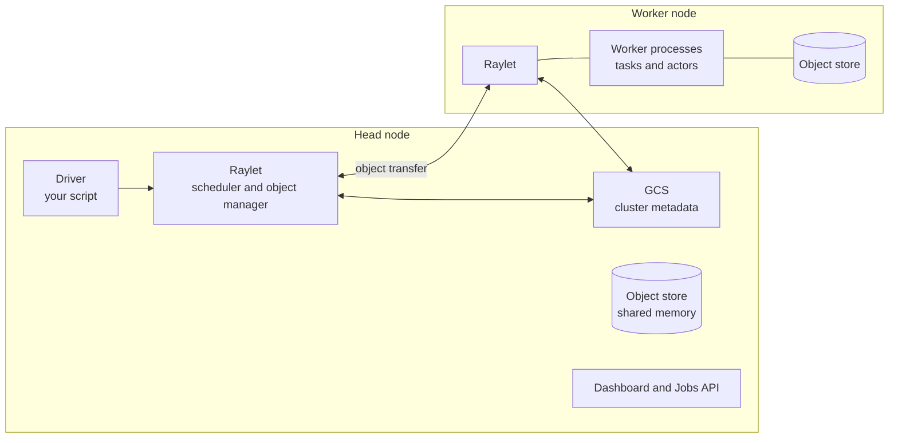
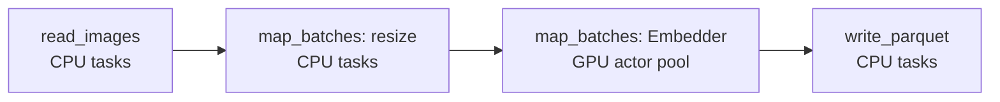
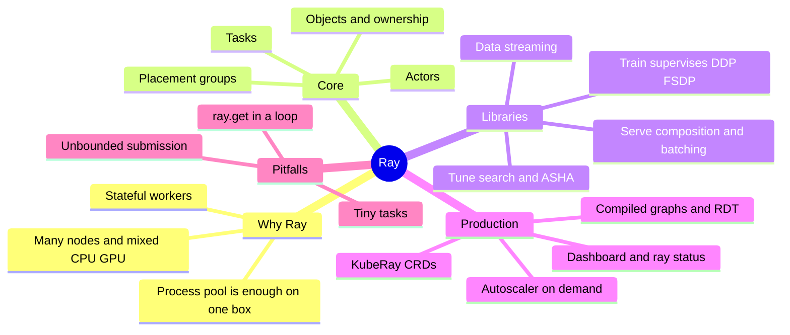

*By Gopi Krishna Tummala*

*Ray turns a Python program into one that runs across a cluster of CPUs and GPUs. This is a map of what it gives you over a process pool, the few ideas it's built on, and its libraries for data, training and serving.*

---

Say you need to compute an embedding for each of 50 million product images, overnight. The first version is simple: a Python script with a `ProcessPoolExecutor` that reads images, resizes them and runs a model. It works on a few thousand images on your workstation.

Then reality shows up. The model needs a GPU, but resizing needs lots of CPU. One machine isn't enough to finish by morning. Loading the model takes a minute, so you don't want to do it for every batch. When a node dies at 3 a.m., you'd rather not start over. And next month the same embeddings will feed a training job and then a search service.

That progression, from one process pool to a mixed CPU and GPU pipeline across many machines, is the problem [Ray](https://www.ray.io/) was built for. This post follows the embedding job through it: when the standard library is still the right answer, the three ideas Ray is built on, and what its libraries for data, training and serving add. APIs here reflect Ray 2.x as of late 2026.

## The idea in one picture


*One Python program, many machines: CPU work, GPU work, training and serving share one cluster and one scheduler.*

## When a process pool is enough

The honest first question about Ray is "why can't I just use a Python process pool?" Often you can, and you should.

```python
# One machine, standard library
with ProcessPoolExecutor(max_workers=32) as pool:
    results = list(pool.map(embed_batch, shards))

# Ray: nearly the same code, and the same code runs on 200 nodes
ray.init()  # or ray.init(address="auto") on a cluster
embed = ray.remote(embed_batch)
results = ray.get([embed.remote(s) for s in shards])
```

*Simplified.*

The pool stops being enough when the job needs several of these at once: more than one machine, different steps that need different hardware, workers that keep state like a loaded model, data that should flow from step to step without passing through your main process, recovery from failures, and capacity that grows and shrinks with the work. Ray covers all of those in one program.

It isn't free. A Ray cluster is another system to run, upgrade and debug, a stack trace from a worker on node 37 is harder to read than one from your laptop, and each task costs about a millisecond of overhead, so a million microsecond-sized tasks are faster in a local pool. Simpler tools also win in their own lanes: `torchrun` on Slurm or Kubernetes for a single fixed-size training job, Spark or DuckDB for SQL-shaped data processing, and `vllm serve` or Triton for one model behind one endpoint.

My rule of thumb: reach for Ray when a job needs at least two of multiple machines, mixed CPU and GPU steps, long-lived stateful workers, elastic capacity, or one pipeline that runs from data to training to serving.

## Three building blocks

Everything in Ray, including its libraries, is built from three ideas.

- **Task:** a function call that runs somewhere in the cluster. Calling `f.remote(x)` returns immediately with a reference to the future result. Resizing one shard of images is a task.
- **Actor:** a class instance that lives in its own process and keeps state between calls. Our embedding model, loaded once onto a GPU and then fed batch after batch, is an actor.
- **Object:** an immutable value stored in Ray's shared-memory object store, identified by an `ObjectRef`. Passing a reference from one task to another moves data between workers without routing it through your script, and on the same machine large arrays are read without copying.

Under the hood, one head node runs a small control service that tracks the cluster, and every node runs a scheduler and an object store. The worker that creates an object is responsible for tracking it, which keeps the central service off the hot path. The trade-off is that if that worker dies, the objects it was tracking are lost and have to be recomputed.



*The GCS is the control service; each node's raylet schedules work and moves objects. Data travels raylet to raylet, not through the head node.*

Most of what goes wrong in Ray programs is a misuse of these three. Calling `ray.get` inside a loop makes everything sequential again. Passing a large array directly to a hundred tasks copies it a hundred times instead of storing it once with `ray.put` and passing the reference. Loading a model inside a task instead of an actor reloads it on every call.

## Putting work on the right hardware

Each task or actor says what it needs, for example `num_cpus=4` or `num_gpus=1`, and Ray places it on a node that has those resources free. These requests are for scheduling only: asking for one GPU sets which GPU the process sees, but doesn't stop your code from using more memory than you planned.

Distributed training adds a stricter need. Eight GPU workers that must talk to each other are useless if only six can start, so Ray has **placement groups**: a request for a set of resource bundles that are reserved all at once or not at all, optionally all on one machine so the workers can use fast GPU-to-GPU links. Ray's training and serving libraries create placement groups for you. You only write them by hand when building your own distributed system.

## Ray Data: streaming the pipeline

[Ray Data](https://docs.ray.io/en/latest/data/data.html) is the library our embedding job ends up using. It reads data in blocks and streams them through a chain of steps, each with its own resources, while keeping memory bounded so a fast reader can't flood a slow GPU step:

```python
ds = ray.data.read_images("s3://bucket/products/")        # CPU, any node
ds = ds.map_batches(resize, batch_size=256)               # CPU tasks
ds = ds.map_batches(Embedder, concurrency=8, num_gpus=1)  # GPU actor pool
ds.write_parquet("s3://bucket/embeddings/")
```

*Simplified. `Embedder` is a class whose constructor loads the model once.*



*Every stage runs at once on different blocks. The CPU stages can be on other machines; the GPU stage keeps its model loaded.*

The useful comparison is with PyTorch's `DataLoader`. A `DataLoader` runs its worker processes on the same machine as the training process, so decoding is limited by that machine's CPUs. Ray Data can run decoding on CPU-only machines elsewhere in the cluster, and can put a GPU model in the middle of a pipeline, which a `DataLoader` can't. It also retries failed pieces instead of failing the whole job. Where the `DataLoader` wins is simplicity and exactness: on one machine with fast random access it gives a perfect shuffle, and with `torchdata`'s `StatefulDataLoader` it can resume a long run at the exact sample it stopped on. If your trainer's CPUs keep up, stay with the `DataLoader`. If GPUs sit idle waiting for decoding, or you're running batch inference over millions of files, Ray Data is the better tool. The [Dataloaders post](/posts/mlops/datasets-and-dataloaders) covers the single-machine side in depth.

## Ray Train: supervising distributed training

Next month the embeddings train a ranking model on 16 GPUs. [Ray Train](https://docs.ray.io/en/latest/train/train.html) doesn't replace PyTorch's DDP or FSDP. It starts the group of training workers on a placement group, sets up communication between them, gives each its share of a Ray Data stream, collects metrics, saves checkpoints to shared storage and, when a worker or node fails, restarts the whole group from the latest checkpoint. Your training loop stays ordinary PyTorch.

For one large, fixed-size pre-training run, `torchrun` on your scheduler is often simpler. Ray Train pays off when training is one step in a larger Python program: fed by Ray Data, launched many times by [Ray Tune](https://docs.ray.io/en/latest/tune/index.html) for hyperparameter search, or sharing a cluster with inference, as reinforcement-learning-from-feedback systems do. The [Training Frameworks post](/posts/mlops/hidden-engine-of-ai) covers what happens inside each worker.

## Ray Serve: answering requests

Finally the embeddings power a search service. [Ray Serve](https://docs.ray.io/en/latest/serve/index.html) runs **deployments**, groups of replica actors behind an HTTP endpoint. Each deployment declares its resources and scales its replicas with the number of requests in flight. Deployments can call each other directly, so a query can go to a CPU text encoder, then a GPU embedding model, then a re-ranker, without turning each step into its own microservice. Serve can also batch requests that arrive close together into one GPU call, and its LLM support runs [vLLM](/posts/mlops/vllm-trilogy-of-modern-llm-scaling) engines as replicas.

For one model behind one endpoint, a plain model server on a Kubernetes deployment is simpler. Serve earns its place when the request path is a graph of Python steps on different hardware.

## The GPU-to-GPU fast path

Normal Ray calls move data through CPU memory and cost about a millisecond each. That's too slow for pipeline-parallel inference or for syncing weights between a trainer and a rollout engine in reinforcement learning. Ray's newer features for these cases, compiled graphs and direct GPU transport, set up a fixed communication plan once and then send tensors GPU to GPU over NCCL with very low overhead. vLLM uses compiled graphs for pipeline parallelism across machines, and several open RLHF frameworks are built on Ray actors and placement groups. These APIs are still evolving, so check the docs for your version.

## Running it on Kubernetes

Most production Ray runs on Kubernetes through [KubeRay](https://docs.ray.io/en/latest/cluster/kubernetes/index.html). The division of labor is worth getting right: Kubernetes schedules pods, which are whole containers that take minutes to start, while Ray schedules tasks and actors inside those pods in milliseconds. KubeRay connects the two, so when Ray has work it can't place, its autoscaler asks Kubernetes for more pods. It offers three resources: a long-lived `RayCluster`, a `RayJob` that creates a cluster for one job and tears it down after, and a `RayService` for serving with zero-downtime upgrades.

When a job seems stuck, `ray status` is the first stop. It shows which resources are free and which requests can't be placed, which explains most hangs: a request for a GPU type no node has, a placement group that can't fit, or an object store that's full and spilling to disk. The dashboard shows the rest.

## Mistakes that waste GPU hours

| Mistake | Why it hurts | Instead |
|---|---|---|
| `ray.get` inside a loop | Submits one task, waits, submits the next | Submit everything, then get once or use `ray.wait` |
| Passing a large array to many tasks | Copies it on every call | `ray.put` it once and pass the reference |
| Loading a model inside a task | Reloads it on every call | Use an actor, or a class in `map_batches` |
| Unlimited task submission | Results fill the object store and spill to disk | Cap tasks in flight, or use Ray Data |
| Running work on the head node | Starves the control service; if the head runs out of memory, the cluster goes down | Give the head node zero CPUs for tasks |

## What I'd remember

- **A process pool is often enough.** Reach for Ray when you need several of: many machines, mixed CPU and GPU steps, stateful workers, elastic capacity, or one pipeline from data to serving.
- **Tasks, actors and objects.** Everything else is built on those three; most bugs are a misuse of one of them.
- **Placement groups are gang scheduling.** All the GPUs a training job needs, or none.
- **Ray Data's value is the mixed pipeline.** CPU decoding anywhere in the cluster feeding GPU steps, with bounded memory.
- **Ray sits under your orchestrator, not instead of it.** It runs the compute; schedulers like Airflow decide when.

The whole guide on one page:



## Where to go next

- [ML Pipeline Orchestration](/posts/mlops/ml-pipeline-orchestration-layers), for where Ray sits next to Airflow, Kubeflow and Temporal.
- [Datasets and Dataloaders](/posts/mlops/datasets-and-dataloaders) and [Training Frameworks](/posts/mlops/hidden-engine-of-ai), for the single-machine and inside-the-worker views.
- The [Ray documentation](https://docs.ray.io/en/latest/), especially the Ray Data and KubeRay guides.

**Questions to sit with**

1. For a job you run today, which of the reasons to use Ray actually apply?
2. In the embedding pipeline, what happens to memory if the GPU step is slower than the reader, and what stops it from blowing up?
3. Where in your stack does Kubernetes scheduling end and something else's begin?
