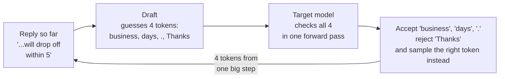
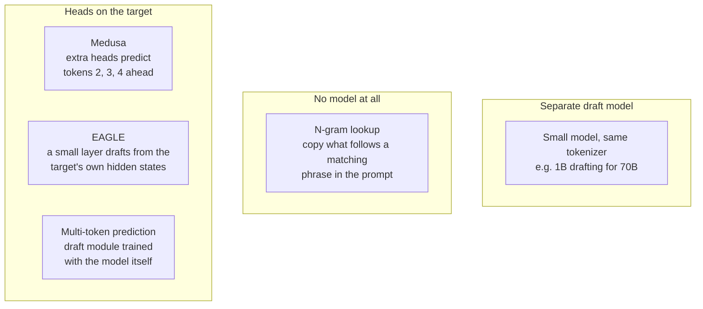
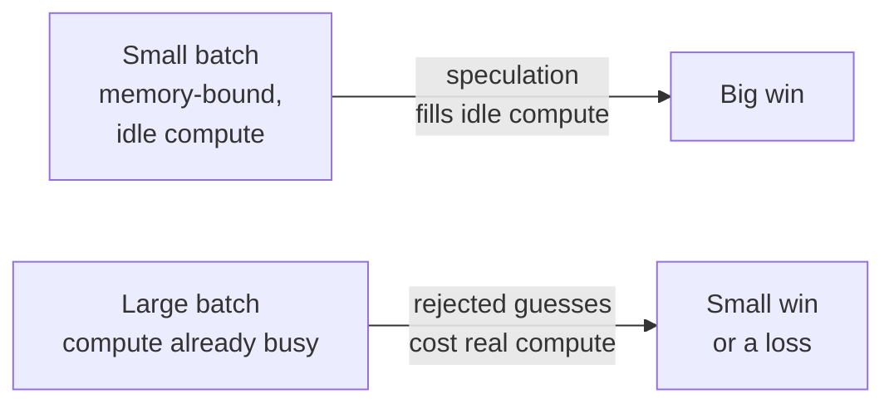

*By Gopi Krishna Tummala*

*Why a large language model can check several guessed tokens for about the cost of generating one, how the acceptance rule keeps the output exactly the same, the main ways to make the guesses, and when it stops helping, including for vision-language and mixture-of-experts models.*

A companion to Module 5 of [the MLOps map](/posts/mlops/infrastructure-first-mlops-roadmap). Read after [LLM Serving with vLLM](/posts/mlops/vllm-trilogy-of-modern-llm-scaling) and [Life of a Request](/posts/mlops/life-of-a-tensor-production-inference).

---

The support team from [the Qwen3-VL post](/posts/generative-ai/vlm-moe-qwen-train-to-deploy) has their model running. A customer sends a billing screenshot, and the model writes a reply: "Hi Dana, the second charge of \$49.00 on October 3 is a pending authorization, not a real charge. It will drop off within 5 business days." The first word appears in under a second. The full reply takes another four.

Those four seconds are decode: one token at a time, each needing a full pass through the model. The odd part is that most tokens in that reply are easy. After "pending" comes "authorization." After "within 5 business" comes "days." A much smaller model, or even a lookup in the ticket text, would guess them right. Speculative decoding uses that: guess several tokens cheaply, then have the big model check all of them in a single pass. When the guesses are right, you get several tokens for the price of one step. When they're wrong, you lose a little work, and the output is still exactly what the big model would have written.

## The idea in one picture



*One step of the big model normally gives one token. Here it gave four: three accepted guesses plus its own correction.*

## Why checking is almost free

As [Life of a Request](/posts/mlops/life-of-a-tensor-production-inference#on-the-gpu-two-very-different-phases) explains, decoding a single request is limited by memory bandwidth, not arithmetic. Each step reads all the model's weights from GPU memory to produce one token, and the GPU's compute units mostly wait.

Checking several tokens at once is a lot like prefill. The model runs one forward pass over the guessed tokens together, reads its weights once, and computes the next-token distribution at every position in parallel. The extra arithmetic fits into compute that was idle anyway, so checking four tokens costs about the same as generating one. That's the whole trick: decode wastes compute, and speculation spends that waste on verifying guesses.

## The rule that keeps the output exact

The surprising part, and the reason this is safe in production, is that speculation doesn't change what the model says. The original papers, [Leviathan et al.](https://arxiv.org/abs/2211.17192) at Google and [Chen et al.](https://arxiv.org/abs/2302.01318) at DeepMind, both 2023, use a modified form of rejection sampling.

For each guessed token $x$, compare the probability the big target model gives it, $p(x)$, with the probability the draft gave it, $q(x)$. Accept it with probability

$$\min\left(1,\ \frac{p(x)}{q(x)}\right).$$

If the target likes the token at least as much as the draft did, it's always accepted. If the target likes it less, it's accepted only sometimes. At the first rejection, the target samples a replacement from the leftover distribution, the part of $p$ the draft under-weighted, and everything after that point is thrown away. The math works out so the accepted tokens are distributed exactly as if the target model had sampled them itself. With greedy decoding it's simpler still: accept a guess only if it's the target's top token.

So speculation never makes the output worse. A bad draft only makes it slower.

## How much it buys

If each guess is accepted with probability $\alpha$ and the draft proposes $k$ tokens, the expected number of tokens per target step is

$$\frac{1 - \alpha^{k+1}}{1 - \alpha}.$$

With $\alpha = 0.8$ and $k = 4$, that's about 3.4 tokens per step instead of 1. The real speedup is lower, because the draft itself costs time and verification isn't entirely free, but 2 to 3 times faster is common. Leviathan et al. reported 2 to 3 times on T5-XXL, and Chen et al. 2 to 2.5 times on a 70B model.

Two things follow from the formula. Acceptance matters more than draft length: past a few tokens, longer guesses mostly add rejected work, because the chance that all of them are right shrinks fast. And acceptance depends on the text. Our support replies, full of repeated names, amounts and polite boilerplate, accept well. A creative story sampled at high temperature accepts poorly.

## Where the guesses come from



*The further down, the more the draft shares with the target model, and usually the higher the acceptance.*

- **A separate draft model.** The original recipe: a small model from the same family, with the same tokenizer, proposes tokens. Simple to set up, but it's a second model to host, and it doesn't know what the big model was "thinking."
- **N-gram lookup.** No model at all. Look for the last few generated tokens earlier in the prompt and propose whatever followed them there. It costs almost nothing and works surprisingly well when the output copies from the input: summaries, code edits, and support replies that quote the ticket.
- **[Medusa](https://arxiv.org/abs/2401.10774).** Add a few extra prediction heads to the target model, each guessing a token further ahead, and check several candidate continuations at once as a small tree.
- **[EAGLE](https://arxiv.org/abs/2401.15077).** A single lightweight layer that drafts from the target model's own internal features rather than from raw tokens, which makes its guesses much better. The latest version, [EAGLE-3](https://arxiv.org/abs/2503.01840), trains the drafter on its own multi-step predictions so errors don't pile up, and reports speedups of up to 6.5 times with greedy decoding, on its best tasks.
- **Multi-token prediction (MTP).** Train the model from the start to predict more than one token ahead, and use that extra module as the drafter. [DeepSeek-V3](https://arxiv.org/abs/2412.19437) does this; its MTP module's guess for the second token is accepted 85 to 90 percent of the time, giving about 1.8 times more tokens per second.

| Method | Extra model to host | Training needed | Best when |
|---|---|---|---|
| Draft model | Yes, small | No, if one exists | A family with a small sibling |
| N-gram lookup | No | No | Output copies the input |
| Medusa, EAGLE | Small heads | Yes, short | You serve one model heavily |
| MTP | No, built in | Done by the model's authors | The model ships with it |

In vLLM, all of these are options on one flag:

```bash
vllm serve Qwen/Qwen3-VL-30B-A3B-Instruct \
  --speculative-config '{"method": "ngram", "num_speculative_tokens": 4,
                         "prompt_lookup_min": 2, "prompt_lookup_max": 5}'
```

*Simplified; method names and keys follow the [vLLM speculative decoding docs](https://docs.vllm.ai/usage/speculative_decoding/), which change between versions. An EAGLE-3 drafter uses `"method": "eagle3"` with the path to its checkpoint.*

## When it stops helping



*Speculation trades spare compute for latency. It helps most when there's spare compute to trade.*

**Large batches.** Verification is cheap only because decode leaves compute idle. With many requests batched together, as in the [vLLM post](/posts/mlops/vllm-trilogy-of-modern-llm-scaling#two-phases-two-kinds-of-latency), the GPU is already doing real work, and every rejected guess is compute taken from someone else's tokens. That's why speculation is usually a latency tool for lightly loaded or interactive services, and why serving systems shorten or switch off drafting as load rises.

**Low acceptance.** High temperature, open-ended writing and a draft that doesn't match the target all push $\alpha$ down. Measure acceptance on your real traffic before tuning anything else.

**Mixture-of-experts models.** In the [Qwen3-VL post](/posts/generative-ai/vlm-moe-qwen-train-to-deploy#what-a-mixture-of-experts-layer-is), a single token reads only its 8 of 128 experts per layer. Verifying four guessed tokens at once can touch up to four different sets of experts, so the step reads many more weights than a normal decode step, and the "verification is free" argument weakens. [Saxena et al.](https://arxiv.org/abs/2506.20675) found that the same speculation setup on Mixtral sped up code by 39 percent and slowed down math by 54 percent, and argue for choosing the number of guesses dynamically.

**Vision-language models.** Speculation only helps the text the model writes; the image tokens still go through prefill as before. For a VLM, the drafter also needs to know what's in the image. A small text-only draft model doesn't, so it guesses badly on exactly the tokens that matter, like the \$49.00 it would have to read from the screenshot. Drafters that work from the target model's own hidden states, like EAGLE and MTP, or n-gram lookup on text the model has already produced, sidestep that, because the image's information is already inside what they read.

For the support team, n-gram lookup is the natural first try. Their replies quote names, amounts and phrases from the ticket and from earlier sentences, it needs no training, and their load is light. The plan: turn it on, measure acceptance and time per reply on real tickets, and let the server drop speculation when the queue gets long. If acceptance is low, an EAGLE-style drafter is the next step.

## What I'd remember

- **Decode wastes compute; speculation spends it.** Checking several guessed tokens costs about one decode step.
- **The output is exactly the same.** The acceptance rule makes accepted tokens follow the target model's distribution.
- **Acceptance rate is the number to watch.** It sets the speedup, and it depends on your traffic.
- **Drafts that share the target's view guess better.** EAGLE and MTP read the target's own features; n-gram lookup is free when outputs copy inputs.
- **It's a latency tool.** Large batches, mixture-of-experts verification and image-heavy prompts all shrink the gain.

## Where to go next

- [LLM Serving with vLLM](/posts/mlops/vllm-trilogy-of-modern-llm-scaling) and [Life of a Request](/posts/mlops/life-of-a-tensor-production-inference), for why decode is memory-bound.
- [Qwen3-VL and Mixture of Experts](/posts/generative-ai/vlm-moe-qwen-train-to-deploy), for the model this post speeds up.
- [Custom Kernels](/posts/mlops/custom-kernel-craze), for why reading bytes, not doing math, sets the pace.
- Papers: [Leviathan et al.](https://arxiv.org/abs/2211.17192), [Chen et al.](https://arxiv.org/abs/2302.01318), [Medusa](https://arxiv.org/abs/2401.10774), [EAGLE-3](https://arxiv.org/abs/2503.01840).

**Questions to sit with**

1. What would you measure first to decide whether speculation is worth turning on for your service?
2. Why can't a bad draft model make the output worse?
3. For an image question, which tokens of the answer would a text-only draft model guess worst, and why?
