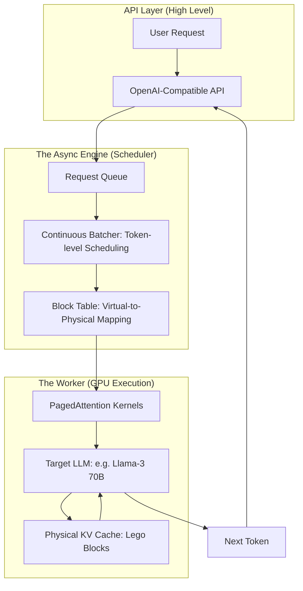

*By Gopi Krishna Tummala*

---

  
Infrastructure-First MLOps — Building the Engine of AI

  

    <a href="/posts/mlops/parquet-arrow-quest-for-analytic-speed" style="background: rgba(255,255,255,0.1); padding: 0.5rem 1rem; border-radius: 6px; text-decoration: none; color: white; opacity: 0.9;">Module 1: Data DNA</a>
    <a href="/posts/mlops/datasets-and-dataloaders" style="background: rgba(255,255,255,0.1); padding: 0.5rem 1rem; border-radius: 6px; text-decoration: none; color: white; opacity: 0.9;">Module 2: Dataloaders</a>
    <a href="/posts/mlops/hidden-engine-of-ai" style="background: rgba(255,255,255,0.1); padding: 0.5rem 1rem; border-radius: 6px; text-decoration: none; color: white; opacity: 0.9;">Module 3: Training</a>
    <a href="/posts/mlops/modern-post-training-peft-2026" style="background: rgba(255,255,255,0.1); padding: 0.5rem 1rem; border-radius: 6px; text-decoration: none; color: white; opacity: 0.9;">Module 4: Post-Training</a>
    <a href="/posts/mlops/vllm-trilogy-of-modern-llm-scaling" style="background: rgba(255,255,255,0.25); padding: 0.5rem 1rem; border-radius: 6px; text-decoration: none; color: white; font-weight: 600; border: 2px solid rgba(255,255,255,0.5);">Module 5: Serving</a>
    <a href="/posts/mlops/custom-kernel-craze" style="background: rgba(255,255,255,0.1); padding: 0.5rem 1rem; border-radius: 6px; text-decoration: none; color: white; opacity: 0.9;">Module 6: Kernels</a>
    <a href="/posts/mlops/beyond-inference-agentic-mlops-mcp" style="background: rgba(255,255,255,0.1); padding: 0.5rem 1rem; border-radius: 6px; text-decoration: none; color: white; opacity: 0.9;">Module 7: Agentic AI</a>
    <a href="/posts/mlops/ml-pipeline-orchestration-layers" style="background: rgba(255,255,255,0.1); padding: 0.5rem 1rem; border-radius: 6px; text-decoration: none; color: white; opacity: 0.9;">Module 8: Orchestration</a>
  

  
📖 You are reading <strong>Module 5: LLM Serving</strong> — vLLM and the Trilogy of Speed

---

### Act 0: LLM Serving in Plain English

Imagine you are running a very busy hotel (The GPU). Every guest (User Request) needs a room to stay in. In a traditional hotel, you have to give every guest a giant "Penthouse Suite" (Fixed memory block) even if they only have one small suitcase. 

If 10 guests arrive, you're full, even if 90% of the rooms are empty space! This is called **Memory Fragmentation**.

**vLLM** is like a magic hotel where:
1.  **PagedAttention:** Guests don't get suites. They get "Lego Bricks" of space. If they buy more souvenirs (generate more tokens), you just snap another Lego brick onto their pile, wherever it fits in the building. No space is ever wasted.
2.  **Continuous Batching:** You don't wait for a busload of guests to arrive before checking them in. As soon as someone walks through the door, they get a room and a key instantly, even if other guests are already sleeping.

The result? You can fit **many more guests** in the same building (the vLLM paper reported 2–4× higher throughput than the best prior systems at the same latency), and far fewer have to wait in the lobby.

---

## Table of contents

---

## The Module in One Picture

---

### Act I: The Hidden Cost of Conversation (The KV Cache)

Before we can appreciate vLLM's genius, we must understand the core problem in LLM inference.

When an AI generates a response, it operates one token at a time. To stay coherent, it must look back at everything that came before. This history is stored in the **KV Cache** (Key-Value Cache).

| Component | Function |
| :--- | :--- |
| **Key ($K$)** | The "Passport" of the token (its identity). |
| **Value ($V$)** | The "Luggage" of the token (its meaning). |

**The Bottleneck:** The KV Cache grows linearly with every token, for every concurrent user. Per token, it costs:

$$\text{KV bytes per token} = 2 \times n_{\text{layers}} \times n_{\text{kv\_heads}} \times d_{\text{head}} \times \text{bytes per value}$$

(the 2 is one K and one V). A 10,000-token document across a few dozen users needs tens of gigabytes of high-speed GPU memory. Traditional systems pre-reserved a contiguous slab for each request's *maximum* length, so most of that memory sat empty, and when the "desk" (GPU memory) overflowed you got **OOM (Out-of-Memory)** errors or tiny batch sizes.

---

#### Act I.V: Mature Architecture — The vLLM Inference Stack

In 2025, production LLM serving has moved beyond simple wrappers. The "Mature Architecture" is a high-performance **Async Engine** that decouples the API from the GPU execution.

**The vLLM Pipeline (Mature Architecture):**

##### 1. Continuous Batching: The Scheduler
Traditional batching (Static) waits for 16 requests, processes them, and returns them all at once. If Request 1 finishes in 5 tokens and Request 2 needs 500, Request 1's GPU resources sit idle for 495 cycles. 
*   **vLLM's Way:** It schedules at the **token level**. Every iteration, it packs the batch with as many active tokens as possible, regardless of when the request started.

##### 2. PagedAttention: The Memory Manager
Inspired by Operating Systems (Paging), vLLM treats GPU memory as a pool of blocks. 
*   **Logical Blocks:** The user's conversation (tokens 0-15, 16-31).
*   **Physical Blocks:** Scattered slots in GPU memory.
*   **Sharing:** If 100 users are chatting about the same PDF, vLLM stores the PDF's KV cache **once** and points all 100 users to the same physical blocks (copy-on-write if a branch diverges, which also makes parallel sampling and beam search cheap).
*   **Preemption:** When memory runs out mid-generation, the scheduler preempts some requests (recomputing or swapping their blocks later) instead of crashing.

---

### Act II: The Math of Scaling

Stories are fun, but the math determines your profit margins. Two axes pin every serving stack: **memory footprint** and **throughput**.

#### 1. Concurrency Drives Throughput
Decode is memory-bandwidth-bound: each step reads all the weights once no matter how many sequences are in the batch, so **more concurrent sequences means more tokens per weight read**. The ceiling on concurrency is how many KV caches fit in memory. Naive serving wasted most of that memory to fragmentation and over-reservation (the vLLM paper measured only 20–38% of KV memory actually used in prior systems); PagedAttention cuts the waste to under 4%.

$$\text{Max concurrent sequences} \approx \frac{\text{VRAM}_{\text{total}} - \text{VRAM}_{\text{weights}} - \text{VRAM}_{\text{activations}}}{\text{KV bytes per token} \times \text{avg sequence length}}$$

#### 2. Time-to-First-Token (TTFT) vs. Inter-Token Latency (ITL)
*   **TTFT (time to first token):** Dominated by the "Prefill" phase (processing your whole prompt in parallel). Compute-bound; grows with prompt length and with queueing.
*   **ITL / TPOT (inter-token latency / time per output token):** The "Decode" phase (generating one token at a time). Memory-bandwidth-bound; grows as the batch gets bigger.

The two fight each other: a long new prompt's prefill can stall everyone else's decode. **Chunked prefill** splits long prompts into chunks and mixes them with decode steps in the same batch, so new requests don't freeze ongoing responses (it is on by default in vLLM's V1 engine). At larger scale, **disaggregated serving** runs prefill and decode on separate GPU pools and ships the KV cache between them.

---

### Act III: 2025 Trends — Speculative & Quantized

#### 1. Speculative Decoding (The "Fast Sketch")
A small, fast "Drafter" (a 1B model, extra prediction heads like Medusa/EAGLE, or even n-gram lookup from the prompt) guesses the next k tokens, say 5. The 70B "Target" model then checks all 5 in **one forward pass**, which costs about the same as generating a single token because decode is memory-bound. With a rejection-sampling acceptance rule, the output distribution is **exactly** the target model's: you accept the longest correct prefix, plus one token from the target. If the guesses are usually right, you emit several tokens per target step.
*   **Interview Question:** "Is Speculative Decoding always faster?"
    *   *Answer:* No. The speedup depends on the **acceptance rate**. If the drafter's guesses are usually rejected, you pay the drafter's cost and the verification for little gain. It also helps most at small batch sizes; at large batch sizes the GPU is already busy and the extra verification compute competes with other requests.

#### 2. FP8 & FP4 Quantization
Weights are moving from 16-bit to 8-bit (near-lossless with good calibration) or 4-bit (small, task-dependent loss; methods like AWQ and GPTQ minimize it). The KV cache can be quantized too (FP8 KV halves its memory).
*   **Benefit:** A 70B model that needs ~140GB in BF16 needs ~70GB in FP8 and ~35GB in 4-bit, so it fits on a single 80GB GPU with room left for KV cache instead of needing a multi-GPU tensor-parallel setup. Hardware matters: native FP8 math needs Hopper/Ada-class GPUs, and native FP4 needs Blackwell; on older GPUs, low-bit weights are dequantized on the fly (saving memory and bandwidth, not FLOPs).

---

### Act IV: System Design & Interview Scenarios

#### Scenario 1: The "Spiky" Traffic
*   **Question:** "Your chatbot is viral on Twitter. Throughput is high, but users complain that individual responses are taking 30 seconds to finish. What is happening?"
*   **Answer:** Two effects stack up. Requests wait in the **queue** (high TTFT), and once admitted they share a very **large batch**, so each decode step is slower (high ITL), and a 500-token answer takes 30 seconds. High throughput and good latency are in tension. Fixes: cap concurrency per replica (`max_num_seqs`, max batched tokens) to protect a latency SLO; **scale out** replicas and autoscale on queue depth or KV-cache usage; route by prefix to reuse caches; enable chunked prefill; prioritize interactive traffic over batch jobs; and consider speculative decoding at lower load.

#### Scenario 2: RAG & Prefix Caching
*   **Question:** "You are building a Legal AI that answers questions about a 500-page contract. Every user asks about the same document. How do you optimize this?"
*   **Answer:** Mention **Automatic Prefix Caching (APC)**. vLLM hashes KV blocks by their token content, so when the first 5,000 tokens (the contract) match a previous request, it reuses those cached blocks instead of recomputing the prefill. Cached blocks stay around until memory pressure evicts them (LRU), so put the shared document *first* in the prompt and the user's question last, and route requests for the same document to the same replica.

---

### Graduate Assignment: The Memory Wall

**Task:**
Calculate the KV cache size for a Llama-3 70B model with:
*   Context Length: 4096 tokens
*   Precision: 16-bit (2 bytes)
*   Layers: 80
*   Query heads: 64, **KV heads: 8** (Llama 3 uses grouped-query attention)
*   Head Dim: 128

1.  **The Calc:** How many GB of VRAM does *one* user's history consume? Compute it twice: with 64 KV heads (classic multi-head attention) and with the real 8 KV heads.
2.  **The Profit:** If you have 80GB H100 GPUs and the weights take up 140GB (unquantized), how many GPUs do you need just to serve **one** user? Now, quantize to 4-bit and recalculate how many 4K-token users fit on one GPU.

<strong>Show the answers</strong>

1.  **Per token:** 2 (K and V) × 80 layers × KV heads × 128 × 2 bytes.
    *   With 64 KV heads: 2,621,440 bytes ≈ 2.6 MB per token → × 4,096 ≈ **10.7 GB per user**.
    *   With GQA's 8 KV heads: 327,680 bytes ≈ 0.33 MB per token → × 4,096 ≈ **1.34 GB per user**. That 8× saving is exactly why modern models use GQA.
2.  **BF16 weights:** 140 GB needs at least **2 × 80GB GPUs** (tensor parallel), leaving roughly 20 GB minus activations and overhead for KV cache, about a dozen 4K-token users with GQA.
    **4-bit weights:** ~35 GB on **one** GPU leaves ~45 GB for KV, roughly **30+ concurrent 4K-token users** (45 ÷ 1.34), before activation and framework overhead.

## Remember This

- **The KV cache, not the weights, limits how many users you can serve.** Know the formula: 2 × layers × KV heads × head dim × bytes, per token, per user.
- **PagedAttention = virtual memory for KV.** Fixed-size blocks and a block table eliminate fragmentation and enable prefix sharing.
- **Continuous batching schedules per iteration, not per request.** Finished sequences leave and new ones join every step.
- **Prefill is compute-bound (TTFT), decode is memory-bound (ITL).** Chunked prefill and disaggregation stop them from hurting each other.
- **Throughput vs latency is a dial.** Bigger batches raise throughput and slow every user; cap concurrency to meet your SLO and scale out.
- **Speculative decoding and quantization buy speed differently.** One emits more tokens per expensive step; the other makes each step move fewer bytes.

<strong>Self-check</strong>

1. Why does decode get more efficient (tokens per second per GPU) as batch size grows, up to a point?
2. What two kinds of waste did pre-vLLM systems have in KV memory, and how do blocks fix them?
3. What does GQA change in the KV cache formula, and by how much for Llama 3 70B?
4. Why does speculative decoding not change the output distribution?
5. A user complains about a 4-second wait before the first token, but then text streams quickly. Which phase is the problem, and what would you try?

---

**Further Reading (State-of-the-Art):**
*   [Efficient Memory Management for Large Language Model Serving with PagedAttention (SOSP 2023)](https://arxiv.org/abs/2309.06180) - The original vLLM paper.
*   [Fast Inference from Transformers via Speculative Decoding (ICML 2023)](https://arxiv.org/abs/2211.17192).
*   [AWQ: Activation-aware Weight Quantization for LLM Compression and Acceleration (MLSys 2024)](https://arxiv.org/abs/2306.00978).
*   [FlashAttention-3: Fast and Accurate Attention with Asynchrony and Low-precision (2024)](https://arxiv.org/abs/2407.08608).
*   [GQA: Training Generalized Multi-Query Transformer Models from Multi-Head Checkpoints (2023)](https://arxiv.org/abs/2305.13245).

---

**Previous:** [Module 4 — Post-Training (PEFT & Alignment)](/posts/mlops/modern-post-training-peft-2026)

**Next:** [Module 6 — Custom Kernels](/posts/mlops/custom-kernel-craze)

---

**Related deep dives:** [Ray Serve LLM](/posts/mlops/ray-field-guide-core-to-production#13-ray-serve-online-inference) runs vLLM engines as autoscaled replicas, and [compiled graphs](/posts/mlops/ray-field-guide-core-to-production#15-gpu-native-paths-compiled-graphs-and-direct-transport) power vLLM's multi-node pipeline parallelism · [The Multimodal Atlas](/posts/generative-ai/multimodal-foundation-models-end-to-end) covers serving and distilling vision-language and video models.
