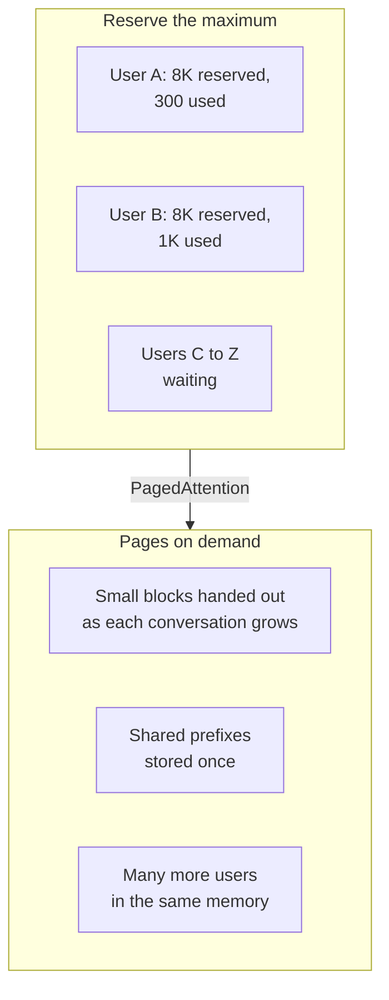
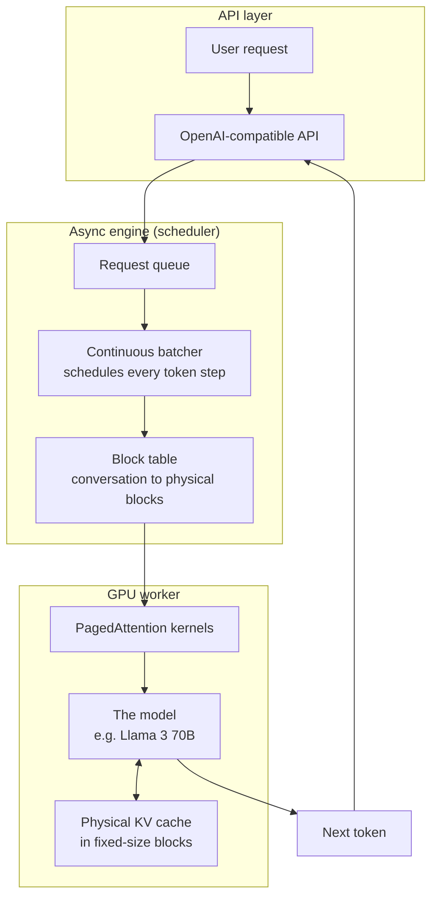
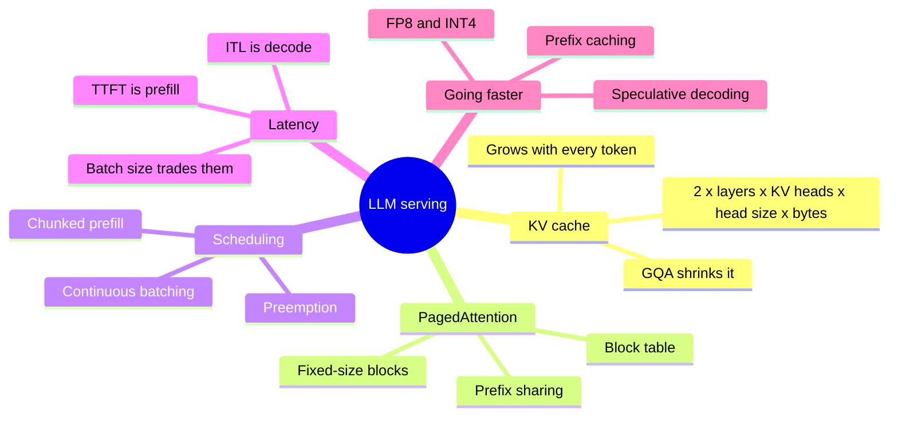

*By Gopi Krishna Tummala*

*When you serve a large language model, the GPU usually runs out of memory for conversations long before it runs out of compute. A map of the KV cache, PagedAttention, continuous batching and the other tricks that let one GPU serve many more people.*

Part 5 of [the MLOps map](/posts/mlops/infrastructure-first-mlops-roadmap). Previous: [Post-Training](/posts/mlops/modern-post-training-peft-2026). Next: [Life of a Request](/posts/mlops/life-of-a-tensor-production-inference).

---

You're serving Llama 3 70B to an internal chat app on a single 80 GB GPU. The weights, quantized to 4 bits, take about 35 GB. That leaves roughly 45 GB. The question that decides your costs is how many people can chat at once, and the answer depends almost entirely on how that remaining memory is used.

Each conversation needs memory that grows with every token. Before vLLM, most servers reserved a block big enough for each request's *maximum* possible length the moment it arrived. A request allowed 8,000 tokens got 8,000 tokens' worth of memory even if it finished after 300. Most of the reserved memory sat empty, and new users waited in a queue for it. vLLM's main idea, borrowed from how operating systems manage memory, was to hand out memory in small pages as each conversation actually grows. This post follows our 70B deployment through why that works and what else modern serving engines do.

## The idea in one picture

*Same GPU, same model. Allocating conversation memory in small pages instead of reserving the maximum up front is what lets many more users fit.*

## The KV cache: memory that grows with every token

To generate each new token, a transformer attends to every earlier token in the conversation. Recomputing the keys and values for all earlier tokens at every step would be far too slow, so the server keeps them: that's the KV cache. Its size per token is

$$2 \times \text{layers} \times \text{KV heads} \times \text{head size} \times \text{bytes per value}$$

with the 2 for keys and values. Llama 3 70B has 80 layers, 8 key-value heads (thanks to grouped-query attention, which shares each key-value head across several query heads) and a head size of 128. In 16-bit precision that's about 0.33 MB per token, or about 1.3 GB for a 4,000-token conversation. With 45 GB free, that's around 30 conversations of that length at once, before overhead. Without grouped-query attention, with 64 key-value heads, it would be 8 times as much memory per conversation.

That's the real limit on a serving GPU. The weights are a fixed cost; the KV cache decides how many users you can fit.

## PagedAttention: virtual memory for conversations

[vLLM's PagedAttention](https://arxiv.org/abs/2309.06180) splits the KV cache into small fixed-size blocks, say 16 tokens each, and keeps a table mapping each conversation's tokens to wherever its blocks happen to sit in memory. A conversation gets a new block only when it needs one. The vLLM paper measured that earlier systems actually used only 20–38% of the memory they reserved for KV caches; with paging, waste drops to under 4%.

Paging brings two more benefits. Conversations that start with the same text, such as a long system prompt or a shared document, can point at the same blocks instead of storing copies. And when memory runs short, the server can pause a conversation and free its blocks, recomputing them later, instead of crashing.

## Continuous batching: don't wait for the slowest request

GPUs are efficient when they process many requests together. The old way, static batching, collected a batch of requests and ran them until all finished. If one request needed 500 tokens and another needed 5, the short one's slot sat idle for 495 steps.

Continuous batching schedules at every step instead. Each step, the server generates one token for every active conversation; finished conversations leave and waiting ones join immediately. Combined with paging, this is what lets a single GPU stay busy with dozens of conversations of very different lengths. The [Orca paper](https://www.usenix.org/conference/osdi22/presentation/yu) introduced the idea; vLLM and most modern servers use it.

Put together, vLLM's engine separates the API from the GPU work. The API accepts requests, an async scheduler decides every step who runs and where their blocks live, and the GPU workers do the math:

*The block table is the piece that makes paging work: the scheduler hands the kernels a map from each conversation to wherever its blocks happen to be.*

## Two phases, two kinds of latency

Every request goes through two phases that behave very differently:

- **Prefill** processes the whole prompt at once. It's compute-heavy and sets the time to first token.
- **Decode** generates one token at a time. Each step reads all the weights and the conversation's KV cache from memory but does little math, so it's limited by memory bandwidth. It sets the time between tokens.

They interfere. A user who pastes a 30-page document triggers a long prefill that can stall everyone else's decode. Chunked prefill splits long prompts into pieces and mixes them with decode steps; very large deployments go further and run prefill and decode on separate GPUs. And there's a basic dial: bigger batches mean more total throughput but slower tokens for each user. Serving well means choosing a point on that dial that meets your latency target, then adding replicas.

## Getting more from the same GPU

Two more techniques show up in almost every deployment:

- **Quantization** stores weights, and sometimes the KV cache, in 8 or 4 bits instead of 16. That's how our 70B model fits on one GPU at all. 8-bit is usually close to lossless; 4-bit methods like [AWQ](https://arxiv.org/abs/2306.00978) lose a little, depending on the task. Native 8-bit math needs Hopper-generation GPUs or newer.
- **Speculative decoding** uses a small, fast draft model to guess the next several tokens, then has the big model check all of them in one step. Because decoding is memory-bound, checking several tokens costs about the same as generating one, and a careful acceptance rule guarantees the output is exactly what the big model would have produced. It helps most when the guesses are usually right and the batch is small.

## What I'd remember

- **The KV cache, not the weights, limits how many users fit.** Know the formula; grouped-query attention cuts it a lot.
- **PagedAttention is virtual memory for conversations.** Small blocks on demand, shared prefixes, almost no waste.
- **Continuous batching keeps the GPU busy.** Requests join and leave at every step.
- **Prefill and decode are different problems.** One sets time to first token, the other time between tokens.
- **Throughput and latency trade off.** Pick a batch size that meets your latency target, then scale out.

The whole module on one page:

*TTFT is time to first token; ITL is inter-token latency, the time between tokens.*

## Where to go next

- [Life of a Request](/posts/mlops/life-of-a-tensor-production-inference), the next module: everything around the GPU, from the network to streaming.
- The [vLLM paper](https://arxiv.org/abs/2309.06180) and [docs](https://docs.vllm.ai/).
- Leviathan et al., [Fast Inference from Transformers via Speculative Decoding](https://arxiv.org/abs/2211.17192).

Previous: [Post-Training](/posts/mlops/modern-post-training-peft-2026). Next: [Life of a Request](/posts/mlops/life-of-a-tensor-production-inference).

**Questions to sit with**

1. For the model you serve, how many bytes of KV cache does one token take, and how many average conversations fit?
2. What happens to everyone else's latency when one user sends a very long prompt, and what would you change?
3. When would speculative decoding not help?
