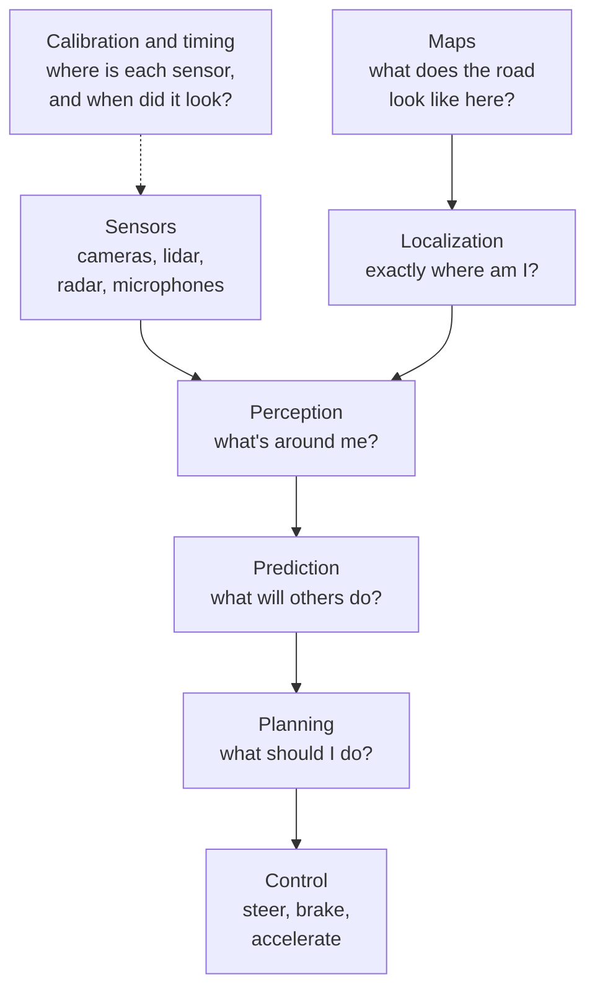
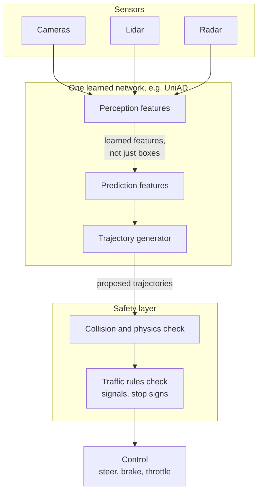

*By Gopi Krishna Tummala*

*The map for this series: what the parts of a self-driving system do, why driving is harder than it looks, and how the architecture has moved from separate modules toward learned systems with safety checks around them.*

Module 1 of 9 in the autonomous stack series. Next: [Module 2: Sensors](/posts/robotics/autonomous-stack-module-2-sensors).

---

A robotaxi needs to turn left at a city intersection. There's no arrow, so it has to find a gap in oncoming traffic. It's dusk and lightly raining. A cyclist is coming fast in the oncoming bike lane, partly hidden by a van that's also waiting to turn. On the far side, a pedestrian is standing at the crosswalk the car will drive through, looking at their phone.

A competent human handles this without thinking much about it. For a machine, nearly every part of it is hard. Is that dark shape behind the van a cyclist? How fast is it coming? Exactly where is the car relative to the lane lines it can barely see in the rain? Will the pedestrian step off the curb? Is the gap big enough, and will the oncoming driver let us go? This series follows that one left turn through every part of a self-driving system, one module at a time.

## The idea in one picture

*The classic stack, one question per box. Every module in this series covers one box, and the last ones cover how learned models are blurring the boundaries.*

## The parts, in plain words

Each part of the system answers one question:

- **Sensors** ([Module 2](/posts/robotics/autonomous-stack-module-2-sensors)): what can the car physically measure? Cameras see color and text, lidar measures distance, radar measures speed through rain.
- **Calibration** ([Module 3](/posts/robotics/autonomous-stack-module-3-calibration)): where is each sensor mounted, and when exactly did it take each measurement? Without this, nothing lines up.
- **Localization** ([Module 4](/posts/robotics/autonomous-stack-module-4-localization)): where exactly is the car, to within centimeters?
- **Maps** ([Module 5](/posts/robotics/autonomous-stack-module-5-mapping)): what does the road here look like, including the parts the sensors can't currently see?
- **Perception** ([Module 6](/posts/robotics/autonomous-stack-module-6-perception)): what's around the car right now, and how is it moving?
- **Prediction** ([Module 7](/posts/robotics/autonomous-stack-module-7-prediction)): what will each of those things do in the next few seconds?
- **Planning** ([Module 8](/posts/robotics/autonomous-stack-module-8-planning)): given all that, what should the car do?
- **Control:** turn the plan into steering, braking and throttle commands.

[Module 9](/posts/robotics/autonomous-stack-module-9-foundation-models) covers foundation models that try to collapse several of these boxes into one.

## Why driving is harder than it looks

**It has to work essentially every time.** In the US, there were 1.19 traffic deaths per 100 million miles driven in 2024, according to NHTSA: roughly one death every 84 million miles. A system that's as good as an attentive human must therefore be right about almost every decision over enormous distances. RAND's [Driving to Safety](https://www.rand.org/pubs/research_reports/RR1478.html) study worked out what that means for testing: demonstrating safety statistically through driving alone could take hundreds of millions to hundreds of billions of miles. That's why the industry leans so heavily on simulation, which is a theme of Modules 8 and 9.

**The hard cases are rare.** Most driving is easy: stay in the lane, keep a distance. What matters is the long tail: a cyclist hidden behind a van, a pedestrian who steps out mid-block, a police officer directing traffic against the signal. Each is rare, but there are so many kinds of rare event that the car meets some of them every day. Getting from "works in demos" to "works in a city" is mostly a fight with this tail.

**Other people react to you.** A chess engine's opponent doesn't change the rules mid-game. On the road, the oncoming driver may slow down to let you turn, or speed up because they think you're hesitating. The car's own actions change what everyone else does, which is why prediction and planning can't be fully separated ([The Role of Predictions in Closed-Loop Driving](/posts/robotics/behavior-prediction-closed-loop-driving) explores this).

## Where the car is allowed to drive

No deployed system drives everywhere. Each has an **operational design domain (ODD)**: the roads, speeds, weather, times of day and conditions it's designed and validated for. A robotaxi might be validated for a specific city's streets in daytime and nighttime, light rain included, freeways excluded.

The ODD is a promise and a strategy. Companies typically start where driving is relatively easy (wide, well-marked roads, mild weather) and expand to harder conditions once the system has proven itself. Each expansion, a new city or snow or freeways, brings new rare events and usually new data collection and retraining. The [SAE J3016](https://www.sae.org/standards/content/j3016_202104/) levels of driving automation describe how responsibility shifts from human to system, and Level 4 means "fully driverless, but only within a defined ODD." That's where robotaxis operate.

## The latency budget

At 30 miles per hour, a car covers about 13 meters every second, or 1.3 meters every tenth of a second. Every stage of the stack, from capturing an image to commanding the brakes, takes time, and the total is distance traveled before the car reacts.

That turns architecture decisions into trade-offs. A new perception model that's slightly more accurate but adds 20 milliseconds is only an improvement if the accuracy buys more safety than the extra 26 centimeters of travel costs. Engineers usually track the slowest one percent of cycles, not the average, because a car that occasionally stutters is more dangerous than one that's consistently a little slower.

Compute is the other constraint. The car carries its computers with it, limited by power, heat and cost. A model that runs well on a data-center GPU may be useless if it doesn't fit the car's chip within its time budget. That's why so much of AV engineering is making models smaller and faster without losing accuracy.

## How the architecture is changing

For most of the last decade, the stack was **modular**: separate teams and separate software for each box, passing explicit outputs between them, such as lists of detected objects with boxes, positions and velocities. Modularity is easy to test and debug: when something goes wrong, you can see which box got it wrong. Its weakness is that each hand-off throws information away. If perception draws a box around the cyclist but isn't sure, the planner may never learn about the doubt.

At the other extreme, **end-to-end** systems train one network from camera pixels to driving commands. They keep all the information and can learn behavior that's hard to write as rules, but they're harder to inspect, test and fix.

Most current systems sit in between. [UniAD](https://arxiv.org/abs/2212.10156), which won a best paper award at CVPR 2023, showed the middle path: one network with perception, prediction and planning stages, trained together for the final goal of planning, passing learned features between stages rather than only boxes. Around it, many teams keep a separate, simpler safety layer that checks every planned trajectory against hard constraints before it reaches the wheels.

*A learned core that keeps uncertainty flowing between stages, with simple, checkable rules around it. Module 9 shows the newest versions of this pattern.*

## How progress is measured

At the system level, a few numbers matter most:

- **Crash rates against a human baseline**, on comparable roads. Waymo publishes these on its [safety impact page](https://waymo.com/safety/impact/): through June 2026, about 271 million rider-only miles, with 95 percent fewer serious-injury crashes than a human benchmark for the same cities.
- **Interventions or remote assistance per mile**, the rate at which the car needs a person's help. It's useful for tracking one system over time, but definitions differ between companies, so it's a poor way to compare them.
- **Trips completed within the ODD**, without getting stuck or refusing the route.
- **Worst-case latency**, as above.

The economics are part of the story too. GM [stopped funding](https://fortune.com/2024/12/10/general-motors-stop-funding-cruise-robotaxi-business/) its Cruise robotaxi unit in December 2024 after spending more than $10 billion, citing the time and capital needed to scale. Building a system that works is one problem; building one that works at a cost that makes sense is another.

## What I'd remember

- **One question per module.** Sense, calibrate, localize, map, perceive, predict, plan, control.
- **Rare events dominate.** The everyday driving is easy; the long tail is the work.
- **The ODD is the contract.** Robotaxis drive only where they've been validated, and expand from there.
- **Every millisecond is distance.** Latency and on-car compute shape every model choice.
- **Architectures are converging on learned cores with safety layers.** Keep the information; keep the checks.

## Where to go next

The series:

1. Architecture (this post)
2. [Sensors](/posts/robotics/autonomous-stack-module-2-sensors)
3. [Calibration and Time](/posts/robotics/autonomous-stack-module-3-calibration)
4. [Localization](/posts/robotics/autonomous-stack-module-4-localization)
5. [Mapping](/posts/robotics/autonomous-stack-module-5-mapping)
6. [Perception](/posts/robotics/autonomous-stack-module-6-perception)
7. [Prediction](/posts/robotics/autonomous-stack-module-7-prediction)
8. [Planning](/posts/robotics/autonomous-stack-module-8-planning)
9. [Foundation Models](/posts/robotics/autonomous-stack-module-9-foundation-models)

Companions: [The Role of Predictions in Closed-Loop Driving](/posts/robotics/behavior-prediction-closed-loop-driving), [Vision-Language-Action Models](/posts/robotics/vla-models-data-architecture-evaluation), and [AutoCalib](/posts/robotics/autocalib-automatic-camera-calibration), from my PhD research.

Next: [Module 2: Sensors](/posts/robotics/autonomous-stack-module-2-sensors).

**Questions to sit with**

1. For the unprotected left turn, which module do you think fails most often, and why?
2. Why does a slightly slower but more accurate model sometimes make the car less safe?
3. What would you need to change before taking a robotaxi from a sunny city to a snowy one?
