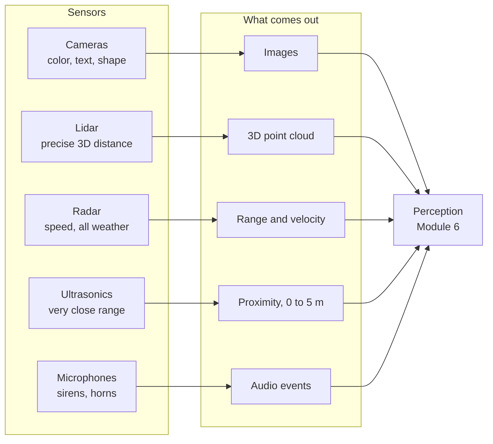
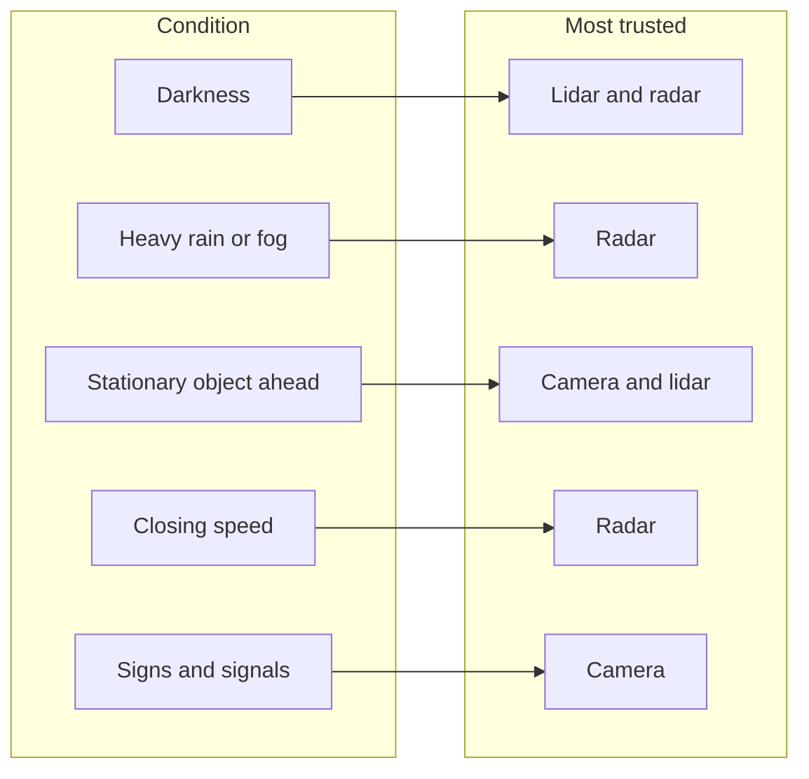

*By Gopi Krishna Tummala*

*Cameras, lidar, radar, ultrasonics and microphones each measure something different and fail in different conditions. Why the point of carrying several is that they fail differently.*

Module 2 of 9 in the [autonomous stack series](/posts/robotics/autonomous-stack-module-1-architecture). Previous: [Module 1: Architecture](/posts/robotics/autonomous-stack-module-1-architecture). Next: [Module 3: Calibration and Time](/posts/robotics/autonomous-stack-module-3-calibration).

---

Back at our unprotected left turn: dusk, light rain, a cyclist approaching behind a waiting van, a pedestrian at the far crosswalk. Before the car can decide anything, it has to measure this scene, and no single sensor can measure all of it.

A camera can see that the far signal is green and that the pedestrian is looking at a phone, but in the dim light it struggles to judge exactly how far away the cyclist is. Lidar can measure the distance to the van to within a few centimeters, but raindrops scatter some of its pulses, and it can't read a traffic light's color. Radar can tell, instantly and through the rain, that something behind the van is coming toward the car at 25 kilometers per hour, but it can't tell whether it's a bicycle or a scooter. Each sensor gets part of the scene right. The system's job is to combine them so the whole scene is right.

## The idea in one picture

*Five kinds of measurement, all feeding perception. They're combined precisely because each one fails in situations where others don't.*

## Cameras: meaning, but not distance

The road was built for eyes. Traffic lights, signs, lane paint, brake lights, turn signals and a pedestrian's gaze are all visual, so cameras carry most of the meaning in a scene. Modern automotive cameras have high resolution and high dynamic range, the ability to see detail in a dark underpass and a bright exit at the same time, and a robotaxi carries a ring of them pointing in every direction.

Their weakness is distance. A single image is flat: a small car far away and a toy car close up can look identical. Depth has to be inferred, from stereo pairs, from motion across frames, or from a network that has learned how big things usually are. That inference is good and getting better, but it's an estimate, and it degrades exactly when the scene is unusual. Cameras also struggle with glare, darkness beyond the headlights, and water or dirt on the lens.

## Lidar: precise 3D, carrying its own light

Lidar fires short laser pulses and times how long they take to come back. Because light travels at a known speed, each echo is a direct distance measurement, typically accurate to a few centimeters. Sweep the beams across the scene many times a second and you get a point cloud: hundreds of thousands to millions of measured 3D points.

Lidar's strengths are geometry and independence from daylight. It measures the exact shape and position of the van and the curb at night as well as at noon. Its weaknesses: it can't see color or read signs, rain, fog and snow scatter its pulses and add noise, very dark or shiny surfaces return weak echoes, and it has historically been expensive, though costs have fallen sharply.

## Radar: speed through bad weather

Radar uses radio waves, which pass through rain, fog and spray far better than light. Its signature ability is measuring speed directly: a target moving toward or away from the radar shifts the frequency of the echo (the Doppler effect), so radar knows the cyclist's closing speed from a single measurement rather than by comparing frames.

Its weakness is resolution. Traditional automotive radar sees the world in coarse blobs and has trouble separating two objects close together or telling what something is. It also produces confusing echoes from metal structures like guardrails, overhead signs and bridges, which historically led to "phantom braking" when a system mistook a bridge for a stopped car. Newer imaging radars (often called 4D radar, because they measure height as well) narrow that gap considerably.

## The supporting cast

- **Ultrasonic sensors**, the familiar parking sensors, measure very short distances, a few meters at most, using sound. They're useful for parking and tight maneuvers.
- **Microphones** hear sirens and horns, often before the source is visible. An ambulance approaching the intersection from behind a building can be heard well before it's seen. Waymo calls its microphone array external audio receivers.

## The two philosophies

The industry has split on how many kinds of sensor to carry.

**Redundancy by physics.** Robotaxi companies carry all of the above. Waymo's [sixth-generation system](https://waymo.com/blog/2024/08/meet-the-6th-generation-waymo-driver/) uses 13 cameras, 4 lidars, 6 radars and an array of external audio receivers. The reasoning: different physics fail in different conditions, so a camera blinded by low sun is backed up by lidar, and lidar degraded by heavy rain is backed up by radar. The cost is hardware, power, calibration effort and a lot of data to process.

**Cameras only.** Tesla [moved away](https://en.wikipedia.org/wiki/Tesla_Autopilot) from radar starting in 2021, and its vehicles built since 2022 carry neither radar nor ultrasonic sensors, relying on cameras and neural networks. The reasoning: people drive with eyes alone, cameras are cheap, and a large fleet can collect enormous amounts of training data. The cost is that distance and speed must be inferred rather than measured, so the system depends on its networks generalizing to situations they haven't seen.

Both are engineering bets about where the remaining errors will come from. Measuring distance directly removes one source of error; seeing everything through one kind of sensor removes the work of keeping several in agreement.

## Combining them: complementary failures

The principle behind using several sensors is that their failures don't overlap much:

| Condition | Camera | Lidar | Radar |
|---|---|---|---|
| Darkness | Weaker beyond headlights | Unaffected | Unaffected |
| Heavy rain or fog | Blurred, reduced range | Noisy, reduced range | Largely unaffected |
| Reading signs and signals | Yes | No | No |
| Measuring speed | Inferred over frames | Inferred over scans | Directly, per measurement |
| Precise shape and position | Inferred | Yes | Coarse |

The same idea as a picture, for the conditions that matter most:

*No sensor wins everywhere, which is the whole argument for carrying several.*

For the left turn at dusk in the rain, that means: trust the camera for the signal and the pedestrian's body language, lidar for the exact geometry of the van and the curb, and radar for how fast the half-hidden cyclist is closing. How those streams are combined into one picture is [Module 6](/posts/robotics/autonomous-stack-module-6-perception). Before that, they have to agree on where each sensor is and when it measured, which is [Module 3](/posts/robotics/autonomous-stack-module-3-calibration).

Two more properties matter for every sensor: **latency**, the delay from the photon or echo to usable data, which spends the budget from Module 1; and **coverage**, since every sensor has blind spots that the layout of the whole suite has to fill.

## What I'd remember

- **Cameras give meaning, lidar gives geometry, radar gives speed.** Each is weak where another is strong.
- **Weather and light are the stress tests.** Rain, fog, glare and darkness each defeat a different sensor.
- **Radar measures speed directly.** That's why it matters for fast, partly hidden objects like our cyclist.
- **Two bets.** Robotaxis carry several kinds of sensor for redundancy; camera-only systems trade measurement for scale.
- **Sensors are only useful together.** Combining them requires calibration and timing, the next module.

## Where to go next

- [Module 3: Calibration and Time](/posts/robotics/autonomous-stack-module-3-calibration), the next module.
- [Module 6: Perception](/posts/robotics/autonomous-stack-module-6-perception), for how the streams are fused.
- Waymo's [sixth-generation Driver](https://waymo.com/blog/2024/08/meet-the-6th-generation-waymo-driver/) announcement.

Previous: [Module 1: Architecture](/posts/robotics/autonomous-stack-module-1-architecture). Next: [Module 3: Calibration and Time](/posts/robotics/autonomous-stack-module-3-calibration).

**Questions to sit with**

1. Which sensor would you trust for the cyclist's speed in the rain, and which for its identity?
2. Why might radar mistake an overhead sign for a stopped car, and how would another sensor catch it?
3. What would have to be true for a camera-only system to be as safe as one with lidar and radar?
