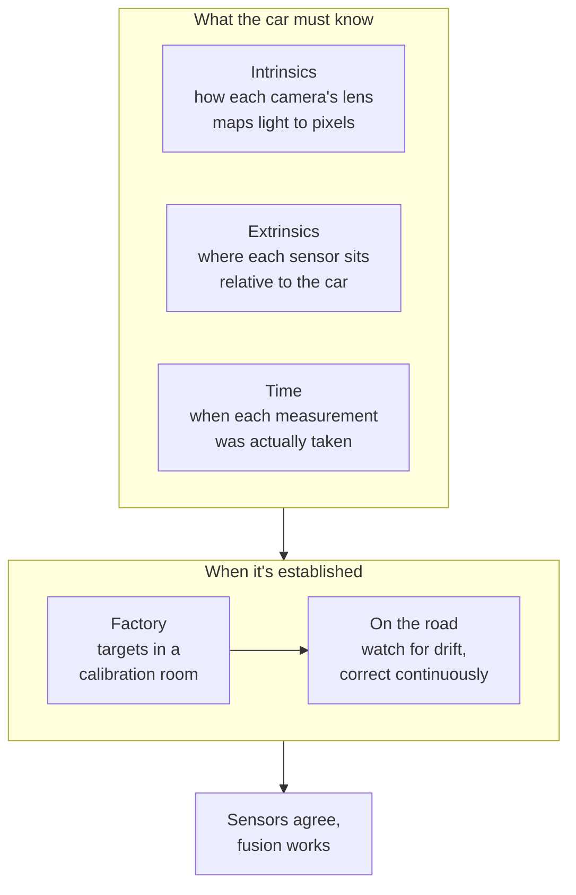
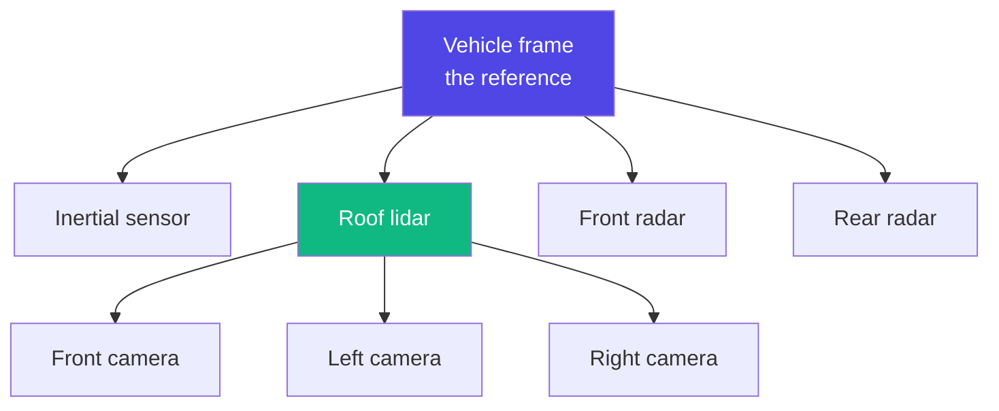
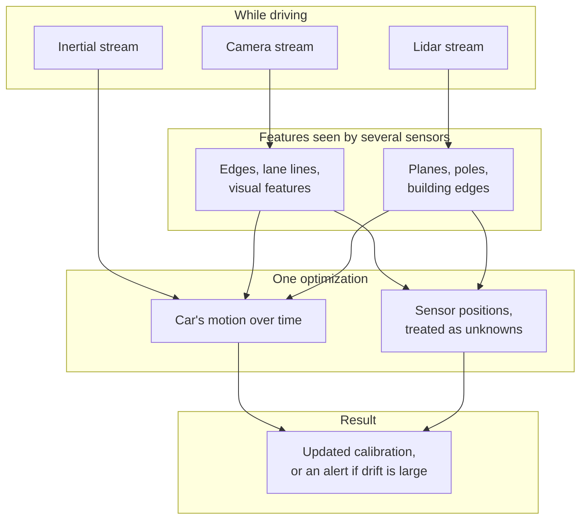

*By Gopi Krishna Tummala*

*Before sensors can be combined, the car must know exactly where each one is, how each lens bends light, and when each measurement was taken. Why tiny errors become big ones at distance, and how cars keep calibration correct while driving.*

Module 3 of 9 in the [autonomous stack series](/posts/robotics/autonomous-stack-module-1-architecture). Previous: [Module 2: Sensors](/posts/robotics/autonomous-stack-module-2-sensors). Next: [Module 4: Localization](/posts/robotics/autonomous-stack-module-4-localization).

---

At our left turn, the camera sees the pedestrian at the far crosswalk and the lidar measures a column of points at the same spot. To combine them, the car projects the lidar points into the camera image and checks that they land on the person. That only works if the car knows, very precisely, where the lidar sits relative to the camera, how the camera's lens distorts the image, and whether the two measurements were taken at the same instant.

Suppose the camera has been knocked half a degree out of position by months of potholes. At 20 meters, half a degree shifts the projected lidar points by about 17 centimeters, roughly the width of a person's torso. The camera says "person here," the lidar says "something there," and a fusion system that requires them to agree may decide one of them is noise. Calibration is invisible when it's right and dangerous when it's slightly wrong.

## The idea in one picture

*Three kinds of knowledge, set precisely once at the factory and then maintained for the life of the car.*

## Why small errors grow

The key intuition is that angle errors scale with distance. A misalignment of a fraction of a degree barely matters for an object a meter away and matters a lot for one fifty meters away. Roughly:

$$\text{position error} \approx \text{distance} \times \text{angle error (in radians)}$$

Half a degree is about 0.0087 radians, so at 20 meters the error is about 17 centimeters, and at 60 meters it's half a meter, enough to put a pedestrian on the wrong side of a lane line. Translation errors, a sensor that's a few millimeters off, don't grow with distance, which is why angle is usually the thing calibration fights hardest to get right.

## What gets calibrated

**Intrinsics: how each camera sees.** Every camera has a focal length, an optical center, and a lens that bends straight lines slightly, especially near the edges of wide-angle lenses. Intrinsic calibration measures all of that, usually by photographing a known pattern like a checkerboard from many angles. Once known, the distortion can be undone, so a straight lane line looks straight to the software.

**Extrinsics: where each sensor sits.** For every sensor, the car needs its exact position and orientation, six numbers: three for position, three for rotation. With a dozen cameras, several lidars and radars, and an inertial sensor, that's a lot of numbers that all have to be consistent with each other.

**Time: when each measurement happened.** Covered below, because it's easy to forget and just as important.

## Calibration at the factory

New vehicles are calibrated in dedicated calibration rooms: walls and fixtures covered in precisely placed targets like checkerboards and coded markers, controlled lighting, and a fixed position for the car, sometimes on a turntable. Every sensor observes known targets, and an optimization finds the intrinsics and extrinsics that best explain all the observations together.

Calibrating everything at once is hard, so it's done in a deliberate order called a calibration tree. Start from a reference frame, usually the vehicle body or its inertial sensor, calibrate one well-measured sensor against it (often a roof lidar), then calibrate the others relative to that one.

*Each sensor is calibrated against one already-calibrated parent, so errors don't go around in circles. Tools like Autoware's calibration suite, and the ROS transform tree, use the same structure.*

A tree avoids a subtle problem: if camera A is calibrated against the lidar, the lidar against camera B, and camera B against camera A, small errors can circulate with nothing anchoring them. A tree gives every sensor exactly one path back to the reference.

## Keeping it right on the road

Factory calibration is precise, but cars don't stay factory-fresh. Heat expands brackets, vibration loosens mounts, a sensor gets replaced after a minor collision. So production systems also monitor calibration continuously while driving.

The idea is that the world itself becomes the calibration target. Lane lines, poles, building edges and curbs are seen by several sensors at once. If the calibration is right, those features line up across sensors after accounting for the car's motion. If they start disagreeing consistently, something has moved.

*The same optimization that tracks the car's motion (Module 4) can also re-estimate where the sensors are, using the natural scene instead of targets.*

The method treats each sensor's position as one more unknown in the same optimization used for localization: find the car's path and the sensor positions that together best explain everything all sensors saw. Small drift gets corrected quietly; large drift, a sensor knocked badly out of place, is better treated as a fault, with the car pulling over or limiting its speed until it's fixed.

Online methods are rarely as accurate as a calibration room, so the two work together: the factory sets precise starting values, and on-road monitoring keeps them honest.

## Time: the forgotten dimension

At 50 kilometers per hour, the car moves about 14 centimeters every hundredth of a second. If the camera image and the lidar sweep are combined as though they happened at the same moment when they're actually 50 milliseconds apart, everything moving, including the car itself, is misplaced by tens of centimeters.

Three things fix this:

- **A shared clock.** All sensors synchronize to one time source, typically with the Precision Time Protocol (IEEE 1588), accurate to around a microsecond on a vehicle network.
- **Timestamps at capture.** Each measurement is stamped when it's taken, not when it arrives at the computer, since processing delays vary.
- **Motion compensation.** A spinning lidar takes about a tenth of a second for one sweep, during which the car moves. Each point is corrected for where the car was when that point was measured. Rolling-shutter cameras, which expose the image line by line, need a similar correction.

## Measuring calibration health

- **Reprojection error:** project lidar points or known features into each camera and measure how far, in pixels, they land from where the camera saw them. A rising trend is the earliest warning of drift.
- **Loop consistency:** going from sensor A to B to C and back to A should return exactly to the start. A gap means one of the links is wrong.
- **Agreement over time:** the same features should line up across sensors on every drive, not just in the calibration room.

My own PhD work, [AutoCalib](/posts/robotics/autocalib-automatic-camera-calibration), tackled a related problem: calibrating thousands of fixed traffic cameras automatically from the cars passing through them, using the vehicles themselves as the calibration targets.

## What I'd remember

- **Calibration is three things.** How each lens sees, where each sensor sits, and when each measurement happened.
- **Angle errors grow with distance.** Half a degree is 17 centimeters at 20 meters.
- **Calibrate in a tree.** One reference, one path for every sensor, no loops.
- **The world is the target on the road.** Online monitoring corrects drift and flags faults.
- **Time matters as much as position.** Shared clocks, capture timestamps and motion compensation.

## Where to go next

- [Module 4: Localization](/posts/robotics/autonomous-stack-module-4-localization), the next module, which uses the same kind of optimization.
- [Module 6: Perception](/posts/robotics/autonomous-stack-module-6-perception), where calibrated sensors are fused.
- [AutoCalib](/posts/robotics/autocalib-automatic-camera-calibration), automatic calibration of traffic cameras at scale.

Previous: [Module 2: Sensors](/posts/robotics/autonomous-stack-module-2-sensors). Next: [Module 4: Localization](/posts/robotics/autonomous-stack-module-4-localization).

**Questions to sit with**

1. Why does a rotation error matter more than a translation error for objects far away?
2. If camera and lidar disagree about the pedestrian, how would you tell a calibration problem from a perception problem?
3. What should the car do if it detects a large calibration change mid-trip?
