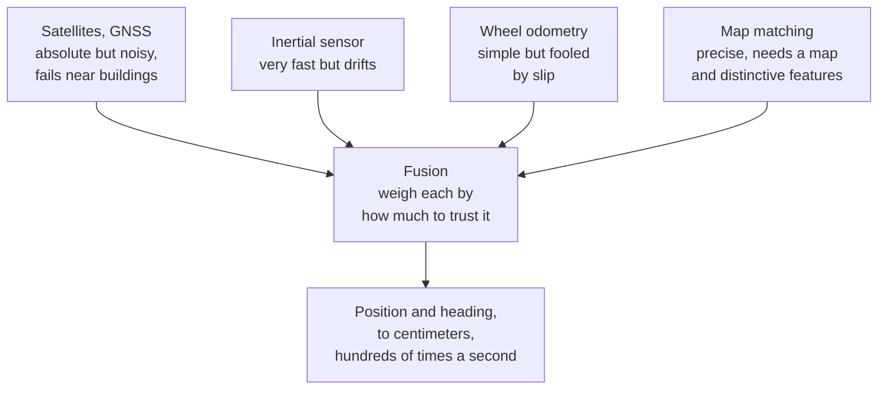
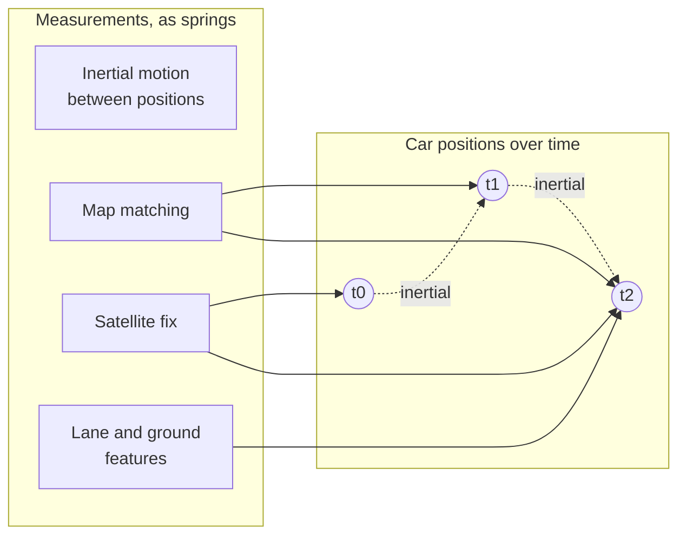

*By Gopi Krishna Tummala*

*GPS alone puts a car somewhere within a few meters, the width of a lane. How self-driving cars get to centimeters by combining several imperfect sources, and what happens when one of them fails.*

Module 4 of 9 in the [autonomous stack series](/posts/robotics/autonomous-stack-module-1-architecture). Previous: [Module 3: Calibration and Time](/posts/robotics/autonomous-stack-module-3-calibration). Next: [Module 5: Mapping](/posts/robotics/autonomous-stack-module-5-mapping).

---

To make our left turn, the car has to know exactly where it is: which lane it's in, how far it is from the stop line, where its front bumper is relative to the crosswalk it's about to cross. Being off by a meter could mean stopping in the crosswalk or turning into the wrong lane of the far street.

A phone's GPS is typically accurate to within about 4.9 meters under open sky, according to [gps.gov](https://www.gps.gov/gps-accuracy), and worse near tall buildings. A US highway lane is about 3.7 meters wide. GPS alone can't even say which lane the car is in. Localization is the work of getting from meters to centimeters, reliably, everywhere the car is allowed to drive.

## The idea in one picture

*No single source is good enough. Combined, their errors cancel: fast sources fill gaps between precise ones, absolute sources stop drift.*

## Four imperfect witnesses

**Satellites (GNSS).** GPS and its counterparts give an absolute position anywhere on Earth, with errors that don't grow over time. But signals bounce off buildings (multipath) and disappear in tunnels and parking garages, so the reported position can jump by meters. Correction services like RTK (real-time kinematic) can bring satellite positioning to centimeters under good conditions, but not in the urban canyons where precision matters most.

**The inertial sensor (IMU).** Accelerometers and gyroscopes measure how the car is accelerating and rotating, hundreds of times a second, with no outside help. They're excellent over short intervals and smooth out everything else. But position comes from integrating acceleration twice, so small errors pile up: over tens of seconds of dead reckoning alone, a typical automotive IMU drifts meters off.

**Wheel odometry.** Counting wheel rotations gives distance traveled. Simple and useful, until the tires slip on a wet road or the car hits a pothole.

**Map matching.** The most precise source. The car compares what its lidar or cameras see right now with a stored map of the area (Module 5) and finds the position where they line up. Think of sliding a puzzle piece over the picture on the box until it clicks into place. When it works, it gives position to a few centimeters. When the surroundings are featureless or have changed, it struggles.

## Fusing them: from filters to factor graphs

The classic way to combine these sources is the **Kalman filter**, an idea from the 1960s Apollo program. It runs a loop: predict where the car should be now from its motion (the IMU), then correct that prediction when a measurement arrives (GNSS or map matching), weighting each according to how much it's trusted. The prediction is fast and smooth; the correction stops drift.

A filter only keeps its current best guess. If a measurement turns out to have been wrong, it can't go back and revise the past. Modern systems increasingly use **factor graphs** instead. Picture the car's recent positions as beads on a string, and every measurement as a spring pulling on one or more beads: the IMU pulls consecutive beads toward the motion it measured, GNSS pulls a bead toward a satellite fix, map matching pulls a bead toward where the scene matched. The solver finds the arrangement where the springs are least stretched.

*Each measurement constrains one or more positions. Keeping a window of recent positions lets the solver revise the past when new evidence arrives.*

Because the graph keeps a window of recent positions, a late or contradictory measurement can correct several of them at once. It also makes it natural to reject bad data: a satellite fix that would require the springs to stretch implausibly far is treated as an outlier and ignored. That's how a well-built system survives a GPS signal reflected off a glass tower, or even a deliberately spoofed one.

A related refinement is **tight coupling**: rather than combining finished position estimates, feed raw lidar points and raw IMU readings into the same optimization. The IMU's fast motion estimates can then correct the distortion in a lidar sweep taken while the car was turning. Open-source systems like [LIO-SAM](https://arxiv.org/abs/2007.00258) and [FAST-LIO2](https://arxiv.org/abs/2107.06829) made this approach standard in robotics.

## When one witness goes quiet

Localization is defined by its failure cases:

- **Tunnels and parking garages.** No satellites. The system leans on the IMU, wheels and lidar, and its uncertainty grows until it can match against the map again.
- **Featureless places.** In a long straight tunnel or on an open highway past fields, lidar scans look the same a few meters apart, so map matching can't tell where along the road the car is. Algorithms like [GenZ-ICP](https://arxiv.org/abs/2411.06766) detect these "degenerate" directions and lower the weight of the lidar along them, trusting the IMU and wheels instead for that direction only.
- **Snow and construction.** Painted lines and road edges vanish or move. Tall, stable structures, poles, signs, building facades, stay visible above the snow and carry the matching.
- **Wet roads.** Wheel odometry becomes unreliable when tires slip.

For our left turn, the intersection has buildings and signs, so map matching is strong, and the car knows its position to a few centimeters. The rain degrades the lidar a little and wheel odometry a little more, and the fusion simply trusts them a bit less.

## Measuring localization

- **Absolute trajectory error:** how far the estimated path is from a reference path, usually measured with expensive survey-grade equipment.
- **Relative error over distance:** how much error builds up over each stretch of road, which matters for smooth driving even when absolute accuracy is good.
- **Lateral error specifically:** being 20 centimeters off sideways matters much more than 20 centimeters along the road.
- **Uncertainty honesty:** when the system says it's confident to 10 centimeters, is it really? An overconfident estimate is more dangerous than an uncertain one, because the planner can be cautious only if it knows to be.

## What I'd remember

- **GPS is one witness, not the answer.** About 5 meters under open sky; worse in cities.
- **Combine sources that fail differently.** Fast-but-drifting with slow-but-absolute.
- **Map matching gives the centimeters.** When the scene is distinctive and the map is current.
- **Factor graphs can revise the past.** And they make rejecting bad data natural.
- **Design for the failure cases.** Tunnels, featureless roads, snow and slippery surfaces.

## Where to go next

- [Module 5: Mapping](/posts/robotics/autonomous-stack-module-5-mapping), the next module: where the maps for matching come from.
- [Module 3: Calibration and Time](/posts/robotics/autonomous-stack-module-3-calibration), which uses the same optimization.
- Papers: [LIO-SAM](https://arxiv.org/abs/2007.00258), [FAST-LIO2](https://arxiv.org/abs/2107.06829).

Previous: [Module 3: Calibration and Time](/posts/robotics/autonomous-stack-module-3-calibration). Next: [Module 5: Mapping](/posts/robotics/autonomous-stack-module-5-mapping).

**Questions to sit with**

1. Why can't a car simply use RTK satellite positioning everywhere?
2. What should the car do as its localization uncertainty grows inside a long tunnel?
3. How would you detect that a GPS signal is being spoofed?
