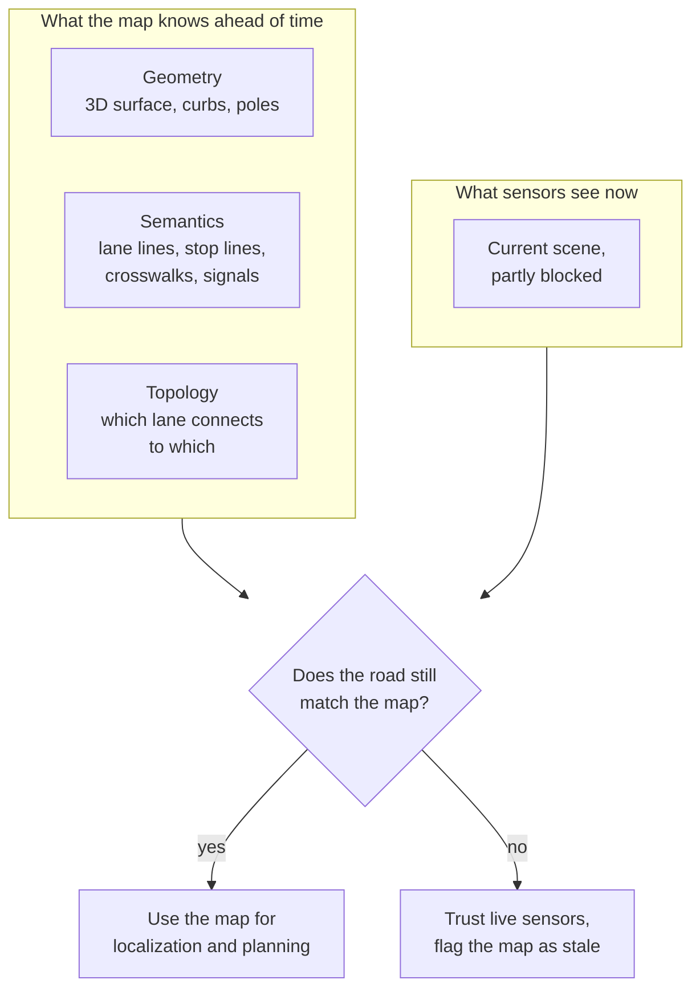
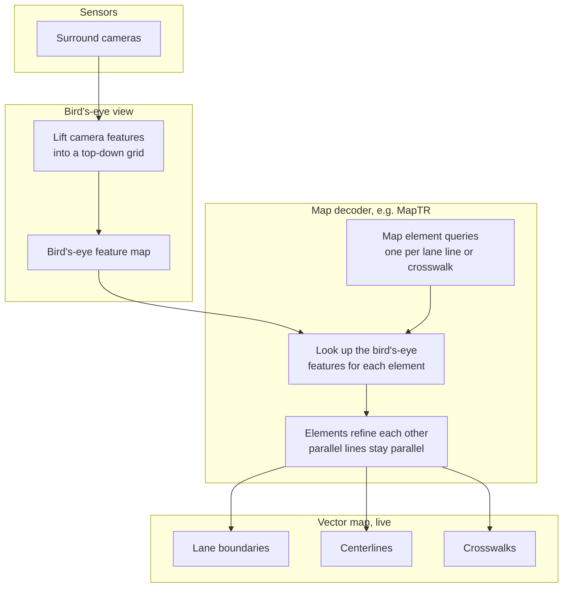

*By Gopi Krishna Tummala*

*An HD map tells a self-driving car what the road looks like before its sensors can see it. What these maps contain, how they're built, why keeping them fresh is the hard part, and why cars increasingly draw the map themselves.*

Module 5 of 9 in the [autonomous stack series](/posts/robotics/autonomous-stack-module-1-architecture). Previous: [Module 4: Localization](/posts/robotics/autonomous-stack-module-4-localization). Next: [Module 6: Perception](/posts/robotics/autonomous-stack-module-6-perception).

---

As our car waits to turn left, a van in the opposite turn lane blocks its view of half the intersection. In the rain, the lane lines on the far street are hard to see. Yet the car needs to know which lane it's turning into, where that lane's stop line and crosswalk are, and that the lane it wants is a through lane, not a turn-only one.

A human who drives here daily knows all that from memory. An HD map gives the car the same memory: the road's layout, stored ahead of time to centimeter precision, available even where sensors are blocked or the paint has worn away. Maps turn "figure out the road from scratch every time" into "check that the road still looks the way we remember."

## The idea in one picture

*A map is a strong prior, not the truth. The car continually checks it against what it sees.*

## What an HD map contains

A navigation map says "turn left onto Main Street in 300 meters." An HD map says where every lane is, to within about ten centimeters. It usually has three layers:

- **Geometry:** the 3D shape of the road surface, curbs, poles and buildings, often as a point cloud or mesh. This is what localization matches against (Module 4).
- **Semantics:** lane boundaries, stop lines, crosswalks, traffic signal positions and which lanes they control, speed limits, signs.
- **Topology:** the lane graph, a network of which lane leads into which, where turns are allowed, where lanes merge and split.

The lane graph is the part planners lean on most. For the left turn, it tells the car that its lane connects to the two leftmost lanes of the far street, that the oncoming lanes have right of way, and where the crosswalk sits in its path. Lanes are usually stored as smooth curves through a few control points, which is compact and gives the planner a clean path to follow.

## How maps are built

Traditionally, a fleet of specially equipped cars drives every street, collecting lidar, camera and positioning data. Offline, the data from many passes is stitched into one consistent 3D model, a problem called SLAM (simultaneous localization and mapping). The key step is **loop closure**: when the car returns to a place it's been before and recognizes it, the accumulated drift along the way is revealed and spread back across the whole route, snapping the map together. Then lanes, signs and other semantic features are labeled, historically with a lot of human annotation and review.

The result is very accurate and very expensive. Every city needs mapping before service, and every change to the road needs remapping.

## The real problem: the world changes

Roads get repainted, lanes get added, construction moves the curb, a new signal goes up. A map that was perfect last month may be wrong today, and a car that trusts a wrong map can be confidently wrong.

So cars check. While driving, they compare what the sensors see with what the map says, and when the difference is larger than normal noise, for example lane lines a meter from where the map has them, the car treats the map as stale for that area: it falls back on live perception, drives more cautiously, and reports the change so the map can be updated for the whole fleet. The general rule: **live observations override the map for safety**. If the map says 45 miles per hour and a temporary sign says 25, the sign wins.

Map freshness is as much an operations problem as a technical one: how fast changes are detected, verified and pushed to every car.

## Drawing the map while driving

The newer approach asks the car to build much of the map itself, live, from its own sensors. **Online vectorized mapping** networks look at the surrounding cameras and output the map elements directly: lane boundaries, lane centerlines and crosswalks as clean lines, not pixels.

*The network outputs the map as a set of lines, the same form an HD map stores, but built fresh every frame from the cameras.*

The approach took off with [HDMapNet](https://arxiv.org/abs/2107.06307) and [MapTR](https://arxiv.org/abs/2208.14437), which treat each map element as a query that a transformer refines into a precise line. [StreamMapNet](https://arxiv.org/abs/2308.12570) added memory across frames so the map stays stable as the car moves.

Online maps handle construction zones and new roads naturally, and they don't need a mapping fleet. Their weaknesses are the mirror image of HD maps: they only see as far as the sensors do, they can't see around the van, and they can hallucinate or miss lines in rain or where paint is worn. They also produce lane geometry more easily than the full lane graph, which lane leads where through a complex intersection.

## Map-heavy, map-light, and in between

The industry spans a range:

- **Map-heavy:** robotaxi operators like Waymo use detailed HD maps within their service areas, which makes the hardest decisions easier and supports precise localization, at the cost of mapping and maintaining every area.
- **Crowdsourced:** Mobileye's REM approach builds lighter maps from the cameras of ordinary production cars, updated continuously at large scale.
- **Map-light:** Tesla and other camera-first systems rely mainly on what the car perceives live, with only standard navigation maps, which scales everywhere but puts the full burden on perception.

Most of the field is converging on a hybrid: a lighter, easier-to-maintain prior map, combined with online mapping that confirms it and fills in what has changed.

## What I'd remember

- **A map is memory.** It covers what sensors can't see right now.
- **Three layers.** Geometry for localization, semantics for rules, topology for routes.
- **Freshness is the hard part.** Detect change, trust live sensors, update the fleet.
- **Cars can draw the map themselves.** Online vectorized mapping handles change but sees only as far as the sensors.
- **The future is hybrid.** Lighter prior maps checked and filled in live.

## Where to go next

- [Module 6: Perception](/posts/robotics/autonomous-stack-module-6-perception), the next module, which shares the bird's-eye-view machinery.
- [Module 4: Localization](/posts/robotics/autonomous-stack-module-4-localization), which matches against the map's geometry.
- Papers: [HDMapNet](https://arxiv.org/abs/2107.06307), [MapTR](https://arxiv.org/abs/2208.14437), [StreamMapNet](https://arxiv.org/abs/2308.12570).

Previous: [Module 4: Localization](/posts/robotics/autonomous-stack-module-4-localization). Next: [Module 6: Perception](/posts/robotics/autonomous-stack-module-6-perception).

**Questions to sit with**

1. At the left turn, which parts of the scene does the car need the map for, and which can it get from sensors?
2. How large a difference between map and observation should make the car distrust the map?
3. What does an online map struggle to get right at a complex intersection, even with clear weather?
