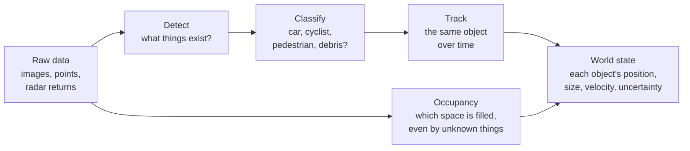
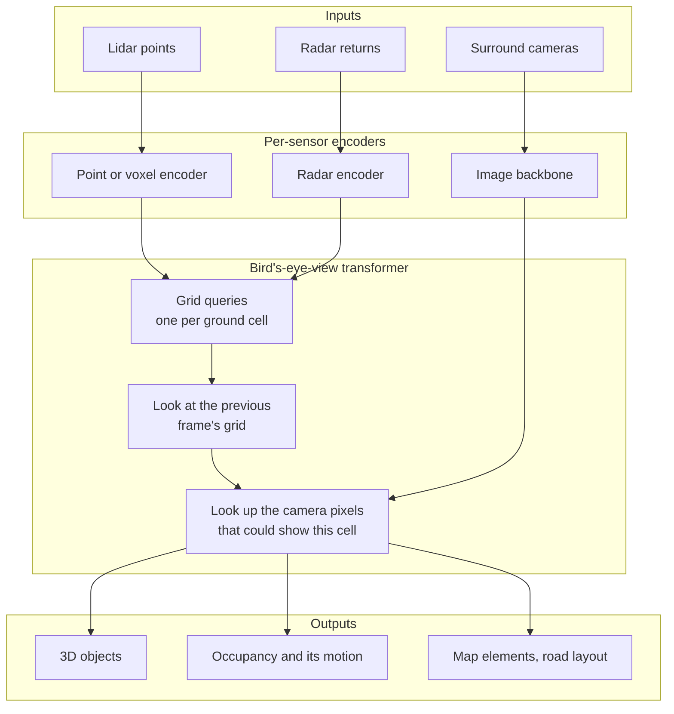

*By Gopi Krishna Tummala*

*Perception turns millions of raw measurements per second into a picture of what's around the car, where it is and how it's moving. How fusion, bird's-eye views and occupancy came to define modern perception.*

Module 6 of 9 in the [autonomous stack series](/posts/robotics/autonomous-stack-module-1-architecture). Previous: [Module 5: Mapping](/posts/robotics/autonomous-stack-module-5-mapping). Next: [Module 7: Prediction](/posts/robotics/autonomous-stack-module-7-prediction).

---

At the left turn, the car's sensors deliver a flood of data every second: images from a ring of cameras, hundreds of thousands of lidar points, radar returns with velocities. None of that, as it stands, says "there's a cyclist behind the van, moving toward us at 25 kilometers per hour." Perception's job is to turn the flood into that sentence, for every relevant thing in the scene, many times a second, with honest uncertainty.

The pedestrian and the van are the easy part. The cyclist, partly hidden, dark-clothed, in the rain, is the hard part, and it's exactly the kind of object perception must not miss.

## The idea in one picture

*Perception outputs a world state: a list of tracked objects plus a map of occupied space for anything that doesn't fit a category.*

## Three questions, every frame

Perception answers, for everything around the car: **what's there** (detection), **what kind of thing is it** (classification), and **where is it going** (tracking and velocity). Tracking deserves more credit than it gets. A cyclist glimpsed in one frame, lost behind the van, and seen again is one cyclist, and recognizing that gives the car its speed and heading, the history that prediction (Module 7) depends on.

## Fusion: from combining answers to combining evidence

Module 2 showed that cameras, lidar and radar fail differently. The question is when to combine them.

- **Late fusion** lets each sensor's pipeline detect objects on its own, then merges the lists. It's modular and easy to debug, but each sensor throws away its doubts before merging. If the camera is 40 percent sure there's a cyclist behind the van and radar is 40 percent sure something is moving there, neither may report it, even though together the evidence is strong.
- **Early or feature-level fusion** combines the sensors' internal features before any decision, so weak evidence from several sensors can add up. Most modern systems work this way. [BEVFusion](https://arxiv.org/abs/2205.13542) is a well-known example, fusing camera and lidar features in a shared top-down grid.

That cyclist is the case for fusing early: partly hidden, low contrast, but moving in a way radar can see.

## The bird's-eye view became the workspace

Cameras see in perspective, lidar in 3D, radar in range and angle. To fuse them, and to hand the result to planning, systems now convert everything into one shared **bird's-eye view (BEV)**: a top-down grid around the car where each cell describes what's at that spot on the ground. Planning happens on the ground plane anyway, so it's the natural common language.

The hard part is getting camera images into that view, because cameras don't measure depth. [Lift-Splat-Shoot](https://arxiv.org/abs/2008.05711) predicted a spread of possible depths for each pixel and "splatted" features onto the grid. [BEVFormer](https://arxiv.org/abs/2203.17270) flipped the direction: each cell of the grid asks, through attention, which pixels in which cameras might show it, and also looks at the grid from previous frames for temporal context.

*Every sensor ends up in one top-down grid, which several output heads share: objects, occupancy and the road layout from Module 5.*

## Beyond boxes: occupancy

Classic detectors draw 3D boxes around known categories: car, truck, pedestrian, cyclist. But the road also has mattresses, fallen branches, open car doors, a pile of construction debris, things with no tidy box or no category at all. A detector that doesn't know "mattress" may not report it.

**Occupancy** asks a simpler question: for each small cube of space around the car, is it filled, and if so, which way is it moving? It doesn't need to know what something is to know the car shouldn't drive through it. Tesla popularized occupancy networks in production at its 2022 AI Day, and benchmarks like [Occ3D](https://arxiv.org/abs/2304.14365) made it a standard research task. Most stacks now use both: boxes for the agents whose behavior must be predicted, occupancy as a safety net for everything else.

## Borrowing from foundation models

Two kinds of general-purpose model have changed perception:

- **Depth.** Models like [Depth Anything V2](https://arxiv.org/abs/2406.09414), trained on huge and varied image collections, estimate relative depth from a single image remarkably well. Combined with sparse lidar points to set the scale, they help cameras fill in geometry.
- **Open vocabulary.** Vision-language models like CLIP connect images to free text, so a perception system can recognize things outside its fixed category list, "inflatable costume," "overturned shopping cart," and flag them. That doesn't replace occupancy, but it adds meaning to unknown objects.

## Where perception fails

The failures are worth knowing by name:

- **Occlusion:** the cyclist behind the van. Fusion, tracking memory and caution in planning all help; none fully solves it.
- **Weather and light:** rain on lenses, low sun, the shift from a dark tunnel into daylight.
- **Look-alikes:** a stop sign printed on a billboard, a person on a poster, a reflection in a shop window.
- **Ghosts:** radar echoes off metal fences and overhead structures.
- **The unknown:** objects no one labeled in training. Occupancy and open-vocabulary recognition exist mainly for this.

## Measuring perception

- **Detection quality**, such as mean average precision, and the [nuScenes](https://www.nuscenes.org/) detection score, which also penalizes errors in position, size, heading and velocity.
- **Tracking quality:** how often the same object keeps the same identity, and how often tracks are lost or swapped.
- **Occupancy accuracy:** overlap between predicted and true occupied space.
- **What actually matters:** missing a nearby pedestrian is far worse than misjudging a parked car's size 80 meters away. Good evaluation weights errors by how much they could affect driving, not equally.

## What I'd remember

- **Perception produces a world state.** Objects with positions, velocities and uncertainty, plus occupied space.
- **Fuse evidence, not answers.** Weak signals from several sensors add up only if combined early.
- **The bird's-eye view is the shared language.** Cameras are lifted into it; planning works in it.
- **Occupancy catches what boxes miss.** Unknown objects don't need a name to be avoided.
- **Evaluate by consequence.** Not all errors are equally dangerous.

## Where to go next

- [Module 7: Prediction](/posts/robotics/autonomous-stack-module-7-prediction), the next module: what the tracked objects will do next.
- [Module 2: Sensors](/posts/robotics/autonomous-stack-module-2-sensors), for why fusion is necessary.
- Papers: [BEVFormer](https://arxiv.org/abs/2203.17270), [BEVFusion](https://arxiv.org/abs/2205.13542), [Lift-Splat-Shoot](https://arxiv.org/abs/2008.05711).

Previous: [Module 5: Mapping](/posts/robotics/autonomous-stack-module-5-mapping). Next: [Module 7: Prediction](/posts/robotics/autonomous-stack-module-7-prediction).

**Questions to sit with**

1. How would late fusion and early fusion each handle the half-hidden cyclist?
2. Why does a bird's-eye view suit planning better than the camera's perspective view?
3. What would you add to your evaluation so that missing the nearby pedestrian counts more than misjudging a distant parked car?
