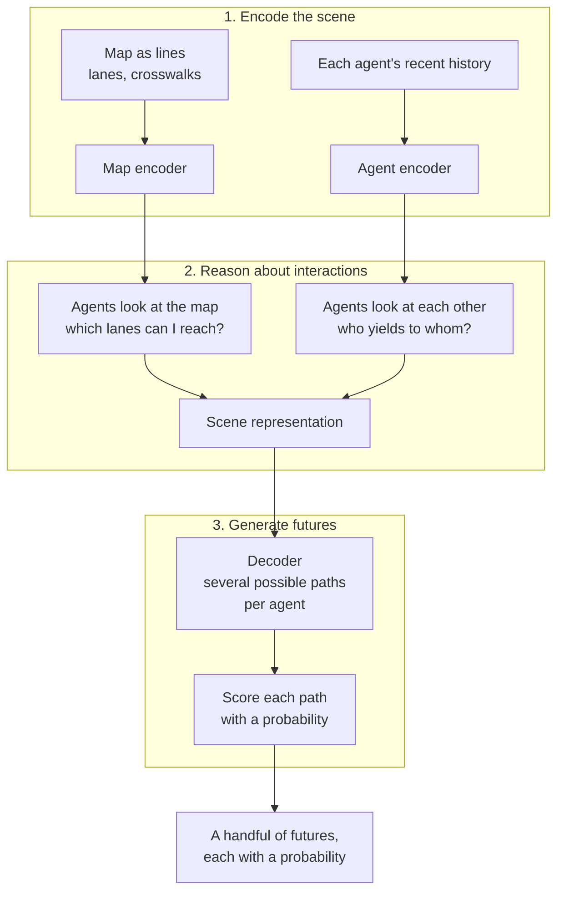
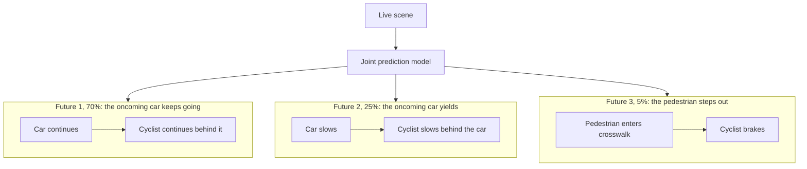

*By Gopi Krishna Tummala*

*A self-driving car has to guess what everyone nearby will do in the next several seconds, knowing there's usually more than one plausible answer. How prediction grew from physics to models that read the map and reason about interactions.*

Module 7 of 9 in the [autonomous stack series](/posts/robotics/autonomous-stack-module-1-architecture). Previous: [Module 6: Perception](/posts/robotics/autonomous-stack-module-6-perception). Next: [Module 8: Planning](/posts/robotics/autonomous-stack-module-8-planning).

---

Perception has told our car what's at the intersection right now: an oncoming car approaching at 40 kilometers per hour, a cyclist behind the waiting van, a pedestrian at the far crosswalk looking at a phone. To decide whether to turn, the car needs to know what each of them will do over the next few seconds.

The oncoming car might keep going or slow down to let the robotaxi turn. The cyclist might continue straight, or slow because they've seen the robotaxi creeping forward. The pedestrian might stay put or step off the curb the moment the phone goes into a pocket. None of these has one right answer. Prediction is the module that turns "where things are" into "where they might be, and how likely each possibility is."

## The idea in one picture

*Read the map, reason about who affects whom, and output several possible futures with probabilities rather than one guess.*

## From physics to intent

The first prediction systems assumed things keep doing what they're doing: constant velocity, maybe constant turning rate, smoothed with a Kalman filter. That works for a car cruising down a straight road and fails exactly where it matters. A pedestrian standing still at the curb has zero velocity, so physics predicts they'll stay there forever. A driver slowing before an intersection might be stopping or turning. Physics sees motion, not **intent**, and intent comes from context: the map, traffic signals, other road users, body language.

## Learning from the map

Learned predictors took over by giving models that context. Early ones drew the scene as a top-down image, lanes, crosswalks and every agent's recent path painted in colors, and used image networks to predict paths. Waymo's [ChauffeurNet](https://arxiv.org/abs/1812.03079) and [MultiPath](https://arxiv.org/abs/1910.05449) worked this way.

Images waste effort on empty pixels and lose precise geometry. [VectorNet](https://arxiv.org/abs/2005.04259) (2020) instead represented lanes, crosswalks and agent histories as sets of line segments, and let a graph network relate them directly. Nearly every modern predictor works with this kind of vectorized scene. Transformer-based models like [Wayformer](https://arxiv.org/abs/2207.05844) and [MTR](https://arxiv.org/abs/2209.13508) then made the interactions explicit with attention: each agent attends to the map to see which lanes it could reach, and to other agents to see who might affect it. Query-centric designs like QCNet describe each element relative to its own position, so the same model generalizes across intersections and cities.

## Several futures, not one

The defining feature of prediction is that the answer is a distribution. At our intersection, the oncoming driver either yields or doesn't. A model trained with a simple average-error loss, asked to predict one path, learns the average of the two: a car half-yielding, which nobody will actually do and which is useless for planning.

So predictors output several distinct futures, typically six or so per agent, each with a probability: "keeps going at speed, 70 percent; slows to let you turn, 25 percent; stops abruptly, 5 percent." Approaches differ in how they produce them, from fixed sets of anchor paths (MultiPath) to mixtures of probability distributions to generative models. Diffusion-based predictors like [MotionDiffuser](https://arxiv.org/abs/2306.03083) generate futures the way image models generate pictures, which handles many possible outcomes naturally, the same idea covered in [Diffusion for Action](/posts/generative-ai/diffusion-for-action-trajectories-policy).

## Predicting agents together

Predicting each agent separately creates a quieter problem. Suppose the model predicts the oncoming car "keeps going" with high probability and, separately, the cyclist "continues straight." Each is plausible alone. But what if the model also predicts "the car swerves right" for the car and "continues straight" for the cyclist, two futures that would put them in the same spot at the same time? Independent predictions can combine into futures that couldn't happen together.

**Joint prediction** predicts the whole scene as one consistent future. [Scene Transformer](https://arxiv.org/abs/2106.08417) and Waymo's [MotionLM](https://arxiv.org/abs/2309.16534) model all agents together. MotionLM treats motion like language: every agent's next step is a token, and the model generates the scene step by step, each agent's move conditioned on what everyone did a moment before. The output is a set of coherent "future movies":

*Each future is consistent across agents. The planner can reason per future: if the car yields, there's a gap; if the pedestrian steps out, the far crosswalk is blocked.*

## The loop with planning

Prediction has a deeper dependency. Whether the oncoming driver yields depends partly on what our car does: creep forward confidently and they may slow; hesitate and they'll continue. A predictor that ignores the robotaxi's own plan is predicting a world in which the robotaxi does nothing. Modern systems increasingly condition predictions on candidate plans ("if I go now, what will they do?") or train prediction and planning together. [The Role of Predictions in Closed-Loop Driving](/posts/robotics/behavior-prediction-closed-loop-driving) explores this feedback loop, and [Module 8](/posts/robotics/autonomous-stack-module-8-planning) shows how planners use it.

## Measuring prediction

The field's benchmarks, like the [Waymo Open Motion Dataset](https://waymo.com/open/data/motion/) and Argoverse 2, use a few standard measures:

- **minADE and minFDE:** the average and final distance between the true path and the best of the model's predicted futures. Taking the best of several rewards covering the possibilities.
- **Miss rate:** how often none of the predicted futures came close to what actually happened.
- **Calibration-aware scores** like Brier-minFDE: penalize models that put low probability on the future that came true.
- **Joint metrics:** for interacting agents, score whole-scene futures, not each agent separately.
- **Realism in simulation:** the [Waymo Sim Agents](https://arxiv.org/abs/2305.12032) benchmark asks whether simulated agents driven by a model behave like real ones over time, which matters when predictors are used to populate simulators.

All of these are open-loop: they compare predictions with a recorded log. A predictor can score well and still be unhelpful to a planner, for instance by being accurate about the easy, far-away cars and vague about the one that matters. That gap is a recurring theme in the next module.

## What I'd remember

- **Physics sees motion; prediction needs intent.** Context comes from the map, signals and other agents.
- **Vectorized scenes and attention are standard.** Agents look at the map and at each other.
- **Output several futures with probabilities.** A single guess averages incompatible outcomes.
- **Predict the scene jointly.** Separate predictions can combine into impossible futures.
- **Prediction depends on your own plan.** Which is why it's merging with planning.

## Where to go next

- [Module 8: Planning](/posts/robotics/autonomous-stack-module-8-planning), the next module: using these futures to decide.
- [The Role of Predictions in Closed-Loop Driving](/posts/robotics/behavior-prediction-closed-loop-driving), on the feedback between prediction and the car's own actions.
- Papers: [VectorNet](https://arxiv.org/abs/2005.04259), [Wayformer](https://arxiv.org/abs/2207.05844), [MotionLM](https://arxiv.org/abs/2309.16534).

Previous: [Module 6: Perception](/posts/robotics/autonomous-stack-module-6-perception). Next: [Module 8: Planning](/posts/robotics/autonomous-stack-module-8-planning).

**Questions to sit with**

1. Why is "the average of the possible futures" a bad prediction for the oncoming driver?
2. How could two individually plausible predictions combine into an impossible scene?
3. How would you predict the oncoming driver differently depending on whether your car creeps forward or waits?
