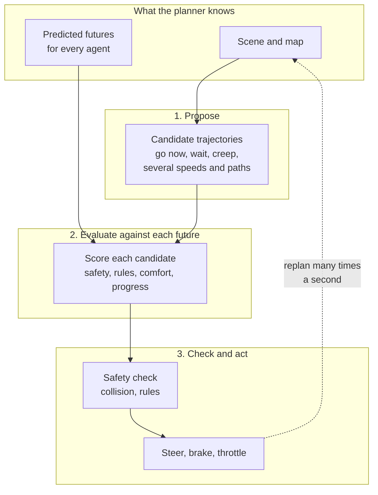

*By Gopi Krishna Tummala*

*Planning turns everything the car knows into a decision: go now, wait, or creep forward. How planners balance competing goals, why learning to plan from human driving is harder than it looks, and where hybrid planners stand now.*

Module 8 of 9 in the [autonomous stack series](/posts/robotics/autonomous-stack-module-1-architecture). Previous: [Module 7: Prediction](/posts/robotics/autonomous-stack-module-7-prediction). Next: [Module 9: Foundation Models](/posts/robotics/autonomous-stack-module-9-foundation-models).

---

Everything so far has led to one decision. Our car is in the intersection, waiting to turn left. It knows where it is (Module 4), the layout of the road (Module 5), what's around it (Module 6), and a set of possible futures for the oncoming car, the cyclist and the pedestrian (Module 7). Now it has to choose: turn now, wait for the next gap, or creep forward to see past the van and signal that it intends to go.

Waiting forever is safe in the narrowest sense and useless in every other: the light will change, and a car stuck in the middle of an intersection is a hazard of its own. Going too eagerly risks the hidden cyclist. Good planning is finding the decision a careful, confident human would make, many times a second, in every situation the car meets.

## The idea in one picture

*Propose options, score them against the possible futures, check the winner, act on the first part of it, and repeat with fresh information.*

## Four goals that pull against each other

Every planner, rule-based or learned, balances the same four things:

- **Safety:** don't collide, and keep margins against things that might happen.
- **Legality:** obey signals, right of way and lane markings.
- **Comfort:** no sudden braking or jerky steering.
- **Progress:** actually get where you're going.

They conflict constantly. A parked delivery truck blocking the lane can only be passed by crossing a double yellow line: legality against progress. Waiting at our left turn until no car is visible for a kilometer is safe and makes no progress. Classical planners encode this balance as a **cost function**, a score where collisions are effectively forbidden, rule violations are expensive, and discomfort and lost time cost a little. Picture terrain where risky options are hills and good ones are valleys, and the planner rolls toward the lowest valley it can find.

Tuning that balance is most of the work. Weights that make a car cautious in one situation make it timid in another, which is a big reason the field turned to learning.

## How classical planners search

Two families of method dominated for a decade:

- **Sampling.** Generate many candidate trajectories, for example by varying how far to drift from the lane center and how fast to go, score each, and keep the best. Describing positions as distance along the lane and offset from its center (a "Frenet" frame, popularized for driving by Werling et al. in 2010) makes "stay in the lane" and "change lanes" simple to express. It works well on structured roads and poorly in parking lots or intersections without clear lanes.
- **Optimization.** Start from a rough path and adjust it smoothly to lower the cost while respecting the car's physical limits. **Model predictive control** applies this in a rolling loop: plan the next several seconds, execute only the first fraction of a second, then replan from the new position. The constant replanning is what lets a planner react when the cyclist suddenly appears.

Above these, many stacks have a **behavior layer**, often a state machine, that picks the high-level maneuver: follow the lane, yield, turn, change lanes. Our left turn is a sequence of such decisions: approach, stop at the line or in the box, wait for a gap, commit, complete the turn.

## Learning to plan from human driving

Hand-tuned rules and costs struggle with the endless variety of real traffic, so the obvious alternative is to learn from people: show a network millions of examples of how humans drove and train it to do the same. This is **imitation learning**, or behavior cloning.

It's harder than it looks, for reasons Waymo's [ChauffeurNet](https://arxiv.org/abs/1812.03079) (2018) laid out clearly:

- **Small errors compound.** A cloned policy that drifts slightly off the human path ends up in situations no human example covers, and drifts further. ChauffeurNet added synthesized perturbations, deliberately pushing the car off course in training, so the model learned to recover.
- **Confusing correlation with cause.** A model that learns "the car slows when the car ahead slows" may also learn "the car slows when its own brake lights are on," which is true in the data and useless for deciding.
- **Rare dangers are rare in the data.** Expert drivers almost never crash, so the model sees few examples of what not to do.

## The surprise: open loop versus closed loop

Learned planners were usually evaluated open-loop: given a logged scene, how close is the planned path to what the human actually did? That's easy to compute and turned out to be misleading. In 2023, [Dauner et al.](https://arxiv.org/abs/2306.07962) evaluated planners on the [nuPlan](https://arxiv.org/abs/2106.11810) benchmark in closed-loop simulation, where the planner's choices actually move the car and other agents react. A rule-based baseline from over twenty years ago beat all the state-of-the-art learned planners on closed-loop metrics, and their simple extension of it, PDM-Closed, scored far higher still. Their conclusion: open-loop and closed-loop evaluation are misaligned. Learned planners were good at forecasting what the human would do, and worse at producing plans that were safe when they had to live with the consequences.

That finding reshaped the field's evaluation. Closed-loop and pseudo-closed-loop benchmarks like NAVSIM, and closed-loop simulation in general, became the standard for judging planners (see the evaluation section of [Vision-Language-Action Models](/posts/robotics/vla-models-data-architecture-evaluation#evaluation-the-hard-part)).

## Where planning is now: learned proposals, checked choices

The field has largely converged on hybrids that use learning where it's strong and explicit checks where they're needed:

- **Learned proposals.** A network, often trained end to end with perception and prediction as in UniAD, proposes a handful of good candidate trajectories, capturing the nuance of human driving.
- **Explicit scoring.** Candidates are scored against the predicted futures for safety margins, rules and comfort, the classical cost function reborn as a referee rather than the only source of behavior.
- **A safety layer.** A simple, verifiable check vetoes anything that would collide or break a hard rule.
- **Reinforcement learning in simulation**, increasingly, to improve beyond imitation by rewarding safe progress rather than closeness to a human.

Fully end-to-end systems sit at one end of this range. Tesla's FSD v12 replaced large amounts of hand-written code with neural networks trained on fleet data, and [Module 9](/posts/robotics/autonomous-stack-module-9-foundation-models) covers foundation models that plan with language-model reasoning.

## Planning as negotiation

Our left turn shows the part of planning that's hardest to formalize: other drivers react to us. If the robotaxi waits motionless behind the line, the oncoming driver has no reason to yield. If it creeps forward a little, it signals intent and gets a better view past the van. Planners that only react to predictions can freeze, never finding a gap they're sure of. Planners that condition predictions on their own actions ("if I creep, the oncoming car will likely slow") can negotiate. This is why prediction and planning are merging, and why [closed-loop reasoning](/posts/robotics/behavior-prediction-closed-loop-driving) matters.

## Measuring a planner

- **Collisions and near misses** per distance, in closed-loop simulation and on the road.
- **Rule compliance:** signals, stop lines, right of way, staying in drivable space.
- **Progress:** route completion and not getting stuck.
- **Comfort:** peak acceleration and jerk, the rate of change of acceleration that passengers feel.
- **Human-likeness**, carefully: useful for comfort and predictability, but closeness to a logged human path is not the same as a good plan.

## What I'd remember

- **Four goals in tension.** Safety, legality, comfort and progress; planning is the balance.
- **Plan, act a little, replan.** Rolling replanning lets the car react to new information.
- **Imitation is harder than it looks.** Compounding errors, false correlations and rare dangers.
- **Judge planners in closed loop.** Open-loop scores misled the field until 2023.
- **Hybrids lead.** Learned proposals, explicit scoring, and a safety layer that can veto.

## Where to go next

- [Module 9: Foundation Models](/posts/robotics/autonomous-stack-module-9-foundation-models), the final module.
- [The Role of Predictions in Closed-Loop Driving](/posts/robotics/behavior-prediction-closed-loop-driving), on planning as a feedback loop.
- Papers: [ChauffeurNet](https://arxiv.org/abs/1812.03079), [Parting with Misconceptions about Learning-based Vehicle Motion Planning](https://arxiv.org/abs/2306.07962), [UniAD](https://arxiv.org/abs/2212.10156).

Previous: [Module 7: Prediction](/posts/robotics/autonomous-stack-module-7-prediction). Next: [Module 9: Foundation Models](/posts/robotics/autonomous-stack-module-9-foundation-models).

**Questions to sit with**

1. At the left turn, what would make "wait for the next gap" the wrong decision?
2. Why could a planner that matches human paths closely still drive badly when it has to live with its choices?
3. How would you stop a planner from freezing when no gap is ever certain?
