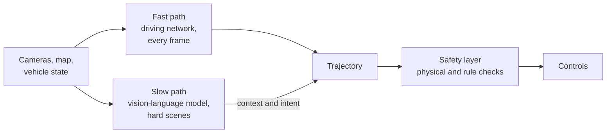

*By Gopi Krishna Tummala*

*Self-driving stacks were built as a chain of specialist modules. Foundation models promise one model that sees, reasons and acts. Here's what that looks like, why teams keep a fast path and a safety layer around it, and what's still unsolved.*

Part 9 of [the autonomous stack series](/posts/robotics/autonomous-stack-module-1-architecture). Previous: [Planning](/posts/robotics/autonomous-stack-module-8-planning).

---

It's 3 p.m. on a residential street. A yellow school bus ahead has stopped with its lights flashing. No child is visible yet.

A classic self-driving stack handles this as a chain of specialists. Perception detects a bus and labels its lights. Prediction forecasts that the bus stays put. Planning applies a rule: flashing school-bus lights mean stop. That works, as long as someone wrote the rule, labeled enough flashing buses and anticipated the situation.

A human driver brings something else: the sense that at 3 p.m. near a stopped school bus, children are about to appear, even before one is visible. Foundation models, large models pre-trained on huge amounts of video, text and driving data, are the field's attempt to give the car that kind of common sense. This module covers what changes when you do, using the school bus as the thread.

## The idea in one picture

*Most current designs pair a fast driving network with a slower reasoning model, and keep an independent safety layer between both of them and the controls.*

## From specialist modules to one model

The first eight modules of this series describe the modular stack: sensors, calibration, localization, mapping, perception, prediction and planning, each built and tested separately. That structure is easy to debug, because when the car brakes for no reason you can find which module made the mistake. Its weakness is the gaps between modules. Each one passes a simplified summary to the next, so context like "it's school pickup time" gets lost along the way, and every rare situation needs its own rule or its own labeled data.

A foundation model approaches the problem differently. Pre-trained on large amounts of video and text, it already knows a lot about the world before it sees any driving data: what school buses are, that children get off them, what a police officer's hand signal means. Fine-tuned on driving, it can bring that knowledge to scenes nobody wrote a rule for. Waymo's [EMMA](https://arxiv.org/abs/2410.23262) research model, for example, maps camera images directly to driving outputs using a multimodal language model, and can explain its decisions in text.

## Fast and slow

Big reasoning models are too slow and too unpredictable to drive every frame. So most designs borrow an idea from psychology: a fast system for routine decisions and a slow system for hard ones.

The fast path is a driving network that runs on every frame and handles lane keeping, following distance and ordinary turns. The slow path is a vision-language model that looks at the scene less often and supplies context: "school bus with flashing lights, children likely, stop and wait." The planner combines the two into one trajectory. In our scene, the fast path would slow for a stopped vehicle anyway; the slow path is what turns "slow down" into "stop and stay stopped until the lights go off."

## Everything becomes tokens

The next step is a single model that sees, reasons and acts, usually called a vision-language-action (VLA) model. Camera frames, the navigation instruction and the vehicle's state all go in as tokens, the same way words go into a language model. What comes out is also tokens, but some of them are actions: steering and speed targets, trajectory waypoints, or, for a robot arm, joint commands.

Robotics has pushed this furthest. Physical Intelligence's [π0](https://arxiv.org/abs/2410.24164) and NVIDIA's [GR00T N1](https://arxiv.org/abs/2503.14734) are trained on data from many different robots, on the bet that a model learns general physical common sense from all of them: objects fall, momentum carries, things collide. For driving, the hope is the same. A model that has learned how bodies move and interact in general should handle more rare situations without a rule for each one.

## Imagining the future before acting

Another line of work trains **world models**: models that predict what the camera will see next, given an action. Wayve's [GAIA-1](https://arxiv.org/abs/2309.17080) and NVIDIA's [Cosmos](https://arxiv.org/abs/2501.03575) are examples. A world model can be used to generate rare, dangerous scenarios for training and testing without staging them on real roads, and, in principle, to let a planner imagine the result of an action before taking it. If the imagined future for "drive past the bus" contains a child stepping out, choose something else. The [Physics-Aware Video Diffusion](/posts/generative-ai/physics-aware-video-diffusion-models) post covers why getting the physics right in those imagined futures is hard.

## What keeps it safe

A model that reasons in natural language can also be confidently wrong in natural language. So deployed systems keep an independent safety layer between any learned model and the controls: simpler, deterministic checks that the trajectory stays on the road, keeps a safe distance and obeys hard rules. In the school-bus scene, that layer enforces "stop for flashing bus lights" no matter what the models propose.

Two other practical constraints shape these systems. Large models are too slow for the car's computer, so teams distill them: a big model labels data or teaches a much smaller model that can run many times a second on board. And measuring them is hard. Answering questions about a scene correctly isn't the same as driving well, so the metric that matters is still closed-loop driving performance in simulation and on the road, as discussed in [the closed-loop prediction post](/posts/robotics/behavior-prediction-closed-loop-driving).

## What I'd remember

- **Modular stacks lose context between modules.** Foundation models bring world knowledge, like "children get off school buses," that no single module carries.
- **Fast and slow paths work together.** A fast network drives every frame; a slower reasoning model handles hard scenes.
- **VLA models treat actions as tokens.** One model reads images and instructions and writes out driving or motor commands.
- **World models imagine the future.** They generate rare scenarios for training and may let a planner check an action before taking it.
- **A deterministic safety layer stays.** Learned models propose; simple, verifiable checks decide what reaches the controls.

## Where to go next

- [The Multimodal Atlas](/posts/generative-ai/multimodal-foundation-models-end-to-end), for how the underlying vision-language and video models are built.
- [Diffusion for Action](/posts/generative-ai/diffusion-for-action-trajectories-policy), for generating trajectories with diffusion models.
- Papers: [EMMA](https://arxiv.org/abs/2410.23262), [π0](https://arxiv.org/abs/2410.24164), [GR00T N1](https://arxiv.org/abs/2503.14734), [GAIA-1](https://arxiv.org/abs/2309.17080), [Cosmos](https://arxiv.org/abs/2501.03575).

Previous: [Planning](/posts/robotics/autonomous-stack-module-8-planning). Back to the start of the series: [Architecture](/posts/robotics/autonomous-stack-module-1-architecture).

**Questions to sit with**

1. In the school-bus scene, which parts of the decision would you trust to a learned model, and which must a rule guarantee?
2. How would you test that a reasoning model actually improves driving, not just its answers about driving?
3. What would a world model need to get right for its imagined futures to be safe to plan with?
