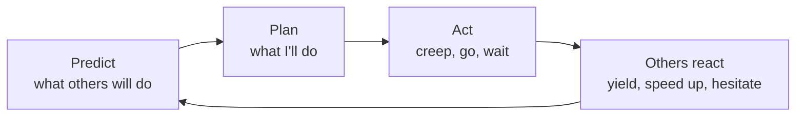

*By Gopi Krishna Tummala*

*Reflections from building behavior prediction for autonomous vehicles: why prediction is a probability over futures, and why the car's own actions change what everyone else does.*

A companion to [Module 7: Prediction](/posts/robotics/autonomous-stack-module-7-prediction) and [Module 8: Planning](/posts/robotics/autonomous-stack-module-8-planning) in the [autonomous stack series](/posts/robotics/autonomous-stack-module-1-architecture).

---

Work on autonomous driving long enough and prediction stops looking like one module in the stack and starts looking like the foundation under the decisions. Picture the unprotected left turn from this series: the robotaxi waiting in the intersection, an oncoming car, a cyclist half-hidden behind a van, a pedestrian at the far crosswalk. The question isn't only where each of them will be in three seconds. It's what each of them intends, and how that intent will change in response to what the robotaxi does.

That second part is what this post is about. Prediction isn't a weather forecast, where the forecaster's choices don't affect the weather. On the road, the forecaster is also a participant.

## The idea in one picture

*In open loop, prediction feeds planning and stops there. In closed loop, the car's action changes what others do, which changes what should have been predicted.*

## Uncertainty is the job, not a defect

Every decision a self-driving car makes is made with partial information. It sees the present, imperfectly, and has to act on a future it can't see. Will the pedestrian step off the curb? Will the oncoming driver yield? Better sensors don't remove that uncertainty, because it lives in people's heads, not in the scene.

That produces the central tension of prediction: the further ahead you look, the less certain you are, and the more you need to look ahead to decide well. The goal isn't to eliminate uncertainty. It's to represent it honestly and hand it to the planner in a form it can use.

## Many futures, with probabilities

So a good prediction system doesn't say "this will happen." It says "here are the plausible futures, and here's how likely each is": the oncoming car continues at speed, or slows to let us turn, or stops abruptly. [Module 7](/posts/robotics/autonomous-stack-module-7-prediction) covers how models produce these sets of futures. What matters here is that the planner then has to choose an action that's acceptable across them, not just good for the most likely one.

From experience building these systems, the hard part is rarely the common case. It's calibration of the rare ones: knowing whether a 5 percent future is really 5 percent, and telling apart two very different kinds of uncertainty. One is "this situation is genuinely ambiguous," where any model would be unsure. The other is "the model hasn't seen anything like this," where the model's confidence may itself be wrong. The second is the dangerous one, because it doesn't look like uncertainty from the outside.

## From Open-Loop to Closed-Loop Systems

Most early prediction systems treated other road users as moving independently of the ego vehicle. The car predicted everyone else, then planned around those predictions, as if its own plan had no effect on anyone. That's open-loop reasoning, and it was a sensible simplification: easier to build, train and debug, and adequate for a lot of driving.

But driving is closed-loop. If our robotaxi hesitates at the turn, the oncoming driver keeps going and the car behind may try to pass. If it creeps forward, the oncoming driver may slow. Every action changes the next second of everyone else's behavior. A planner working from open-loop predictions can freeze, waiting for a gap that never comes because it isn't doing anything to create one, or it can act on predictions that its own action has just made wrong.

Closed-loop reasoning means modeling that feedback: predicting how others will respond to each candidate action, and choosing actions with those responses in mind. It also introduces the hard part: stability. If the predictor expects the oncoming car to slow and it accelerates instead, the plan has to recover gracefully rather than oscillate between going and stopping. Evaluating systems in closed loop, where the car's choices actually affect the simulated world, is how the field found out how much this matters (see [Module 8](/posts/robotics/autonomous-stack-module-8-planning#the-surprise-open-loop-versus-closed-loop)).

## What production prediction looks like

In practice, prediction systems combine several kinds of input: the tracked history of every agent from perception, the map's lanes and crosswalks, traffic signal states, and increasingly the ego vehicle's own candidate plans. Over time the field moved from drawing all of this as top-down images to representing it as sets of lines and agents that a model relates directly, with approaches like [VectorNet](https://arxiv.org/abs/2005.04259) and later transformer models. Outputs are sets of futures with probabilities, often jointly for interacting agents, consumed by a planner that evaluates its options against them.

The models are sophisticated, but the gap that matters most is data. Rare, dangerous interactions are exactly what's under-represented in driving logs, so a large share of the engineering goes into finding them, mining them from fleet data, and generating more of them in simulation.

## What comes next

Two directions seem most promising to me. The first is more context: vehicle-to-vehicle and vehicle-to-infrastructure communication could let cars share intent directly, removing some uncertainty at the source. The second is memory: systems that retrieve similar past situations to inform the current one, helping with rare scenarios that a model has seen only a handful of times.

Underneath both is a shift from predicting trajectories to understanding intentions: not just where the cyclist will be, but why, and what would change their mind. Whether a machine can ever "understand" driving in the way people do is an open question. Whether it can reason well enough about other people's reactions to drive among them safely is the practical one, and closed-loop thinking is how we get there.

## What I'd remember

- **Prediction is a set of futures with probabilities.** The planner has to be acceptable across them.
- **Two kinds of uncertainty.** Genuine ambiguity, and situations the model hasn't seen; the second is more dangerous.
- **The car is a participant, not an observer.** Its actions change what others do.
- **Closed-loop reasoning prevents freezing.** And requires plans that stay stable when predictions are wrong.
- **Rare interactions are the bottleneck.** Finding and simulating them is most of the work.

## Where to go next

- [Module 7: Prediction](/posts/robotics/autonomous-stack-module-7-prediction), for how prediction models work.
- [Module 8: Planning](/posts/robotics/autonomous-stack-module-8-planning), for how planners use predictions and why closed-loop evaluation matters.
- [Vision-Language-Action Models](/posts/robotics/vla-models-data-architecture-evaluation#evaluation-the-hard-part), for closed-loop evaluation of learned driving models.

**Questions to sit with**

1. At the left turn, how would you predict the oncoming driver differently if the robotaxi creeps forward?
2. How could you tell whether a model's low confidence comes from real ambiguity or from never having seen the situation?
3. What would make a closed-loop planner oscillate, and how would you stop it?
