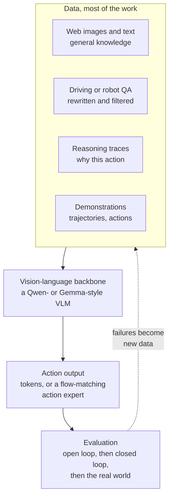
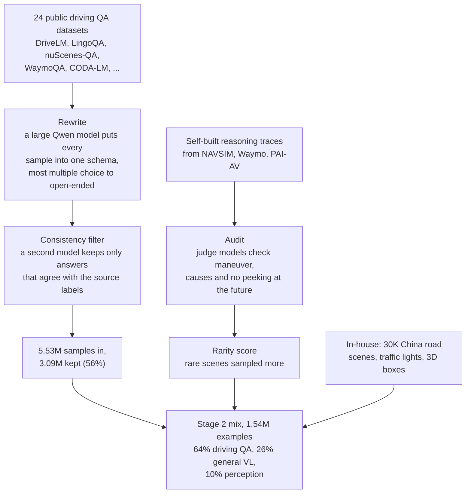
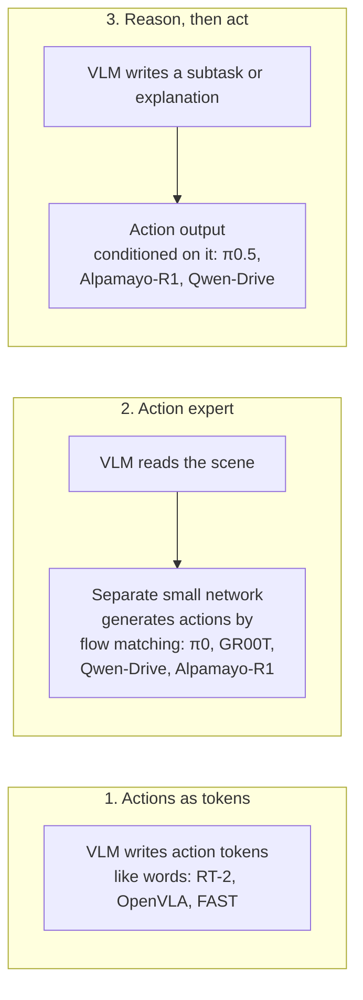
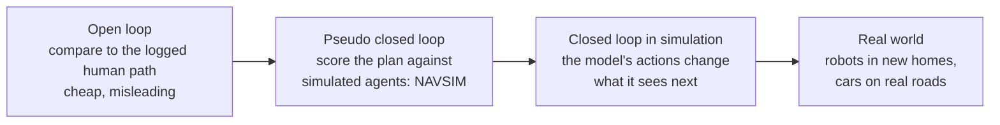

*By Gopi Krishna Tummala*

*A map of the models that see, read and act, for robots and for cars: where their data comes from and how it's curated, the three ways to turn a language model into a controller, how they're trained, and why evaluating them is harder than building them.*

A deep dive from [Module 9: Foundation Models in Autonomous Driving](/posts/robotics/autonomous-stack-module-9-foundation-models).

---

A car approaches a lane closure. Cones block its lane, and a worker in a high-visibility vest is waving it forward, past the cones and briefly into the oncoming lane. Every rule the car learned says don't cross into oncoming traffic. The worker is saying do it now.

A modular driving stack handles this badly because the situation lives between its modules. Perception sees a person and cones, prediction sees a pedestrian who isn't moving, planning sees a rule. None of them understands that the gesture overrides the lane markings.

A vision-language-action (VLA) model brings that understanding in from outside driving. Start from a vision-language model that has probably read about flaggers and construction zones, then teach it to output actions, for a car or a robot arm, instead of only words. The same idea is behind the robot models that have become popular over the last two years: π0 and π0.5 from Physical Intelligence, NVIDIA's GR00T, Google's Gemini Robotics, and on the driving side NVIDIA's Alpamayo-R1 and, from the Qwen team, [Qwen-Drive-1.0](https://arxiv.org/abs/2609.00111).

This post follows the flagger scene through three questions: what data these models learn from, how a language model becomes a controller, and how anyone can tell whether the result is any good.

## The idea in one picture

*A VLA is a vision-language model with an action output bolted on. What it can do is mostly decided by the data, and what you know about it is decided by the evaluation.*

## What an "action" is

For a robot arm, an action is a small vector: move the gripper this far, rotate this much, open or close. Modern robot VLAs output an action chunk, a short sequence of them; [π0](https://arxiv.org/abs/2410.24164) predicts 50 steps at once and controls robots at up to 50 Hz.

For a car, an action is usually a planned trajectory. Qwen-Drive outputs 50 waypoints, each a position and heading, covering the next 5 seconds at 10 Hz. For our flagger, the right answer slows, bends left around the cones into the oncoming lane, and comes back.

## Data: why there's no internet of actions

Language models had the web; vision-language models had billions of captioned images. There's no equivalent pile of actions with the reasoning attached, so every VLA team's first problem is assembling one.

### Robot data: scarce, expensive, pooled

Robot demonstrations come mostly from people teleoperating robots, one episode at a time. The field responded by pooling:

- **[Open X-Embodiment](https://arxiv.org/abs/2310.08864)** combined 60 existing datasets from 21 institutions into over a million real robot trajectories across 22 different robots.
- **[DROID](https://arxiv.org/abs/2403.12945)** collected 76,000 demonstrations, 350 hours, in 564 scenes across 52 buildings, deliberately chasing variety of places rather than volume of one task.
- **π0** was trained on over 10,000 hours of robot data from 7 robot configurations and 68 tasks, most of it Physical Intelligence's own.

NVIDIA's [GR00T N1](https://arxiv.org/abs/2503.14734) describes the answer as a data pyramid: a wide base of web data and human videos, a middle layer of synthetic data from simulation and from video-generation models, and a narrow top of real robot demonstrations. Going up, there's less data but it matches the robot more exactly.

### Co-training: keep the web in the mix

The biggest lesson from the robot side is that action data alone makes a narrow model. Google's [RT-2](https://arxiv.org/abs/2307.15818) showed in 2023 that training on robot data together with the original web vision-language data, rather than fine-tuning on robot data alone, kept the model's general knowledge and let it follow instructions about objects it had never manipulated.

[π0.5](https://arxiv.org/abs/2504.16054) pushed this further. In its first training phase, 97.6 percent of training examples did not come from the target task of mobile robots doing household chores. They came from other robots, labs, high-level task descriptions and web data. The result cleaned kitchens and bedrooms in homes it had never seen, and its generalization kept improving as the number of distinct training homes grew toward about 100. Physical Intelligence's [blog](https://www.pi.website/blog/pi05) reports that removing the web data lowered out-of-distribution success from 94 to 74 percent.

### Driving data, curated: Qwen-Drive as a worked example

Fleets record constantly, but very little driving data says what to do and why. [Qwen-Drive-1.0](https://arxiv.org/abs/2609.00111) documents its curation in unusual detail, across three kinds of data.

**Perception labels.** 3D boxes, occupancy and road maps from nuScenes (28,000 labeled keyframes) and OpenScene (607,000 frames). The two datasets disagree on categories, so labels are merged to the coarsest categories both support. Where one dataset lacks a class, labels are filled in offline: OpenScene has no "driveable" occupancy class, so ground voxels are relabeled from the nuPlan road map.

**Driving question answering.** This is where most of the curation lives:

*Most of the effort goes into consistency, not volume. Nearly half the public QA data was thrown away for disagreeing with its own labels.*

The reasoning traces are what would teach the model about our flagger. The approach follows NVIDIA's [Alpamayo-R1](https://arxiv.org/abs/2511.00088), which calls them chains of causation: a short explanation tying the action to the specific things in the scene that caused it. Qwen-Drive builds them in four steps:

1. **A rule-based classifier** reads the recorded trajectory and labels the maneuver, for example "decelerate, shift left."
2. **A large model writes the explanation** from the camera images, the past motion, that maneuver label and the navigation instruction.
3. **Judge models audit it** by answering classification questions rather than giving scores: does the explanation match the maneuver, are the cited causes really causal, and does it leak information from the future that the car couldn't have known?
4. **A rarity score** makes unusual scenes, like construction zones with flaggers, more likely to be sampled.

Alpamayo-R1 adds human review to its own automated labeling, and its model card lists about 700,000 such traces.

**Trajectories.** For learning to plan, Qwen-Drive uses about 2.83 million samples from NAVSIM, the Waymo end-to-end dataset (WOD-E2E) and NVIDIA's PhysicalAI-AV, with about a quarter paired with a reasoning trace. Samples implying accelerations above 9.8 m/s² or implausibly fast turning are dropped as logging glitches.

The pattern across all of these: start broad, rewrite into one format, filter hard for consistency, and oversample the rare cases you actually care about.

## Architecture: three ways to make a language model act

The backbone is a vision-language model like the ones in [the Qwen3-VL post](/posts/generative-ai/vlm-moe-qwen-train-to-deploy#how-a-qwen-style-vlm-reads-the-screenshot). The design question is how actions come out.

*Most recent models combine 2 and 3: think in text when it helps, then hand off to a dedicated action network.*

**Actions as tokens.** The simplest approach treats actions as text. RT-2 and [OpenVLA](https://arxiv.org/abs/2406.09246) split each action dimension into 256 bins and give each bin a token. The model writes "128 91 241..." the way it writes words. OpenVLA, a 7B open model trained on 970,000 demonstrations, beat the 55B RT-2-X by 16.5 points in task success. But per-step tokens are slow and poor at smooth, high-frequency motion. [FAST](https://arxiv.org/abs/2501.09747) fixes much of that by compressing a whole action chunk with a discrete cosine transform, the same idea as JPEG, before tokenizing, which cut training time by up to 5 times.

**An action expert.** π0 attaches a separate 300M-parameter network to a 3B PaliGemma backbone. The expert reads the backbone's internal state and produces a whole action chunk by flow matching, refining random noise into actions over 10 steps, the same family of techniques covered in [Diffusion for Action](/posts/generative-ai/diffusion-for-action-trajectories-policy). GR00T N1 uses the same split, with a fast diffusion transformer generating motor actions under a slower vision-language module. Qwen-Drive's planning expert is a 1.1B-parameter transformer that reads the language model's attention keys and values directly and turns noise into the 50 waypoints in 10 steps. A small expert is fast and suits smooth motion.

There's a catch when the two are trained together: gradients from a freshly initialized action expert can damage what the backbone knows. Physical Intelligence's [knowledge insulation](https://arxiv.org/abs/2505.23705) stops those gradients from flowing into the backbone while training the backbone separately on tokenized actions. Qwen-Drive avoids the problem more bluntly: its language model is frozen while the planning expert trains.

**Reason, then act.** π0.5 first predicts a short text subtask, "pick up the plate," then the actions for it. Alpamayo-R1 and Qwen-Drive can write a chain-of-causation explanation before the trajectory. For the flagger, that explanation might be: "a worker is waving traffic forward; cones block the lane; proceed slowly into the left lane." It also gives engineers something to read when the model gets it wrong. Google's [Gemini Robotics](https://arxiv.org/abs/2503.20020) splits this differently: an embodied-reasoning model (Gemini Robotics-ER) for pointing, detection and grasp planning, and a VLA built on top of it for control.

| Model | Backbone | Action output | Notable data idea |
|---|---|---|---|
| OpenVLA | Llama 2 7B, DINOv2 + SigLIP | 256-bin tokens | Open X-Embodiment, 970K demos |
| π0 | PaliGemma 3B | Flow-matching expert, 50-step chunks | 10,000+ hours, 7 robot types |
| π0.5 | π0 lineage | Subtask text, then actions | 97.6% off-target co-training |
| Alpamayo-R1 | Cosmos-Reason | Flow-matching trajectory decoder | Human-checked causal traces |
| Qwen-Drive-1.0 | Qwen3.5-4B | 1.1B planning expert, 5 s at 10 Hz | Rewrite, filter, audit, oversample rare |

## Training: stages, then rewards

These models train in stages for the same reason [Qwen3-VL](/posts/generative-ai/vlm-moe-qwen-train-to-deploy#how-qwen3-vl-is-trained) trains its merger alone first: new parts shouldn't wreck old ones. Qwen-Drive's recipe:

1. **Perception head alone,** with the language model frozen.
2. **Perception and question answering together,** unfreezing the backbone so its features learn 3D structure.
3. **Planning expert alone,** with the backbone frozen again, on trajectories with and without reasoning.
4. **Reinforcement learning** on the planning expert. For each scene, eight trajectories are sampled, each scored with a driving-quality score (NAVSIM's PDMS, or WOD-E2E's rater-based score), and the model is pushed toward the better-than-average ones. It's the group-relative idea from GRPO, explained in [Post-Training](/posts/mlops/modern-post-training-peft-2026#reinforcement-learning-with-rewards-you-can-check), applied to trajectories.

Copying human drivers teaches average behavior; rewarding safe progress teaches what they were trying to achieve. Alpamayo-R1 reports that RL improved its reasoning quality by 45 percent and the consistency between its reasoning and its actions by 37 percent. For background on the RL itself, see [the reinforcement learning post](/posts/fundamentals/reinforcement-learning-intuition-to-algorithms).

## Evaluation: the hard part

Building a VLA is now a recipe. Knowing whether it's good is not.

*Each step to the right is more expensive and more trustworthy.*

**Open loop is misleading.** The cheapest test compares the model's planned path with what the human driver did, usually as average distance error. But there's often more than one good path, and mistakes that compound never show up. In the flagger scene, a model that simply stops behind the cones may be near the human path for the first second and completely wrong after that.

**Closed loop is what counts, and it's expensive.** In closed loop, the model's actions change the scene: if it drifts, the next camera frame shows it drifting. [Behavior Prediction and Closed-Loop Driving](/posts/robotics/behavior-prediction-closed-loop-driving#from-open-loop-to-closed-loop-systems) covers why this matters. NAVSIM sits in between, scoring a plan against simulated outcomes for collisions, staying on the road, time to collision, progress and comfort. Fully closed-loop simulators replay real drives using neural reconstruction so the car can deviate from the log.

Qwen-Drive's results show why one number is never enough. Reinforcement learning raised its NAVSIM score from 88.2 to 90.7 and halved its off-road rate in NVIDIA's closed-loop AlpaSim simulator, from 24 to 12 percent. But it made less progress along the route, and Alpamayo-R1 still did better in that closed-loop test overall. The authors point to their short history of past frames as a likely reason. Their paper is also unusually direct about the limits: the reasoning doesn't always capture the real cause in a scene, and the trajectory doesn't always follow the reasoning it wrote.

**Robots have the same problem.** Real-world success rates are the true measure and slow to collect: RT-2 was evaluated over 6,000 trials. Simulated suites like [LIBERO](https://arxiv.org/abs/2306.03310), 130 tasks in four groups, are fast but easy to saturate. [SIMPLER](https://arxiv.org/abs/2405.05941) builds simulations matched to real setups and showed that rankings in its simulator correlate strongly with real-world rankings, which is the property you actually need from a cheap test.

**And check what you didn't train for.** A VLA can quietly lose the general knowledge that was the point of using a VLM. Qwen-Drive measures this directly on 15 general vision-language benchmarks and stays within about a point of its base model on average. That number is what tells you the flagger knowledge is probably still in there.

## What's still hard

- **Data is the moat.** The teams with the best results built or curated most of their own.
- **Reasoning isn't guaranteed to drive the action.** A model can write the right explanation and still produce the wrong trajectory. Measuring that consistency is now part of evaluation.
- **Latency.** A multi-billion-parameter backbone is slow for 10 Hz driving or 50 Hz control, hence small action experts, chunks and fast/slow splits; Alpamayo-R1 reports 99 ms on the vehicle. [Speculative Decoding](/posts/mlops/speculative-decoding-guess-and-verify) covers one way to speed up the text-generating part.
- **Safety still sits outside.** In driving, the VLA proposes and a separate safety layer checks, as described in [Module 9](/posts/robotics/autonomous-stack-module-9-foundation-models#what-keeps-it-safe).

## What I'd remember

- **A VLA is a VLM that outputs actions.** The language model brings world knowledge; the action output makes it a controller.
- **Data decides most of it.** Pool robot data, co-train with web data, and for driving, rewrite, filter, audit and oversample rare scenes.
- **Three ways to act.** Action tokens, a flow-matching action expert, or reasoning first then acting; most new models combine the last two.
- **Train in stages and protect the backbone.** Freeze it, or stop gradients, when adding new parts.
- **Trust closed loop over open loop.** And check that general knowledge survived.

## Where to go next

- [Module 9: Foundation Models in Autonomous Driving](/posts/robotics/autonomous-stack-module-9-foundation-models), for where VLAs fit in a driving stack.
- [Qwen3-VL and Mixture of Experts](/posts/generative-ai/vlm-moe-qwen-train-to-deploy), for the kind of backbone these models start from.
- [The Multimodal Atlas](/posts/generative-ai/multimodal-foundation-models-end-to-end#most-of-the-work-is-data), for the same data-first lesson in image and video models.
- [Diffusion for Action](/posts/generative-ai/diffusion-for-action-trajectories-policy), for how flow matching and diffusion produce actions.
- Papers: [π0](https://arxiv.org/abs/2410.24164), [π0.5](https://arxiv.org/abs/2504.16054), [OpenVLA](https://arxiv.org/abs/2406.09246), [Alpamayo-R1](https://arxiv.org/abs/2511.00088), [Qwen-Drive-1.0](https://arxiv.org/abs/2609.00111).

**Questions to sit with**

1. For the flagger scene, what would a training example need to contain to teach the right behavior, and where would you find a hundred more like it?
2. Why can a model with a lower open-loop error be the worse driver?
3. If your VLA's general-benchmark scores dropped five points after driving fine-tuning, what would you change in the data mix?
